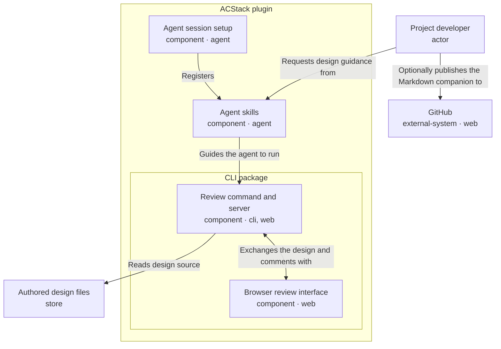

# ACStack design-review workflow

Review the proposed map-to-approval integration and evidence retention for ACStack's design-doc map, without redesigning the existing review viewer.

<!-- Generated from the entry YAML and its element files; regenerate with design-doc --markdown -->

## Review the integration, not a new viewer

Approve or revise the proposed path from map contributions to exact-revision approval and retained archive evidence before expanding ACStack's workflow.

- The existing viewer supplies nested architecture, drawers, layout, navigation, and local comment transport
- This branch adds authored design loading, map contributions, explicit reconciliation, durable approval, and evidence-preserving closeout
- The nine entities and six relationships below retain the example's architecture, stable identities, mirrored declarations, and sibling runtime/viewer boundaries
- The workflow sequence below describes responsibilities, not additional architecture arrows

### Three decisions for the reviewer

1. Do Agent skills guide decisions while the Review command and server enforce exact-input approval at the right boundary?
    - Recommendation: retain this split rather than move workflow policy into the Browser review interface
2. Is explicit reconciliation of every selected comment and current contribution sufficient evidence before human approval?
    - Recommendation: require a rationale for each disposition and keep conflicts or `needs-human` outcomes blocking
3. Is retaining original review evidence worth bounded history growth after temporary map nodes disappear?
    - Recommendation: preserve the evidence and stop on discovery limits rather than silently discard obligations

### The map and design refer to each other

- This document has identity `acstack-workflow` and binds to the GitHub map `design-doc`, root issue #351
- The root's `Design entry` names `.acstack/designs/acstack-workflow/design.yaml`; contributions come from issues #352, #353, and #354
- Status must report the same tracker and map before implementation or archive can trust its approval
- The live review reports approval; this document does not declare itself approved or close issues
- The portable example at `examples/design-doc/acstack/` remains separate and unbound
- Earlier `acstack-design` feedback keeps its original identity and history

### One journey from proposal to retained evidence

1. **Prepare the contribution**: the agent records a branch proposal under `## Design contributions` in a map node body
    - Both files and GitHub backends use a fenced JSON array with `id`, `designId`, `targets`, and `statement`
    - Contributions for this review use `designId: acstack-workflow` and existing document, element, relationship, or concern IDs
    - Status reports the source `nodeId`, a `<nodeId>/<contributionId>` key, and the ancestor chain from `answers` as provenance
    - Planning provenance never becomes architecture containment or a new diagram arrow
2. **Open the authored design**: Agent skills guide the agent to run the Review command and server against this entry
    - The loader validates bounded local YAML and Markdown before preparing the Browser review interface and Markdown companion
    - Map binding requires exactly one root reference matching this entry; unavailable or incomplete inputs fail closed
    - The Project developer posts feedback through the existing local connection; an export or an empty review is not approval
3. **Reconcile explicitly**: the agent inspects status and records one disposition per selected comment and current contribution
    - `applied`, `retained`, or `needs-human` requires a rationale; contradictions return to a human instead of silently replacing authored content
    - Automatic discovery carries previously selected histories and unresolved `needs-human` obligations forward after source changes
    - Original feedback stays with its original version; current receipts establish reconciliation freshness
    - Discovery fails closed beyond 1024 directory entries or 16 MiB of history; missing or invalid canonical histories also block progress
4. **Approve the exact revision**: the human chooses Approve this revision only after reconciliation and blocking decisions are settled
    - Approval binds `sourceRevision`, `reviewRevision`, `commentsDigest`, and `mapInputsDigest`
    - Later authored source, saved feedback, or meaningful contribution changes reopen the gate
    - Generated presentation or layout changes alone preserve approval; historical approval never authorizes a changed revision
5. **Implement and verify separately**: the agent requires current `approval.valid: true` before proceeding with the agreed integration
    - Approval settles the reviewed design, not implementation correctness, publication, or release
    - Build, lint, type checks, tests, and applicable browser checks remain separate completion evidence
6. **Archive only after clearance**: archive checks for open work, fog, and claims before inspecting current approval and reconciliation
    - It verifies implemented requirements against source and evidence, then records qualifying decisions, agreed terms, and node provenance
    - It retains authored designs, canonical reviews, reconciliation, approvals, imports, original legacy artifacts, and relevant decision logs independently of node disposal
    - GitHub closed issues remain the node archive; clearance and current approval determine when closeout is allowed

### Six delivery packages share this decision

- Communication: one canonical writing standard across hosts
- Authoring and rendering: validated atomic files and the existing shared presentation
- Map integration: explicit contributions with provenance
- Reconciliation and approval: human approval of exact inputs after feedback is settled
- Legacy transition: explicit migration with target mappings and historical approval kept as evidence
- Archive and retention: verified implemented behavior and retained evidence

These are delivery scopes, not six new software components.

### Local source and optional GitHub publication

- Authored design files are the local YAML and supporting Markdown read by the Review command and server
- GitHub hosts a published copy of the generated companion only when the Project developer chooses to share it
- Local browser review and saved comments do not require publishing design files to GitHub
- Native Git ignore rules exclude `.acstack/` from ordinary tracking by default
- This repository explicitly allows tracking nonsensitive `.acstack/` data through root `.gitignore` exceptions
- Allowing tracking does not stage, commit, or push files; the publication arrow represents a separate developer action
- Both the Authored design files and GitHub drawers explain source ownership, published copies, and ignore rules

### Legacy migration retains evidence without current approval

- Legacy import requires an explicit mapping; startup and archive never copy legacy history automatically
- Imported approval is historical only; imported feedback requires reconciliation and fresh approval
- The old `map --map` and `align-viewer` commands retire without compatibility aliases

### Evidence available for this review

- Branch verification passes 1,789 CLI tests across 54 files, build, typecheck, and lint
- Branch verification passes 1,489 shell checks across 15 suites and 29 desktop/mobile browser checks
- Isolated localhost captures prove canonical instruction delivery to actual Claude Code, Codex, and pi parents and delegated children
- Codex requires enabled, trusted hooks and a fresh session after named-role installation
- The captures prove instruction delivery, not a model's compliance with those instructions
- These reports support implementation review but cannot substitute for the human's approval of this document

### Optional source paths

- Authoring and review guidance: `skills/design-doc/SKILL.md`
- Bounded loading and generated presentation: `cli/src/lib/design-doc.ts`
- Both contribution backends and provenance: `cli/src/lib/design-map.ts`
- Reconciliation and exact-input approval: `cli/src/lib/design-lifecycle.ts`
- Canonical history and bounded discovery: `cli/src/lib/design-review.ts`
- Explicit legacy mapping: `cli/src/lib/design-migration.ts`
- Clearance and evidence retention: `skills/archive/SKILL.md`

Repository paths outside this directory are context, not loader detail references.

## Project developer

*Authors the design and reviews the exported artifact locally.*

- Identity: `user`
- Kind: actor
- Channels: none
- Source: [user.yaml](user.yaml)

## ACStack plugin

*Ships agent skills, session setup, and a bundled CLI.*

- Identity: `acstack`
- Kind: component
- Channels: none
- Source: [acstack.yaml](acstack.yaml)

## Agent skills

*Guide the agent through authoring and exporting a design for review.*

- Identity: `skills`
- Kind: component
- Channels: agent
- Source: [skills.yaml](skills.yaml)

## Honest review status

- Requirement: An exported review artifact must not imply that a reviewer approved a map or implementation.
- Design response: Comments and exports are not approval. Approval requires reconciled feedback and contributions, resolved blocking questions, and the exact source, review, comments, and map-input tuple. Implementation checks remain separate.
- Applies to: skills, review-runtime, viewer

## Agent session setup

*Registers ACStack skill commands and adds rules for planning, coding, and checking changes to the agent's session.*

- Identity: `host`
- Kind: component
- Channels: agent
- Source: [host.yaml](host.yaml)

## CLI package

*Ships the review command, local server, and browser review interface.*

- Identity: `cli`
- Kind: component
- Channels: none
- Source: [cli.yaml](cli.yaml)

## Review command and server

*Reads and validates authored YAML, serves the browser review interface, saves comments, and exports Markdown.*

- Identity: `review-runtime`
- Kind: component
- Channels: cli, web
- Source: [review-runtime.yaml](review-runtime.yaml)

## Offline review

- Requirement: Reviewers can inspect the design without uploading project details or fetching browser assets.
- Design response: The review command and server read bounded local source files and embed validated graph data with bundled browser assets, without uploading the design. Agent-side reads of GitHub-bound maps still require network access.
- Applies to: review-runtime, viewer, design-source

## Honest review status

- Requirement: An exported review artifact must not imply that a reviewer approved a map or implementation.
- Design response: Comments and exports are not approval. Approval requires reconciled feedback and contributions, resolved blocking questions, and the exact source, review, comments, and map-input tuple. Implementation checks remain separate.
- Applies to: skills, review-runtime, viewer

## Browser review interface

*Receives the prepared design graph and syncs comments with the local server.*

- Identity: `viewer`
- Kind: component
- Channels: web
- Source: [viewer.yaml](viewer.yaml)

## Offline review

- Requirement: Reviewers can inspect the design without uploading project details or fetching browser assets.
- Design response: The review command and server read bounded local source files and embed validated graph data with bundled browser assets, without uploading the design. Agent-side reads of GitHub-bound maps still require network access.
- Applies to: review-runtime, viewer, design-source

## Honest review status

- Requirement: An exported review artifact must not imply that a reviewer approved a map or implementation.
- Design response: Comments and exports are not approval. Approval requires reconciled feedback and contributions, resolved blocking questions, and the exact source, review, comments, and map-input tuple. Implementation checks remain separate.
- Applies to: skills, review-runtime, viewer

## Authored design files

*Holds the local YAML and supporting Markdown that the review server reads.*

- Identity: `design-source`
- Kind: store
- Channels: none
- Source: [store.yaml](store.yaml)

Authored design files define the design in the local checkout; GitHub hosts a published copy only if the developer chooses to share it.

- Local files drive the review
    - The Review command and server read the local YAML and supporting Markdown to generate the browser view and Markdown companion
    - Revise these source files when the design changes
    - Local browser review and saved comments work without publishing design files to GitHub
- GitHub hosts a published copy
    - The Project developer can commit and push the generated companion for others to read on GitHub
    - The developer can publish the companion alone or include the authored source files
    - GitHub does not replace the local files read by the review server or automatically receive its saved comments
    - This diagram's publication arrow is separate from using GitHub issues as the map tracker
- Git ignore rules control tracking, not publication
    - Ignore rules exclude matching untracked files from ordinary staging
    - Removing an ignore rule does not stage, commit, or push anything
    - Already tracked files remain tracked even if an ignore rule later matches them
    - In this repository, root exceptions allow tracking nonsensitive `.acstack/` data; publication still requires an explicit commit and push

## Offline review

- Requirement: Reviewers can inspect the design without uploading project details or fetching browser assets.
- Design response: The review command and server read bounded local source files and embed validated graph data with bundled browser assets, without uploading the design. Agent-side reads of GitHub-bound maps still require network access.
- Applies to: review-runtime, viewer, design-source

## GitHub

*Hosts a published copy of the Markdown companion when the developer chooses to share it.*

- Identity: `github`
- Kind: external-system
- Channels: web
- Source: [github.yaml](github.yaml)

Authored design files define the design in the local checkout; GitHub hosts a published copy only if the developer chooses to share it.

- Local files drive the review
    - The Review command and server read the local YAML and supporting Markdown to generate the browser view and Markdown companion
    - Revise these source files when the design changes
    - Local browser review and saved comments work without publishing design files to GitHub
- GitHub hosts a published copy
    - The Project developer can commit and push the generated companion for others to read on GitHub
    - The developer can publish the companion alone or include the authored source files
    - GitHub does not replace the local files read by the review server or automatically receive its saved comments
    - This diagram's publication arrow is separate from using GitHub issues as the map tracker
- Git ignore rules control tracking, not publication
    - Ignore rules exclude matching untracked files from ordinary staging
    - Removing an ignore rule does not stage, commit, or push anything
    - Already tracked files remain tracked even if an ignore rule later matches them
    - In this repository, root exceptions allow tracking nonsensitive `.acstack/` data; publication still requires an explicit commit and push
