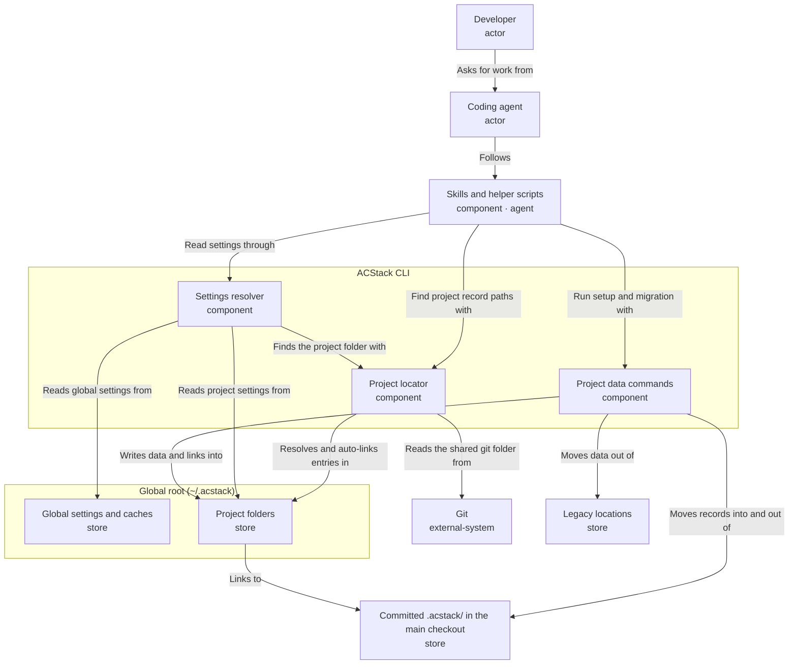

# Global ACStack project data

Move ACStack settings, caches, and every project's records into one machine-wide root, \~/.acstack/, with an opt-in tracked mode that keeps a project's records in its repository.

<!-- Generated from the entry YAML and its element files; regenerate with design-doc --markdown -->



## Proposed change

ACStack moves every machine-wide setting and every project's records into one root, `~/.acstack/`. Each repository gets one entry, `~/.acstack/projects/<key>/`, shared by all of its worktrees.

- **Global mode (default).** The project's records live in that folder. The repository holds no ACStack files and needs no `.gitignore` rules
- **Tracked mode (opt-in, per project).** The records stay in the repository's committed `.acstack/`. The project entry is a link into the main checkout's `.acstack/`, so `ls -l ~/.acstack/projects/` still shows every project

Today ACStack spreads data over four places: each checkout's git-ignored `.acstack/`, `~/.config/acstack/`, `~/.local/share/acstack/`, and `~/.acstack/` itself, which holds `ac-teams/`.

### Review questions

1. Is the split between the Project locator, the Settings resolver, and the Project data commands the right set of responsibilities in the CLI?
2. When `project-data migrate` finds `.acstack/` files already in the Git index, should it choose tracked mode automatically? The proposal says yes: tracking was already the developer's choice, and nothing moves.
3. When a project folder and a committed `.acstack/` both exist, for example after a teammate pushes tracked data to a repo you used in global mode, should ACStack refuse and ask the developer to choose with `project-data mode`? The proposal says yes.
4. Is the accepted caveat for tracked mode acceptable: edits on a feature branch's own `.acstack/` take effect only after they reach the main checkout?

### Trade-offs to judge

| Choice | Gain | Cost |
|---|---|---|
| Whole-project tracking, not per part | One root per project; no `.gitignore` management | A project can no longer track only specs and decisions |
| Key from the shared git folder's path | Every worktree finds the same entry with no setup | Moving the repo on disk orphans the entry until `project-data relink` runs |
| Link from global into the repo, not the reverse | Teammates' clones get real files, not a broken link | Tracked mode reads the main checkout's copy, not the current worktree's |
| Explicit migration only | Nothing moves silently | Every developer runs one command per machine and per project |

## Settled decisions

The developer settled these on 2026-11-02:

- Everything under `.acstack/` moves: settings, specs, maps, designs, design reviews, decision logs, decisions, verification knowledge, and handoffs
- Tracked mode covers the whole project; there is no per-part tracking
- `project-data ensure` and the managed root `.gitignore` baseline are removed
- Every global file moves, including `~/.config/acstack/*` and `~/.local/share/acstack/*`
- `ACSTACK_HOME` overrides the root; ACStack no longer reads the `XDG_*` variables
- On Windows, tracked mode uses a directory junction, which needs no special privilege
- After migration ACStack does not read the old locations. While legacy data exists, it warns once per session and names `project-data migrate`
- `~/.acstack/ac-teams/` stays where it is; the ac-teams repository owns it

## Worked journeys

### A developer starts ACStack in a new repository

1. The developer opens an agent in `~/projects/shop` and runs `/acstack:setup`
2. The Project locator asks Git for the shared git folder, `/home/dev/projects/shop/.git`, and derives the key `shop-3f9a2c`
3. Setup writes `project.yaml` into `~/.acstack/projects/shop-3f9a2c/`. **Changed:** setup used to write the repo's `.acstack/` and a managed `.gitignore` block
4. Later, a worktree at `~/.herdr/worktrees/shop/feat-x` reports the same shared git folder, so it reads the same project folder

### The developer opts a project into tracked mode

1. The developer runs `acstack project-data mode tracked` from any worktree
2. The command moves the folder's contents into the main checkout's `.acstack/`, then replaces the folder with a link to it
3. The developer commits `.acstack/`
4. A teammate clones the repo. On first use the Project locator finds no entry, sees a committed `.acstack/project.yaml` in the main checkout, and creates the link automatically

`acstack project-data mode global` reverses the move. It removes the files from the working tree and leaves deleting them from Git to the developer's next commit.

### The developer migrates an existing machine

1. ACStack warns that legacy data exists and names `acstack project-data migrate`
2. The developer updates installed tools and stops old agents and review servers, as the current legacy migration already requires
3. From each repository, the developer runs `acstack project-data migrate`
    - The first run also moves `~/.config/acstack/*` to `~/.acstack/` and `~/.local/share/acstack/*` to `~/.acstack/cache/`
    - A repo whose `.acstack/` files are in the Git index becomes tracked mode, and only the link is created (review question 2)
    - Otherwise the repo's `.acstack/` moves into its project folder, and the managed `.gitignore` block is removed
4. The command preflights every move and aborts on a collision without writing anything

### A repository moves on disk

1. The developer moves `~/projects/shop` to `~/work/shop`. The new shared git folder gives a new key, which has no entry
2. The Project locator finds an entry named `shop-*` whose recorded repo path no longer exists, and prints `acstack project-data relink`
3. Relink renames the entry to the new key and updates its recorded path, or its link target in tracked mode

## Effect on other work

The large-read guard (branch `feat/large-read-guard`) reads its settings through one function. This change repoints that function at the Settings resolver; the guard's callers do not change.


## Developer

*Uses ACStack across many repositories and decides whether each project's data stays private or is committed with the repo.*

- Identity: `developer`
- Kind: actor
- Channels: none
- Source: [developer.yaml](developer.yaml)


## Coding agent

*Claude Code, Codex, or pi session that follows ACStack skills inside a checkout.*

- Identity: `coding-agent`
- Kind: actor
- Channels: none
- Source: [coding-agent.yaml](coding-agent.yaml)


## Skills and helper scripts

*Tell the agent where project records live and run host helpers that need global settings.*

- Identity: `skills`
- Kind: component
- Channels: agent
- Source: [skills.yaml](skills.yaml)


## ACStack CLI

*The bundled acstack command; owns every rule about where project data and settings live.*

- Identity: `cli`
- Kind: component
- Channels: cli
- Source: [cli.yaml](cli.yaml)


## Project locator

*Maps the current checkout to its project folder and reports whether the project is in global or tracked mode.*

- Identity: `locator`
- Kind: component
- Channels: none
- Source: [locator.yaml](locator.yaml)

## How the Project locator finds a project

1. Ask Git for the shared git folder: `git rev-parse --path-format=absolute --git-common-dir`
2. Resolve that path to its real path, so a symlinked checkout path gives the same key
3. Build the key: the main checkout's folder name, a hyphen, and the first 6 hex characters of the SHA-256 of the real path, for example `shop-3f9a2c`
4. Look up `<root>/projects/<key>`, where `<root>` is `ACSTACK_HOME` or `~/.acstack`
    - A real folder means global mode
    - A link means tracked mode; the target is `<main checkout>/.acstack`
    - No entry, with a committed `.acstack/project.yaml` in the main checkout: create the link (a junction on Windows), then use tracked mode
    - No entry, and another `<name>-*` entry records a repo path that no longer exists: report the orphan and name `project-data relink`
    - No entry otherwise: the project has no ACStack data yet

The main checkout is the parent of the shared git folder. Outside a Git repository there is no key, and commands that need project data say so.

A global-mode folder records its shared git folder in `project.json`, so an orphan can be matched to its moved repo.


## One project across worktrees

- Requirement: Every worktree of a repository must see the same records, wherever the worktree sits on disk.
- Design response: The project key comes from the shared git folder, which every worktree reports identically. In tracked mode the link always targets the main checkout, the parent of that shared folder, so a feature branch's own .acstack/ copy takes effect once it reaches the main checkout.
- Applies to: locator, git, project-folders, tracked-data

## Readable breadcrumbs

- Requirement: ls -l \~/.acstack/projects/ must show every project and where its data lives.
- Design response: Keys combine the repo name with a short hash. Global entries are real folders recording their repo path; tracked entries are links whose target is the repo. A missing target or recorded path marks an orphan that relink can repair.
- Applies to: project-folders, tracked-data, locator

## One override for the root

- Requirement: Tests and unusual setups must point ACStack at another root without touching the real one.
- Design response: ACSTACK\_HOME replaces \~/.acstack for every reader, and the XDG variables no longer affect ACStack paths. Tests switch from XDG\_CONFIG\_HOME to ACSTACK\_HOME.
- Applies to: locator, settings, global-settings

## Settings resolver

*Answers one setting by checking project settings, then global settings, then built-in defaults.*

- Identity: `settings`
- Kind: component
- Channels: none
- Source: [settings.yaml](settings.yaml)

## One override for the root

- Requirement: Tests and unusual setups must point ACStack at another root without touching the real one.
- Design response: ACSTACK\_HOME replaces \~/.acstack for every reader, and the XDG variables no longer affect ACStack paths. Tests switch from XDG\_CONFIG\_HOME to ACSTACK\_HOME.
- Applies to: locator, settings, global-settings

## Project data commands

*Run the explicit moves: legacy migration, switching between global and tracked mode, and relinking a moved repo.*

- Identity: `project-data-cmd`
- Kind: component
- Channels: none
- Source: [project-data-cmd.yaml](project-data-cmd.yaml)

## Project data commands

| Command | What it does |
|---|---|
| `acstack project-data migrate` | Moves legacy global files and this repo's legacy `.acstack/` into the new layout |
| `acstack project-data mode tracked` | Moves the project folder's contents into the main checkout's `.acstack/` and replaces the folder with a link |
| `acstack project-data mode global` | Moves the main checkout's `.acstack/` into the project folder and removes the link |
| `acstack project-data relink` | Renames an orphaned entry to the current key and updates its recorded path or link |

Every command:

- Preflights every move and aborts on a collision without writing anything
- Never changes the Git index, commits, or force-adds files
- Refuses while another worktree of the repo has uncommitted `.acstack/` changes it would overwrite

`project-data ensure` is removed. Its only job was the managed `.gitignore` baseline, which this design removes.


## Explicit migration

- Requirement: No data moves without the developer asking, and no move overwrites existing data.
- Design response: Only project-data migrate moves legacy data. It preflights every move, aborts on any collision, and leaves the old paths untouched until all moves succeed. ACStack warns once when legacy data exists and names the command.
- Applies to: project-data-cmd, legacy, project-folders, global-settings

## Git

*Reports the repository's shared git folder, which every worktree of one repo has in common.*

- Identity: `git`
- Kind: external-system
- Channels: none
- Source: [git.yaml](git.yaml)

## One project across worktrees

- Requirement: Every worktree of a repository must see the same records, wherever the worktree sits on disk.
- Design response: The project key comes from the shared git folder, which every worktree reports identically. In tracked mode the link always targets the main checkout, the parent of that shared folder, so a feature branch's own .acstack/ copy takes effect once it reaches the main checkout.
- Applies to: locator, git, project-folders, tracked-data

## Global root \(\~/.acstack\)

*The single machine-wide home for ACStack settings, caches, and per-project folders.*

- Identity: `global-root`
- Kind: store
- Channels: none
- Source: [global-root.yaml](global-root.yaml)


## Global settings and caches

*Hold config.json, the opener token, terminal-workspace files, and cached assets such as mermaid.min.js.*

- Identity: `global-settings`
- Kind: store
- Channels: none
- Source: [global-settings.yaml](global-settings.yaml)

## Explicit migration

- Requirement: No data moves without the developer asking, and no move overwrites existing data.
- Design response: Only project-data migrate moves legacy data. It preflights every move, aborts on any collision, and leaves the old paths untouched until all moves succeed. ACStack warns once when legacy data exists and names the command.
- Applies to: project-data-cmd, legacy, project-folders, global-settings

## One override for the root

- Requirement: Tests and unusual setups must point ACStack at another root without touching the real one.
- Design response: ACSTACK\_HOME replaces \~/.acstack for every reader, and the XDG variables no longer affect ACStack paths. Tests switch from XDG\_CONFIG\_HOME to ACSTACK\_HOME.
- Applies to: locator, settings, global-settings

## Project folders

*One entry per repository under projects/: a real folder in global mode, or a link into the repo in tracked mode.*

- Identity: `project-folders`
- Kind: store
- Channels: none
- Source: [project-folders.yaml](project-folders.yaml)

## Layout of the global root

```text
~/.acstack/                         (or $ACSTACK_HOME)
├── config.json                     was ~/.config/acstack/config.json
├── opener.token                    was ~/.config/acstack/opener.token
├── terminal-workspace.yaml         and the other terminal-workspace files
├── cache/mermaid.min.js            was ~/.local/share/acstack/
├── ac-teams/                       unchanged; owned by ac-teams
└── projects/
    ├── shop-3f9a2c/                global mode: a real folder
    │   ├── project.json            records the shared git folder
    │   ├── project.yaml
    │   ├── specs/  maps/  designs/  design-reviews/  decisions/ ...
    └── acstack-91c0d4 -> /home/dev/projects/acstack/.acstack   tracked mode
```

Inside a project folder, every part keeps the name it has under today's `.acstack/`, so skills change the folder they point at, not the parts inside it.


## Explicit migration

- Requirement: No data moves without the developer asking, and no move overwrites existing data.
- Design response: Only project-data migrate moves legacy data. It preflights every move, aborts on any collision, and leaves the old paths untouched until all moves succeed. ACStack warns once when legacy data exists and names the command.
- Applies to: project-data-cmd, legacy, project-folders, global-settings

## One project across worktrees

- Requirement: Every worktree of a repository must see the same records, wherever the worktree sits on disk.
- Design response: The project key comes from the shared git folder, which every worktree reports identically. In tracked mode the link always targets the main checkout, the parent of that shared folder, so a feature branch's own .acstack/ copy takes effect once it reaches the main checkout.
- Applies to: locator, git, project-folders, tracked-data

## Readable breadcrumbs

- Requirement: ls -l \~/.acstack/projects/ must show every project and where its data lives.
- Design response: Keys combine the repo name with a short hash. Global entries are real folders recording their repo path; tracked entries are links whose target is the repo. A missing target or recorded path marks an orphan that relink can repair.
- Applies to: project-folders, tracked-data, locator

## Committed .acstack/ in the main checkout

*Holds a tracked-mode project's records in the repository so teammates receive them with a clone.*

- Identity: `tracked-data`
- Kind: store
- Channels: none
- Source: [tracked-data.yaml](tracked-data.yaml)

## One project across worktrees

- Requirement: Every worktree of a repository must see the same records, wherever the worktree sits on disk.
- Design response: The project key comes from the shared git folder, which every worktree reports identically. In tracked mode the link always targets the main checkout, the parent of that shared folder, so a feature branch's own .acstack/ copy takes effect once it reaches the main checkout.
- Applies to: locator, git, project-folders, tracked-data

## Readable breadcrumbs

- Requirement: ls -l \~/.acstack/projects/ must show every project and where its data lives.
- Design response: Keys combine the repo name with a short hash. Global entries are real folders recording their repo path; tracked entries are links whose target is the repo. A missing target or recorded path marks an orphan that relink can repair.
- Applies to: project-folders, tracked-data, locator

## Legacy locations

*Today's homes: each checkout's git-ignored .acstack/, \~/.config/acstack/, and \~/.local/share/acstack/.*

- Identity: `legacy`
- Kind: store
- Channels: none
- Source: [legacy.yaml](legacy.yaml)

## Explicit migration

- Requirement: No data moves without the developer asking, and no move overwrites existing data.
- Design response: Only project-data migrate moves legacy data. It preflights every move, aborts on any collision, and leaves the old paths untouched until all moves succeed. ACStack warns once when legacy data exists and names the command.
- Applies to: project-data-cmd, legacy, project-folders, global-settings
