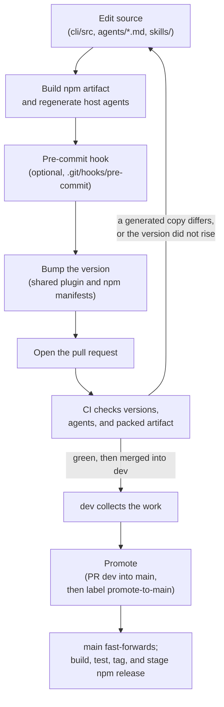

# Contributing to ACStack

ACStack publishes one npm package containing the CLI, skills, agents, and host integrations. Claude Code and Codex install it through the `ac-agentic-coding` marketplace; pi installs `npm:acstack`.

- `npm pack` builds `cli/dist/` and regenerates host agent definitions before packaging
- Git keeps CLI source and generated `agents/codex/` and `pi/agents/`; it does not keep `cli/dist/`
- Bump `.claude-plugin/plugin.json` and root `package.json` together
    - Building syncs `cli/package.json` from the Claude manifest
- CI tests the packed artifact without runtime builds or registry dependencies and checks committed agent definitions for freshness



| What you want | Where |
| --- | --- |
| Where a file goes | section 1 |
| Editing `assets/` and its helper scripts | section 2 |
| Regenerating `cli/dist` | section 3 |
| Regenerating `agents/codex` | section 4 |
| Regenerating `pi/agents`, and the pi package | section 4.1 |
| Running the tests | section 5 |
| Bumping, opening the pull request, promoting, and the tag | section 6 |
| Writing standards | section 7 |

## 1. Plugin layout

*Seven directories and one file, each with one job.*

```
.claude-plugin/plugin.json   – shared Claude and Codex manifest (version, name, description)
agents/                      – subagent definitions
hooks/                       – SessionStart, Stop and UserPromptSubmit hooks
skills/                      – slash-command skills
output-styles/               – output styles (ac-writing-style)
cli/                         – Node.js CLI (TypeScript source + built dist/)
pi/                          – the pi port: extension.ts and the generated agents/
package.json                 – npm package, CLI bin, and pi extension manifest
assets/                      – files a skill installs on a user's machine, and the model never reads them
docs/                        – long-form docs a skill links to instead of inlining
TROUBLESHOOTING.md           – downstream install diagnostics for Claude Code
```

Codex uses the existing `.claude-plugin/plugin.json` manifest. Do not add a portable root `plugin.json`: Codex 0.163.0 gives it precedence but skips its hooks. The native package check verifies hook discovery through the shared manifest.

By default, Codex 0.163.0 caps each hook's injected output at 2,500 tokens. The orchestrator's SessionStart handler sets `additionalContextLimit: 0` to deliver the full trusted policy without spilling it to disk. This supported per-handler setting leaves user configuration and other hook limits unchanged.

## 2. Assets and helper scripts

*`assets/` holds what a skill installs rather than reads. One duplicate key there costs the user their whole config file.*

Today that is `assets/terminal-workspace/setup.sh`, which installs the optional terminal workspace.

Two rules govern it.

- **Every helper script carries the `acstack-*` prefix and lives under `assets/terminal-workspace/helpers/`**, installed by `setup.sh`
    - `setup.sh` remains the entrypoint and sources modules under `assets/terminal-workspace/lib/`
    - Editing a helper means editing its source file in `helpers/`
    - `uninstall` removes them by that prefix
        - A helper named anything else leaks
- **Every edit to a user's config sits between the managed markers**, `# >>> acstack terminal-workspace >>>` and `# <<< ... <<<`
    - Re-applying replaces only those regions
        - Hand-written config around them survives
    - Never write outside the markers, and never assume the file is absent

### 2.1. Merging into a user's TOML config

*TOML forbids a duplicate key. The managed block therefore either claims a key or concedes it.*

- herdr rejects a config that holds a duplicate, and yazi throws its config away and falls back to presets
- The block **claims** each key it writes, meaning it deletes the user's own copy of that key first
- The block **concedes** a key it cannot prove is free, meaning it writes nothing there and says so

The herdr keymap is the first case.

- The block claims every key it sets
- Before the merge it removes a same-name assignment in the user's own `[keys]`
- It also removes any `[[keys.command]]` bound to a key the block binds
- The same applies to `[worktrees]`, which the block re-declares in full

Merging into an existing `[keys]` produces **two** managed regions rather than one.

- A bare key must sit inside `[keys]`
- `[[keys.command]]` and `[worktrees]` are top-level tables, so they cannot
- What must hold is that re-applying never accumulates regions

`yazi.toml` is the same case, and stricter.

- A yazi config that falls back to presets loses every setting the user has
- The managed block writes into four namespaces: `mgr`, `opener.markdown`, `plugin.prepend_previewers`, and `open.prepend_rules`
- Every one of them is a claimed-key case
- An array-of-tables entry adds to the config only where the name is free, or where it already holds an array of tables
    - `[[plugin.prepend_previewers]]` is fine under a `[plugin]` that leaves `prepend_previewers` unset
    - It is a duplicate under a `[plugin]` that holds it as an inline array, which is the form yazi's own documentation teaches

How `setup.sh` decides:

- It asks `tomllib` which namespaces the user has claimed
- It puts the question in the exact form the block would write it
- It appends that header to the config outside the markers, then sees whether the whole thing still parses
- Whatever the parser rejects is a namespace the user already claimed
    - `setup.sh` leaves it alone

A dict lookup would not do.

- TOML also refuses to reopen an inline table or to overwrite a scalar
- Neither `opener = { text = [...] }` nor `opener = "nope"` has an `opener.markdown` key to find
- A lookup therefore calls both free, and the write then kills the file
- A config that already fails to parse concedes all four namespaces
    - Such a file teaches `setup.sh` nothing, and repairing a user's config is not its job

The fallback path, for a machine without Python 3.11:

- `tomllib` needs Python 3.11
- Without it, the fallback names the top-level table anywhere the text could open one
- That means bare, `"quoted"` or `'literal'`, as a header or as a key of its own
- That mostly concedes namespaces which would have been safe to write
    - Each of those concessions costs one setting, where guessing the other way costs the file
- The fallback errs the other way in one place
    - Text cannot see that a config never parsed
        - The fallback writes all four into a file the parsed path would have conceded whole
- `setup.sh` leaves whatever it concedes to the user and names it in a `say` line
    - A config that parses with a setting missing beats one yazi throws out

### 2.2. Testing a setup.sh change

*Test against a fake home, never your own.*

```bash
export FAKE=$(mktemp -d)
mkdir -p "$FAKE/.acstack"
cp assets/terminal-workspace/config.example.yaml "$FAKE/.acstack/tw.yaml"
HOME=$FAKE ACSTACK_TW_CONFIG=$FAKE/.acstack/tw.yaml ACSTACK_TW_BIN=$FAKE/bin \
  bash assets/terminal-workspace/setup.sh apply
```

Then check three things.

- The generated config parses
- Running `apply` twice does not grow the managed block count
- Running `uninstall` leaves nothing behind

Run the guard suite too, which is offline and needs no herdr:

```bash
bash tests/test-terminal-workspace.sh
```

- It checks setup.sh against `docs/terminal-workspace.md` in both directions
- Every `acstack-*` and every bound command the docs mention must be something setup.sh installs
- The docs must also cover every default keybinding
- It merges the generated keymap onto a hand-written config and asserts the result is valid TOML
- CI runs it on every push and pull request
- Rename a helper or change a default key and this suite fails until the docs follow

## 3. CLI build discipline

*The CLI ships pre-built and bundled. `cli/dist/index.js` has to work with no `node_modules/` beside it.*

- `cli/dist/index.js` is a single self-contained file
- esbuild inlines every runtime dependency into it: commander, chalk, fast-glob, yaml, and zod
- Marketplace installs download the prebuilt npm artifact; lifecycle scripts do not build it downstream

Install CLI dependencies explicitly in each fresh clone or worktree before checks:

```sh
npm --prefix cli ci
```

Use `npm --prefix cli install` when deliberately changing dependencies. Test and
build commands do not install packages for you.

After any change in `cli/src/`, from the repository root:

```
cd cli
npm run build   # rebuilds dist/index.js via esbuild (see build.mjs)
npm run typecheck  # tsc --noEmit, catches type errors the bundler skips
npm run lint    # eslint, type-aware rules over src/ (see eslint.config.js)
git add src/ package.json package-lock.json
```

- Commit source and dependency changes; `cli/dist/` is ignored
- `npm pack` at the repository root runs `prepack`, rebuilding the CLI and both sets of host agents

Verify the actual package from the repository root:

```sh
bash tests/test-npm-package.sh
```

The check packs, installs offline in a temporary home with lifecycle scripts disabled, and exercises the CLI plus packaged startup hooks. It verifies versions and required host assets too. Set `ACSTACK_TEST_CODEX=1` to verify native Codex installation and hook discovery; npm transport is stubbed to use the same local tarball.

### 3.1. The recommended pre-commit hook

*The optional pre-commit hook regenerates committed agent definitions. CI enforces freshness.*

Drop this into `.git/hooks/pre-commit` inside the acstack clone, not the marketplace parent. Then run `chmod +x .git/hooks/pre-commit`. Git ignores hook files, so this stays per-clone.

```bash
#!/usr/bin/env bash
# Regenerate whichever committed generated files the staged diff invalidates.
set -euo pipefail

staged=$(git diff --cached --name-only)

if grep -qE '^agents/[^/]+\.md$' <<<"$staged"; then
  echo "pre-commit: agents/*.md changed – regenerating agents/codex/ and pi/agents/"
  node scripts/gen-codex-agents.mjs
  node scripts/gen-pi-agents.mjs
  git add agents/codex pi/agents
fi
```

- Each block fires only when its own source is part of the staged diff, then stages what it regenerates
- The commit aborts if either command fails
- The repository commits two sets of generated agent definitions
    - `agents/codex/*.toml` and `pi/agents/*.md` come from `agents/*.md`
    - `cli/dist/` is built separately for the npm package
- The hook is optional and easy to forget to install
    - `.github/workflows/ci.yml` regenerates each set and fails the run if the committed copy differs
    - Treat the hook as a convenience, and never as the guarantee

This repository's `project.yaml`, in its project folder (`acstack project-data path`), names both commands in one place.

- Its `commands.build` runs the esbuild build and the Codex generator together
- Anything that verifies a build therefore leaves the tree matching what CI expects

### 3.2. What `npm run build` does to the version

*`npm run build` syncs `cli/package.json` for tidiness. `acstack --version` never depends on that sync.*

- `npm run build` syncs `cli/package.json`'s version from `.claude-plugin/plugin.json`, then runs esbuild
- Commit the synced `cli/package.json` alongside the three release manifests
- `acstack --version` reads `.claude-plugin/plugin.json` directly at runtime, in `cli/src/lib/version.ts`
    - The reported version is right whether or not anything rebuilt
    - It has to work that way, because the rebuild only fires when `cli/src/` changes
    - Bumping the plugin alone would otherwise leave a baked-in copy behind
    - That is exactly how the CLI came to report `0.1.0` while the plugin was at 0.14.2

## 4. Codex agent definitions

*`agents/*.md` is the source, the generator writes the TOML, and Codex discards a file holding one unrecognised key.*

- `scripts/gen-codex-agents.mjs` generates `agents/codex/*.toml` from `agents/*.md`
- Commit the generated files, and never hand-edit the TOML

```sh
node scripts/gen-codex-agents.mjs
```

Why the hook installs them:

- Codex cannot ship agent definitions inside a plugin
    - The SessionStart hook installs them into `$CODEX_HOME/agents/` (default `~/.codex/agents/`)
- It re-reconciles on every session
- It only overwrites a file carrying the generated marker
    - It leaves alone an agent of yours that shares a name
- It does nothing when the selected Codex home directory does not exist

Before checking delivery in Codex:

- Enable hooks and trust the reviewed ACStack hook source through Codex's trust flow
    - Installing the plugin alone does not grant hook execution
    - Noninteractive automation must establish that trust before expecting startup context
- Start a fresh session after the first startup installs agent definitions
    - Codex discovers available roles before that startup hook runs
- Verify a native named-role delegation when checking the generated definitions
    - The native v1 agent tool exposes role selection; the v2 collaboration tool has a different interface

The generator emits only the three keys Codex applies: `name`, `description`, and `developer_instructions`. It deliberately omits others.

- `model` – ours says `opus`, a Claude alias that means nothing to Codex
    - Omitting it makes a subagent inherit the parent's model
    - That is what we want
- `sandbox_mode` and `mcp_servers` – Codex parses then ignores both
    - A child agent may never escalate past its parent
    - Emitting them would imply a guarantee that does not hold

One unrecognised key discards the whole file.

- Codex parses an agent file with `deny_unknown_fields`
- It logs the rejection somewhere nobody reads
- CI parses every generated file and fails on any key outside the allowed three

Keep the markdown harness-neutral.

- Naming Claude Code's tools directly, as in "use Grep/Glob", produces instructions that are wrong under Codex
- Prefer "search the codebase"
- Fixing it in the markdown keeps the generator free of a translation layer

### 4.1. pi agent definitions and the pi package

*`scripts/gen-pi-agents.mjs` writes `pi/agents/*.md` from the same markdown. The root `package.json` tells pi what to load.*

```sh
node scripts/gen-pi-agents.mjs
```

- Commit the generated files, and never hand-edit them
    - CI regenerates them and fails on a stale copy
- They live under `pi/`, outside `agents/`
    - Claude Code would load a second copy under `agents/` as four more agents
- `pi-subagents` reads them through `pi.subagents.agents` in `package.json`
- The root `package.json` gives pi no skills
    - pi would turn each skill into a `/skill:<name>` command, beside `/acstack:<name>`
    - `pi/extension.ts` lists the skills in the system prompt and registers `/acstack:<name>` and `/acstack <name>`
- The generator gives an agent the ACStack skills it reads through `skills` and `skillPath`
    - `SKILLS` in the script lists them per agent
    - `pi-subagents` resolves `skillPath` from the agent file and never adds it to the parent's skills
- The generator omits `model` and `color`
    - `model: opus` means nothing to pi, so the user's `pi-subagents` default applies
- The generator lists pi's builtin file and shell tools in `tools`
    - A foreground subagent loads none of the parent's extensions
    - The agents reach the CLI through `bash`, at `~/.claude/acstack/bin/acstack`
- The root `package.json` version must equal `.claude-plugin/plugin.json`
    - `scripts/version-gate.sh` fails the pull request on a mismatch
    - Use `pi install npm:acstack`; a source checkout requires a local build first
- `pi/extension.ts` ports the hooks
- `tests/test-pi-extension.sh` drives it with a stub pi API
    - The suite needs Node 22.18 or later, and skips on older Node

## 5. Testing

*Two layers, two commands.*

- Run `cd cli && npm test` for the CLI tests
    - The full CLI suite takes a few minutes, mostly in `src/commands/config.test.ts`
    - To run one file: `cd cli && npm test -- src/lib/diagram.test.ts`
    - If a test needs isolation, use `--pool=vmThreads`
- Run `bash tests/run-all.sh` for the hook suites
    - Run `bash tests/test-terminal-workspace.sh` for terminal workspace and docs checks; allow at least five minutes
    - Run `bash tests/test-terminal-workspace-pi.sh` for the pi component alone

## 6. Releasing

*CI enforces the version bump, because the plugin cache only re-pulls when the version changes.*

- The `version-gate` check runs on every pull request to `main`
- It fails when the change touches a shipped path without raising the version in `.claude-plugin/plugin.json`
- A **shipped path** is a file an installed copy of the plugin loads or runs
    - A change to one must roll out to every machine
- A merge to `main` that leaves the version alone is invisible to every installed copy
- That is what the gate exists to prevent

### 6.1. Inert paths

*Everything is a shipped path except this list.*

These files never reach an installed copy, so changing them needs no bump:

```
README.md
CONTRIBUTING.md
CONTEXT.md
LICENSE
THIRD_PARTY_NOTICES
docs/adr/**
docs/migrate-0.8.md
tests/**
.github/**
.claude/**
acstack/**
```

- The `INERT_PATHS` array at the top of `scripts/version-gate.sh` holds a second copy of this list
- Change one and change the other
- The gate treats a new top-level path as shipped
    - It works from a deny-list

### 6.2. Picking the level

*The gate checks that the version went up. You pick the level.*

- Use semver: patch for a fix, minor for a feature, major for a breaking change

### 6.3. The no-bump label

*The `no-bump` label is the exception. It is never a way past a red check.*

- Add the `no-bump` label to the pull request to pass the gate without a bump
- This is for a change that touches a shipped path but genuinely should not roll out
    - Reformatting a file with no behavioural effect
    - A fix that has to wait for a later release
- A version that goes *down* fails even with the label
    - An installed copy never downgrades

### 6.4. Before you open the pull request

1. Bump `.claude-plugin/plugin.json` and root `package.json` together.
2. Run `bash tests/test-npm-package.sh`, then commit the synced `cli/package.json` and any changed generated agents.
3. Commit via `/acstack:commit` in this repository. Marketplace changes are separate commits.

### 6.5. Promoting `dev` to `main`

*A promotion is a fast-forward that a label triggers. Nobody presses Merge.*

- Open a pull request with base `main` and head `dev`
- Review it, then add the `promote-to-main` label
- `.github/workflows/promote.yml` checks six preconditions and moves `refs/heads/main`
- GitHub closes the pull request as merged on its own, because `main` now reaches every commit on `dev`

The Merge button does not work on that pull request, and it does not work for admins either.

- `main` requires a check called `promotion-gate`, and only `promote.yml` ever creates it
- A pull request into `main` without the label is missing that check, so it cannot merge

- GitHub offers no fast-forward merge
    - Its merge commit, squash, and rebase each write a commit to `main` that `dev` can never contain
    - That commit is what used to force a back-merge into `dev` after every promotion
- A fast-forward strands nothing on `main`, so there is no back-merge

Three things follow as rules:

- No merge commit, squash, or rebase onto `main`
- No cherry-pick onto `main`, because a new SHA makes the two histories diverge for good
- No back-merge of `main` into `dev`

The workflow refuses a promotion on three grounds: CI is not green, the move is not a fast-forward, or a non-admin added the label. Each refusal names its own fix.

### 6.6. After the promotion

*Nothing to tag by hand.*

- The `tag-release` workflow creates an annotated tag `vX.Y.Z` for whatever version `main` holds
- `promote.yml` dispatches it, because a push made with `GITHUB_TOKEN` starts no workflow runs
- It skips silently when that tag already exists, so a re-run costs nothing

### 6.7. Publishing the npm package

`acstack` is the shared npm package for Claude Code, Codex, and pi. The CLI and skills ship together at one version; no separate global CLI install is required.

The existing `tag-release` workflow installs build dependencies, checks types and lint, packs the artifact, then runs CLI and packaged-install tests. It stages that exact tarball with provenance using npm's staged publishing flow. Approve the staged release on npmjs.com to publish it. Re-running skips an already published version.

The `ac-agentic-coding` repository owns the Claude and Codex marketplace catalogs. Both resolve `acstack@latest`; neither builds source on the user's machine. pi installs the same npm artifact directly. Node 20 or newer is required; pi has its own host requirements.

For the initial migration, stage npm from the reviewed release branch before promoting it to `main`:

```sh
gh workflow run tag-release.yml --ref <release-branch>
```

Branch dispatches build and stage the tarball without creating a Git tag. Approve the staged npm release, verify a registry-backed install on each host, and deploy the marketplace catalog changes. Only then promote the source revision that removes `cli/dist/` from Git. The main workflow creates the tag and skips npm staging when that version is already published.

Do not promote bundle removal while the live marketplace still uses Git. Local Git checkouts need `npm --prefix cli ci` and `npm --prefix cli run build` before running the CLI.

### 6.8. Who owns `acstack` on PATH

*The SessionStart hook defers to a `acstack` already on PATH. Agents are outside this entirely.*

- The hook leaves an existing `acstack` on PATH alone if it is not the hook's own symlink
- It says where the winner came from
- Two managers pointing one command name at different copies make a silent race, which PATH order decides
- The hook should not be one of the racers
- Skills and agents call `~/.claude/acstack/bin/acstack` by absolute path
    - That is always the plugin's own CLI, whatever PATH says

## 7. Writing standards

Use the fewest clear words that preserve all necessary information.

- `output-styles/ac-writing-style.md` owns the shared communication standard in its marked block
    - Session-start and subagent-start hooks load the block independently of project activation
    - `hooks/ac-writing-style-reminder.sh` keeps the selected-style reminder on user turns
    - `pi/extension.ts` retains parent-session style controls
    - The Codex and pi generators embed the block in every provided agent definition
    - Generated definitions are build artifacts, not separate style guides
    - Keep the markers intact; extraction depends on them, not headings or item counts
- Read `skills/writing/SKILL.md` and its examples before editing durable prose
    - The skill loads the canonical standard even on hosts without style injection
    - `skills/visual-docs/SKILL.md` applies the standard to document structure and diagrams
- Choose structure to fit the reader's questions and the relationships you explain
    - Lengths and counts prompt review; they do not determine clarity or correctness
- Run `~/.claude/acstack/bin/acstack lint-prose <paths>` before opening a pull request
    - It warns about sentence length, paragraph length, passive voice, vocabulary, marks, and emoji
    - Review its heuristic warnings in context; the command never blocks
