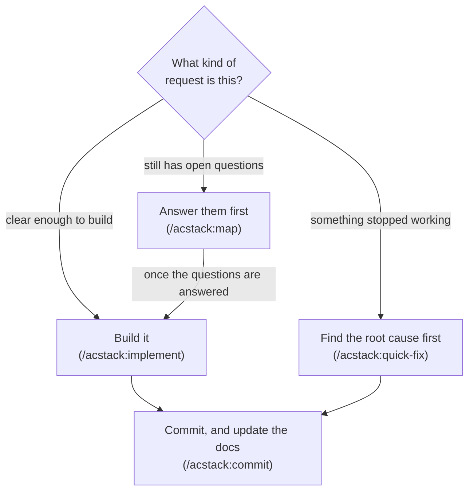

# ACStack

ACStack is an agentic coding stack. It helps coding agents clarify requirements, test meaningful behavior, and keep docs matching the code.

- **ACStack aims to solve two common failure modes coding agents introduce**
    - The agent starts building before the requirements are clear
    - The agent writes code, then creates tests that pass against that code
- **ACStack has first-class support for Claude Code and pi**
    - Claude Code installs it as a plugin
    - pi installs it as an npm package
- **ACStack introduces structure around how your agent works**
    - Verification fits the change under a shared policy in `orchestrator/AGENTS.md`
    - Every commit updates your specs from the diff
- Straightforward work can stay with one agent, including investigation, tests, implementation, and verification
    - One verification owner gathers final completion evidence, reusing valid results instead of repeating checks at every handoff
    - Review depth follows affected risks; adjacent cleanup is advisory unless the user approves it



Every box above is section 2. The rest of this file is reference.

| What you want | Where |
| ------------- | ----- |
| Quickstart | section 1 |
| The three commands, and which one to use | section 2 |
| Configure a project and a machine | section 3 |
| The CLI | section 4 |
| Every skill | section 5 |
| Every agent | section 6 |
| Output style | section 7 |
| Terminal workspace | section 8 |
| Design principles | section 9 |
| Licence and credits | section 10 |

## 1. Quickstart

ACStack has first-class support for [Claude Code](https://claude.com/claude-code) and [pi](https://pi.dev).

### 1.1. Install on Claude Code

You need the Claude Code CLI and Node.js 20 or later.

Install the plugin:

```
/plugin marketplace add ac8318740/ac-agentic-coding
/plugin install acstack@ac-agentic-coding
```

Then, in your project:

```
/acstack:setup
```

- `/acstack:setup` detects the project type, then writes `.acstack/project.yaml` with workflow settings
- All ACStack-owned project records stay local by default under `.acstack/`
    - Setup asks which parts to track, with none selected by default
    - Native exceptions after the root `.gitignore` baseline let you track configuration, specs, decisions, or any other part independently
    - See [Project data and migration](docs/config-reference.md#project-data-stays-local-by-default) for canonical paths and commands
- Update installed ACStack tools before migrating an older project
    - Stop old agents and reviews, run `~/.claude/acstack/bin/acstack project-data migrate`, then restart with updated tools
    - Migration aborts on collisions without overwrites or Git index changes; tracked old paths become pending deletions
- The SessionStart hook loads the orchestrator instructions whenever it detects an ACStack project
- Your CLAUDE.md stays clean for project-specific content
- Upgrading from a version before 0.8.0 means deleting one stale `@import` line (see [docs/migrate-0.8.md](docs/migrate-0.8.md))

### 1.2. Install on pi

*The same project installs as a [pi](https://pi.dev) package with `@tintinweb/pi-subagents` or `pi-subagents` for delegation.*

```
pi install npm:@tintinweb/pi-subagents
pi install npm:acstack
```

Then, in your project, run `/acstack:setup`.

- Every skill runs under the same name as on Claude Code, e.g. `/acstack:map`
    - `/acstack map` does the same
    - Both always run the ACStack skill, even when another pi package has a skill called `map`
- ACStack's skills deliberately don't appear as `/skill:<name>` commands
    - The package gives pi no skills, so `/skill:map` never runs ACStack's map
    - The extension lists the skills in the system prompt instead, so the model still reads one when the task matches
- `pi/extension.ts` does what the Claude Code hooks do
    - It links the CLI at `~/.claude/acstack/bin/acstack`
    - It adds the orchestrator instructions to the system prompt in an ACStack project
    - It lists ACStack's skills in the system prompt in every session
    - It re-injects a handoff after a compaction
    - It nudges with a continuity-versus-freshness checkpoint as the context fills
        - Continuity keeps useful working context in the same session, using billion-context or host ACP compression when available
        - Freshness uses `/acstack:handoff` when a fresh window or independent read helps more
        - With no thresholds set, the first nudge comes at 200k tokens or half the window, whichever is lower
        - The urgent nudge comes at 500k tokens or 80% of the window, whichever is lower
- ACStack includes the question-status bridge automatically
    - With `@juicesharp/rpiv-ask-user-question` and Herdr's Pi integration installed, Herdr shows blocked while Pi waits for an answer
    - Existing setup-installed bridges can stay installed without counting the same wait twice
- Both subagent packages find the four agents through the `pi.subagents` field in `package.json`
    - `@tintinweb/pi-subagents` exposes `Agent`; `pi-subagents` exposes `subagent`
    - The agents use your subagent package's default model
    - ACStack warns at session start when pi lists neither tool
- Allow delegation in `~/.pi/agent/AGENTS.md`:

    ```
    When an ACStack skill or the ACStack orchestrator says to launch a subagent, you may delegate to it.
    ```

    - For `pi-subagents`, set `"toolActivation": "eager"` in `~/.pi/agent/extensions/subagent/config.json` to offer `subagent` from the first turn (restart pi after)
- pi gets the ACStack writing style from the extension by default
    - Run `/acstack-writing-style default` to use the bundled style again
    - Run `/acstack-writing-style off` to disable style injection
    - Run `/acstack-writing-style custom <path>` to use a user-owned style file

## 2. The three commands, and which one to use

*Pick by what is in your way: nothing, a bug, or an unanswered question.*

Two words first, because the third command below uses them.

- **A map** is a to-do graph ACStack keeps for one piece of work
- **A node** is one entry on that graph: one question to answer, or one piece of work to do

The three commands:

- **The request is clear enough to build** – run `/acstack:implement`
    - It runs the four agents of section 6 on your request
    - A one-line change stays a one-line change
- **Something already built stopped working** – run `/acstack:quick-fix`
    - It makes the agent find the root cause before it edits anything
- **The request still has open questions** – run `/acstack:map`
    - The agent interviews you one round at a time
    - Each round asks every question it can answer next
    - Each question comes with the agent's recommended answer
    - You provide feedback on the agent's recommended answer instead of prompting from scratch
    - Some requests only need one question
    - The agent writes that decision down as a short note under `.acstack/decisions/`
    - A big feature may need dozens of questions
    - The agent stores those questions as a **map**
    - You work through the map across several sessions

### 2.1. What a map holds

*`/acstack:map` builds a map only when a single conversation cannot settle every question.*

Each node carries one of five statuses.

| Status | Meaning |
| ------ | ------- |
| `fog` | anything you cannot yet articulate clearly |
| `open` | ready to answer or build |
| `claimed` | someone is working on it now |
| `resolved` | done |
| `out-of-scope` | dropped on purpose |

Each node also records six things.

- **Which earlier answer led to this question**
    - You can read the decisions back in the order you made them
- **Which other nodes have to finish before this one starts**
    - ACStack uses that to tell you what is ready to start
- **Who answers it**: you, or the agent working alone
- **What kind it is**: a destination, a standing note, a decision, research, or work
- **A short name**, which labels the node in a diagram
- **Where it lives**: a GitHub issue by default, or a markdown file under `.acstack/maps/` with no GitHub remote

Almost every node explains itself with a diagram.

- The entry node draws the whole map, and collapses the parts you have finished
- Every other node draws its own question or its own change
- A legend sits under each diagram, showing only the symbols that diagram uses
- On GitHub you click a node in the diagram to open its issue

Two things ACStack does with a finished map.

- **It works through the nodes that are ready to start**, meaning the open ones with nothing unfinished blocking them
    - ACStack calls that set the **frontier**
- **It packs the whole map into a single brief**
    - A fresh agent session picks up where the last one stopped

Every rule in ACStack exists because something went wrong without it, over months of real product development with coding agents.

For the full picture of each step and how they connect, read [docs/workflows.md](docs/workflows.md).

## 3. Configure a project and a machine

*The project states what to run. The machine states what it can do.*

- `.acstack/project.yaml` holds every project-scoped setting
    - [docs/config-reference.md](docs/config-reference.md) gives each key, its values, its default and what changes
- `~/.config/acstack/config.json` holds the nine `host.*` axes
    - `/acstack:host` writes eight of them once per machine, and `/acstack:setup` writes the ninth
    - [docs/dev-setups.md](docs/dev-setups.md) gives every axis, what reads it, and how to describe a fresh machine
- `/acstack:setup` copies the commands and directories from one of three language profiles
    - **python** – pytest, ruff, mypy
    - **node-typescript** – npm test, eslint, tsc
    - **fullstack-python** – Python backend, plus a Node or TypeScript frontend
- `acstack config check` audits the project and the machine
    - It exits 2 when a required host axis has no value

## 4. The CLI

*Four storage operations carry the whole map. One fixed path makes the CLI reachable from any agent session.*

ACStack ships a Node.js CLI: `acstack config`, `acstack list`, `acstack node ...`, and `acstack archive`.

- The storage behind a map provides four operations and nothing more: create, read, update, list
    - GitHub issues are the default
        - The first line of every issue body carries all of that node's edges
        - One call therefore reads the whole map
        - A sub-issue and an issue dependency mirror those edges, so GitHub's own interface draws the map
    - Markdown files are the fallback, one per node under `.acstack/maps/<name>/`
- The CLI builds everything else on those four operations
    - `acstack node frontier` lists what is ready to start now, closest to the original goal first
    - `acstack node walk` packs the whole map into one brief for a fresh session, in the order the decisions happened
    - The brief always includes the original goal, plus any node you marked as worth carrying along
    - `acstack node diagram` draws a map, or any part of one, as a mermaid diagram with a legend under it
    - The skills claim and resolve a node with `update` calls

Two symlinks reach the CLI. The SessionStart hook maintains both.

- `~/.claude/acstack/bin/acstack` is the fixed path every skill and agent calls
    - Agents therefore do not depend on your shell `PATH`
    - The CLI keeps working across plugin version bumps, non-interactive subshells and fresh agent contexts
- `~/.local/bin/acstack` is for typing `acstack` at a terminal yourself
    - Add `~/.local/bin` to your `PATH` to use it
    - The hook prints a one-line reminder when it is absent
    - Nothing in the plugin breaks without it

If `acstack` does not run after a Claude Code install, read [TROUBLESHOOTING.md](TROUBLESHOOTING.md). A Claude Code session can read it and apply the fix directly.

## 5. Every skill

*Four groups, ordered by when you reach for them.*

### 5.1. Implementation

| Skill | Description |
|-------|-------------|
| `/acstack:implement` | Build what is ready to start, running the four agents of section 6, whether or not a map exists |

For work with open decisions, chart it with `/acstack:map` first.

### 5.2. Planning

| Skill | Description |
|-------|-------------|
| `/acstack:map` | Answer the open questions first, building the to-do graph on the first run and working through it after |
| `grilling` | The interview itself, asking every question it can answer next per round, each with a recommended answer (the agent invokes it) |
| `record-context` | Writes a decision down when one lands: a short note, a glossary term, both, or neither (the agent invokes it) |

### 5.3. Operations

| Skill | Description |
|-------|-------------|
| `/acstack:commit` | Commit, and update the specs under `.acstack/specs/` from the diff first |
| `/acstack:archive` | Verify implemented specs and current design approval, retain review evidence, then dispose of temporary map nodes |
| `/acstack:sync` | Update the specs from code changes, outside a commit |
| `/acstack:handoff` | Hand work to a visible agent, a new one in its own pane or one already running, with acknowledgement |
| `/acstack:compact-and-continue` | Anchor the session's load-bearing state to survive compaction, then continue in place |

What an effort leaves behind is what matters: updated specs, decision notes, and glossary entries. ACStack throws the nodes away.

### 5.4. Setup and supporting

| Skill | Description |
|-------|-------------|
| `/acstack:setup` | Set up ACStack in a project, and change how a project already set up is configured |
| `/acstack:host` | Declare this machine's dev setup once, as the `host.*` axes |
| `/acstack:bootstrap` | Write the first set of specs by reading your existing code |
| `/acstack:explore` | Thinking partner mode, read-only |
| `/acstack:quick-fix` | Structured bug fix workflow with root cause analysis |
| `/acstack:pre-commit-review` | Deep quality review of all changes since last commit |
| `/acstack:test-conventions` | Test placement rules and naming conventions |
| `/acstack:code-review` | Linus Torvalds code philosophy for reviews |
| `/acstack:browser-verify` | agent-browser command reference, CDP troubleshooting, and selector strategy |
| `/acstack:bridge` | Set up and operate the Playwriter cross-device browser bridge |
| `/acstack:visual-docs` | Write docs that lead with a diagram and derive structure from it (Minto pyramid) |
| `/acstack:new-worktree` | Create a git worktree off the remote base branch and continue the task inside it |
| `/acstack:teardown-worktree` | Retire finished worktrees and delete their merged local and remote branches |
| `/acstack:terminal-workspace` | Set up a keyboard-only terminal for driving agents on a dev machine |

## 6. Every agent

*Use agents when independent interpretation, review, or parallel scopes improve confidence.*

| Agent | Role |
| --- | --- |
| `test-writer` | Optional independent tests from requirements and interfaces |
| `task-executor` | Implements source and tests unless tests have a separate owner |
| `task-checker` | Bounded independent review; owns completion checks only when assigned |
| `frontend-verifier` | Configured real-browser verification on final frontend code |

- `orchestrator/AGENTS.md` owns the shared Implementation discipline
- Require independent review for security boundaries, money, irreversible data changes, or unresolved correctness or impact uncertainty
- Separate test ownership stays separate when chosen
- Configured frontend gates still apply without a delegated checker

## 7. Output style

*The plugin ships one output style. It applies the house standard to every chat reply.*

- Claude Code shows the style as `acstack:ac-writing-style`
- It applies the `writing` skill's plain-language rules and the `visual-docs` skill's Minto pyramid and bullet discipline
- A reply leads with the answer and puts 90% or more of what follows in bullets
- Each bullet holds one sentence and ends without a period
- Sub-bullets nest as far as the point needs, indented four spaces per level
- Every word has to earn its place: no em dash, no emoji, no puffery, and no contrast clause that does no work

How to turn it on:

- `/acstack:setup` offers the style on both paths
    - On a new project it comes late
    - It is optional there
    - On a project already set up it is a health-check row
- The skill writes `outputStyle` for you
- It asks first
- Use `~/.claude/settings.json` for every project, or `.claude/settings.local.json` for this one
- A project value overrides the global one
- The style applies after `/clear`, or in a new session
- The plugin never forces it on

The style also ships a per-turn reminder:

- `hooks/ac-writing-style-reminder.sh` runs on every prompt and re-injects the style's own words
- A built-in style carries a `turnReminder` field, and a file-based style cannot, so the hook supplies the equivalent
- It emits two sections lifted straight out of `output-styles/ac-writing-style.md`
    - "Who you are", top-level lines only, which is the persona
    - "Before you send", in full, which is the nine-item checklist
- It reads those sections at run time, so the reminder can never drift from the style
- It stays silent under any other output style, and it writes nothing to the transcript

## 8. Terminal workspace for driving several agents

*An optional keyboard-only setup for running several agents on a remote machine. ACStack works fine without it.*

- `/acstack:terminal-workspace` installs every tool and writes every config
- [docs/terminal-workspace.md](docs/terminal-workspace.md) gives the exact config, every key, and the traps worth knowing
- The setup builds on herdr, a terminal multiplexer that keeps each agent's terminal running after you disconnect
    - You attach from your own machine with `herdr --remote`
    - Your own clipboard and browser then reach the session
    - Each agent can get its own git worktree, meaning its own checkout on its own branch
- gh-dash then triages pull requests and diffnav reads diffs, both without leaving the terminal

## 9. Design principles

*Meaningful evidence matters more than a fixed agent sequence.*

- Prefer practical tests-first work to expose mistakes before implementation
- Require tests for meaningful changed behavior when existing coverage cannot catch mistakes
- Reuse adequate coverage for refactors and skip new tests for nonbehavioral edits
- Explain impractical testing and disclose missing regression protection
- Keep docs current through commit-time spec sync
- Build no more planning structure than the unanswered questions need
- Preserve explicit requests for stronger process
- The deprecated `workflow.tdd.strict` and `workflow.tdd.orchestrator_strict` booleans no longer control sequencing or delegation, including explicit `true`
    - Neither key has an effective default
    - ACStack removes the former strict guarantee
    - ACStack does not automatically rewrite existing configuration
    - New setup does not offer or generate these keys

## 10. Licence and credits

*[MIT](LICENSE). Four projects shaped the design.*

- **[OpenSpec](https://github.com/Fission-AI/OpenSpec)** – ACStack forks its CLI from OpenSpec
    - OpenSpec was the core spec engine under the original workflow
    - The map-based concepts all originate there: proposals, designs, tasks, living specs, change management, and archiving
- **[Taskmaster AI](https://github.com/eyaltoledano/claude-task-master)** – Taskmaster's task management model inspired the orchestrator pattern and the agent coordination approach
- **[Skills for Real Engineers](https://github.com/mattpocock/skills)** by Matt Pocock – the Wayfinder map, the round-by-round interview, and the durability rule for agent briefs
    - ACStack's node graph is a direct adaptation of Wayfinder
    - MIT licensed, and recorded in [THIRD_PARTY_NOTICES](THIRD_PARTY_NOTICES)
- Additional inspiration comes from [Superpowers](https://github.com/obra/superpowers), [GSD](https://github.com/gsd-build/get-shit-done) and [Spec Kit](https://github.com/github/spec-kit)

The optional terminal workspace installs, but does not bundle, the five tools you drive and the five behind them. Each one keeps its own licence.

- [herdr](https://herdr.dev)
- [tuicr](https://github.com/agavra/tuicr) by agavra, which reviews a pull request inside the terminal
- [gh-dash](https://github.com/dlvhdr/gh-dash) and [diffnav](https://github.com/dlvhdr/diffnav) by dlvhdr
- [delta](https://github.com/dandavison/delta) by dandavison
- [lazygit](https://github.com/jesseduffield/lazygit) by jesseduffield, which stages, commits and pushes on one key
- [harlequin](https://github.com/tconbeer/harlequin) by tconbeer, the SQL editor this setup opens on one key
- [yazi](https://github.com/sxyazi/yazi) by sxyazi, the file manager that previews whatever the cursor sits on
- [mermaid-ascii](https://github.com/AlexanderGrooff/mermaid-ascii) by AlexanderGrooff
- [glow](https://github.com/charmbracelet/glow) by charmbracelet

The optional fork build of tuicr compiles [agavra/tuicr#607](https://github.com/agavra/tuicr/pull/607) by [antonio2368](https://github.com/antonio2368). It also compiles [agavra/tuicr#633](https://github.com/agavra/tuicr/pull/633) and one counts fix not yet submitted upstream, both written for this fork. That build is off by default and temporary.

See [docs/terminal-workspace.md](docs/terminal-workspace.md).
