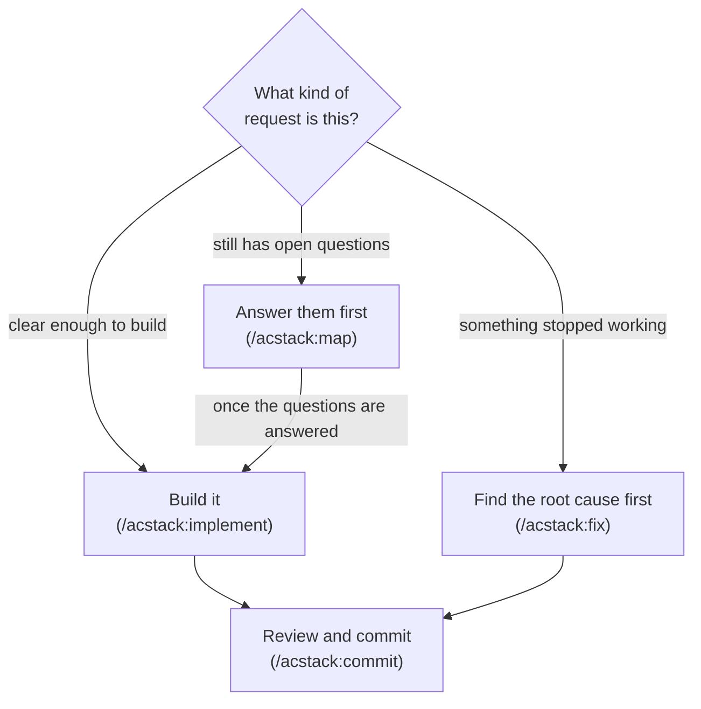

# ACStack

ACStack is an agentic coding stack. It helps coding agents clarify requirements, test meaningful behavior, and review changes before they land.

- **ACStack targets two common ways coding agents fail**
    - The agent starts building before the requirements are clear
    - The agent writes code, then writes tests that pass against that code
- **ACStack supports Claude Code, Codex, and pi from one npm package**
    - Claude Code and Codex install it through the `ac-agentic-coding` marketplace
    - pi installs `npm:acstack`
    - The package includes the prebuilt CLI, so installation needs no source build
- **ACStack fits verification to the change**
    - Straightforward work can stay with one agent, including investigation, tests, implementation, and verification
    - One verification owner gathers final completion evidence, reusing valid results instead of repeating checks at every handoff
    - Review depth follows the risks a change affects; adjacent cleanup is advisory unless you approve it
    - `orchestrator/AGENTS.md` holds the shared policy every host loads



## Install

ACStack supports [Claude Code](https://claude.com/claude-code), [Codex](https://developers.openai.com/codex), and [pi](https://pi.dev). Each needs Node.js 20 or later.

After installing, use `/acstack:implement`, `/acstack:fix`, or `/acstack:map` in any Git repository. Without project configuration, ACStack follows repository instructions and discovers tooling from manifests, tests, and CI. Run `/acstack:setup` only when you want saved project settings or features that need storage, such as maps.

### Claude Code

```
/plugin marketplace add ac8318740/ac-agentic-coding
/plugin install acstack@ac-agentic-coding
```

- The SessionStart hook loads the orchestrator instructions in Git repositories, even without project setup
- Your `CLAUDE.md` stays free for project-specific content
- If `acstack` does not run after install, see [docs/troubleshooting.md](docs/troubleshooting.md)

### Codex

You also need the Codex CLI with npm plugin support, and npm.

```sh
codex plugin marketplace add ac8318740/ac-agentic-coding
codex plugin add acstack@ac-agentic-coding
```

- Enable hooks and trust ACStack's hook source through Codex's trust flow
    - Installation alone does not grant hook execution
- Start a fresh session after the first startup
    - Startup installs ACStack's agent roles into `$CODEX_HOME/agents/` (default `~/.codex/agents/`)
    - It leaves your own roles with the same names alone
- Use the marketplace rather than the public Codex plugin directory, because the plugin includes lifecycle hooks

### pi

ACStack on pi delegates through `@tintinweb/pi-subagents` or `pi-subagents`.

```
pi install npm:@tintinweb/pi-subagents
pi install npm:acstack
```

Allow delegation in `~/.pi/agent/AGENTS.md`:

```
When an ACStack skill or the ACStack orchestrator says to launch a subagent, you may delegate to it.
```

- Skills run under the same names as on Claude Code, e.g. `/acstack:map`; `/acstack map` does the same
    - ACStack's skills do not appear as `/skill:<name>`, so another package's `map` skill never collides with ACStack's
    - The extension lists the skills in the system prompt, so the model still reads one when the task matches
- `pi/extension.ts` does what the Claude Code hooks do
    - It links the CLI at `~/.claude/acstack/bin/acstack`
    - It adds the orchestrator instructions in Git repositories and re-injects a handoff after a compaction
    - It suggests compacting or handing off as the context fills: first at 200k tokens or half the window, urgently at 500k tokens or 80% of the window, whichever is lower
- Both subagent packages find ACStack's agents through `pi.subagents` in `package.json`
    - The agents use your subagent package's default model
    - ACStack warns at session start when pi offers neither the `Agent` nor the `subagent` tool
    - For `pi-subagents`, set `"toolActivation": "eager"` in `~/.pi/agent/extensions/subagent/config.json` to offer `subagent` from the first turn, then restart pi
- With `@juicesharp/rpiv-ask-user-question` and Herdr's pi integration installed, Herdr shows the session as blocked while pi waits for your answer

## The three commands

Pick by what is in your way: nothing, a bug, or an unanswered question.

- **The request is clear enough to build**: run `/acstack:implement`
    - It works solo or as a team, using ACStack's agents where they help
    - A one-line change stays a one-line change
- **Something already built stopped working**: run `/acstack:fix`
    - The agent finds the root cause before it edits anything
- **The request still has open questions**: run `/acstack:map`
    - The agent interviews you one round at a time
    - Each round asks every question that can be answered next, each with the agent's recommended answer, so you react instead of writing from scratch
    - If the repository keeps decisions, the agent records each one under `.acstack/decisions/`
    - When one conversation cannot settle every question, the agent stores them as a map you work through across sessions

### What a map holds

A **map** is a to-do graph ACStack keeps for one piece of work. Each **node** on it is one question to answer or one piece of work to do.

- Each node has a status (`fog`, `open`, `claimed`, `resolved`, or `out-of-scope`) and says who answers it
- Each node links to the answer that raised it and to the nodes that must finish first
- The **frontier** is the open nodes with nothing unfinished blocking them: what is ready to start
- Nodes live in GitHub issues, or in markdown files under `<project folder>/maps/` when GitHub is unavailable; `workflow.maps.tracker` in `project.yaml` records the choice

[docs/workflows.md](docs/workflows.md) links each step to the skill that owns it and defines the map vocabulary.

## Configure a project and a machine

The project states what to run. The machine states what it can do.

- `project.yaml` holds every project setting
    - It lives in the project folder, one per repository and shared by its worktrees: `~/.acstack/projects/<key>/`, outside the repository
    - `~/.claude/acstack/bin/acstack project-data path` prints the folder
    - `/acstack:setup` detects the project type and starts from the `python`, `node-typescript`, or `fullstack-python` profile
    - [docs/config-reference.md](docs/config-reference.md) gives each key, its values, and its default, and explains where project data lives and how to migrate an older project
- Architecture decisions (`.acstack/decisions/`) and the glossary (`.acstack/CONTEXT.md`) live in the repository and merge like code
    - Each is optional; `/acstack:setup` asks whether to create them
- `~/.acstack/config.json` holds the `host.*` settings that describe this machine
    - `/acstack:host` writes them once per machine
    - [docs/dev-setups.md](docs/dev-setups.md) explains each one and what reads it
- `acstack config check` audits the project and the machine

## Documentation

| Page | What it covers |
| --- | --- |
| [docs/reference.md](docs/reference.md) | Every skill, agent, and CLI command, and the output style |
| [docs/workflows.md](docs/workflows.md) | The map vocabulary and which skill owns each step |
| [docs/config-reference.md](docs/config-reference.md) | Every `project.yaml` key, and where project data lives |
| [docs/dev-setups.md](docs/dev-setups.md) | Describing a machine with the `host.*` settings |
| [docs/concurrent-work.md](docs/concurrent-work.md) | Coordinating several agents working at once |
| [docs/terminal-workspace.md](docs/terminal-workspace.md) | The optional keyboard-only terminal for driving several agents |
| [docs/troubleshooting.md](docs/troubleshooting.md) | Fixing a Claude Code install where `acstack` does not run |
| [CONTRIBUTING.md](CONTRIBUTING.md) | Developing ACStack itself |

## Licence and credits

ACStack is [MIT](LICENSE) licensed. [THIRD_PARTY_NOTICES](THIRD_PARTY_NOTICES) lists the code and text it adapts.

- **[OpenSpec](https://github.com/Fission-AI/OpenSpec)**: ACStack's CLI began as a fork of OpenSpec's, and the original workflow's proposals, designs, tasks, and archiving came from it
- **[Taskmaster AI](https://github.com/eyaltoledano/claude-task-master)**: its task management model inspired the orchestrator pattern and agent coordination
- **[Skills for Real Engineers](https://github.com/mattpocock/skills)** by Matt Pocock: the Wayfinder map, the round-by-round interview, and the durability rule for agent briefs
    - ACStack's node graph is a direct adaptation of Wayfinder
- Additional inspiration comes from [Superpowers](https://github.com/obra/superpowers), [GSD](https://github.com/gsd-build/get-shit-done), and [Spec Kit](https://github.com/github/spec-kit)

The optional terminal workspace installs, but does not bundle, these tools. Each keeps its own licence.

- [herdr](https://herdr.dev)
- [tuicr](https://github.com/agavra/tuicr) by agavra
- [gh-dash](https://github.com/dlvhdr/gh-dash) and [diffnav](https://github.com/dlvhdr/diffnav) by dlvhdr
- [delta](https://github.com/dandavison/delta) by dandavison
- [lazygit](https://github.com/jesseduffield/lazygit) by jesseduffield
- [harlequin](https://github.com/tconbeer/harlequin) by tconbeer
- [yazi](https://github.com/sxyazi/yazi) by sxyazi
- [mermaid-ascii](https://github.com/AlexanderGrooff/mermaid-ascii) by AlexanderGrooff
- [glow](https://github.com/charmbracelet/glow) by charmbracelet

The optional tuicr fork build compiles [agavra/tuicr#607](https://github.com/agavra/tuicr/pull/607) by [antonio2368](https://github.com/antonio2368), plus [agavra/tuicr#633](https://github.com/agavra/tuicr/pull/633) and one counts fix written for this fork. That build is off by default.
