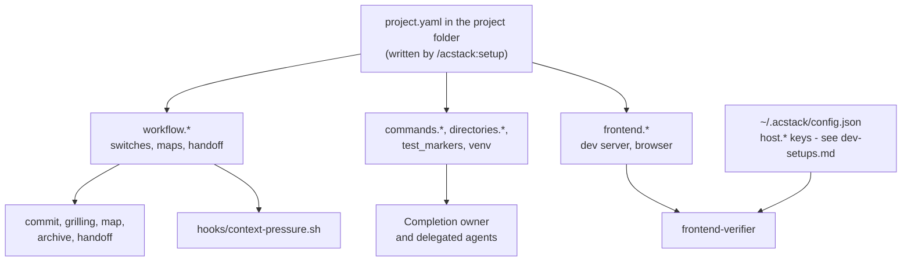

# Project configuration

*Every key in `project.yaml`, the values it takes, its default, and what changes when you change it.*

Optional `<project folder>/project.yaml` holds saved ACStack project settings.
The project folder is the repository's ACStack data folder, the path `~/.claude/acstack/bin/acstack project-data path` prints (section 1 explains where it lives).

General implementation, investigation, and review work without setup. Without this file, agents use repository instructions, manifests, existing tests, and CI to discover commands and directories. They do not invent commands or create configuration automatically. Run `/acstack:setup` when you want saved settings or storage-backed features such as maps and living specs.

Existing configuration keeps its gates. Unreadable or invalid configuration, legacy data, and project-data conflicts require the reported repair; they are not absent-config fallbacks. Orphan warnings alone do not block general work.

- **It names what to run**: the test, build, lint, typecheck, and format commands
- **It names where to look**: the source and test directories, and the frontend
- **It configures required gates**: spec sync, frontend verification, and design review
- **Agents read it when present** before running project checks
- **A key you leave out takes the default** this document gives it

Three terms first.

- **A key** is one dotted path into the file, such as `workflow.spec_sync`
- **A default** is what ACStack does when the file states no value
- **A rung** is one token count at which the context-pressure hook speaks up, asking the session to choose continuity or freshness



| Step in the diagram | Detail |
| --- | --- |
| The file, and what writes it | section 1 |
| `profile` | section 2 |
| `workflow.*` switches | section 3 |
| `workflow.maps` | section 4 |
| `workflow.handoff` | sections 5 and 6 |
| `commands`, `directories`, `test_markers`, `venv` | section 7 |
| `frontend.*` | sections 8 and 9 |
| `host.*`, and what is not a key here | section 10 |
| Every default | section 11 |

## 1. Where the file lives, and what writes it

*The setup skill writes the whole file. To change one key, run `acstack config set`.*

- `<project folder>/project.yaml` sits beside `<project folder>/domain-map.yaml`
- `/acstack:setup` writes it
    - On a fresh project the skill detects the project type, then writes every key from a profile under `profiles/`
    - On a project that already has the file, the skill leads with the health check and offers a menu of changes
- `acstack config set <key> <value>` changes one key without an interview
- A key the file omits takes the default the tables below give it
    - The `commands`, `directories`, and `frontend` keys have no such default
    - The setup skill copies them from a profile
        - An omitted one names nothing at all

These commands report configuration without changing settings.

| Command | What it prints |
| --- | --- |
| `acstack config show` | the profile, the commands, and what the project says about its browser |
| `acstack config check` | an audit of the project and the machine, exiting 2 when a required host axis has no value |
| `acstack config list` | every key the file states |
| `acstack design-gate` | whether a design review runs here, as `on` and exit 0 or one `off: <reason>` line per reason and exit 1 (section 3) |

### Where project data lives

*Each repository has one project folder, outside the repository by default. All of its worktrees share it.*

- `~/.claude/acstack/bin/acstack project-data path` prints the project folder's absolute path, even before the folder exists
    - It exits non-zero outside a Git repository
    - It exits non-zero with a repair message for legacy, invalid, or conflicting data
    - Orphan warnings do not block a valid current repository or adopt the orphan's settings
    - The session-start hook states the same path in the agent's context
- This document writes a part inside it as `<project folder>/project.yaml`, `<project folder>/specs/`, and so on
- `/acstack:setup` creates the folder with `mkdir -p "$(~/.claude/acstack/bin/acstack project-data path)"`
- No configuration key and no `.gitignore` rule controls where project data lives

A project uses one of two modes.

| Mode | Where the records live | What the repository holds |
| --- | --- | --- |
| Global (default) | `~/.acstack/projects/<key>/`, a real folder | No ACStack files, and no `.gitignore` rules |
| Tracked (opt-in) | The main checkout's `.acstack/`; `~/.acstack/projects/<key>` is a link to it | `.acstack/`, which the developer commits |

- `<key>` is the main checkout's folder name, a hyphen, and a short hash of the repository's shared Git folder, for example `shop-3f9a2c`
    - Every worktree reports the same shared Git folder, so every worktree finds the same entry
    - `ls -l ~/.acstack/projects/` lists every project and shows which are tracked
- `ACSTACK_HOME` replaces `~/.acstack` for every path in this section
- In tracked mode the project folder resolves into the main checkout
    - Edits to a feature branch's own `.acstack/` take effect only once they reach the main checkout
    - A teammate's clone links its entry to the committed `.acstack/` automatically on first use
- Spec sync stages updated specs only when they sit inside the working tree being committed
    - In global mode they never do
    - In tracked mode they do only for a commit made in the main checkout

Every part keeps its name inside the project folder.

| Part | Path |
| --- | --- |
| Project configuration | `<project folder>/project.yaml` |
| Domain map | `<project folder>/domain-map.yaml` |
| Living specs | `<project folder>/specs/` |
| Maps | `<project folder>/maps/` |
| Archives | `<project folder>/archive/` |
| Legacy change records | `<project folder>/changes/` |
| Legacy review artifacts | `<project folder>/alignment-packs/` |
| Canonical design reviews | `<project folder>/design-reviews/` |
| Architecture decisions | `<project folder>/decisions/` |
| Cross-domain glossary | `<project folder>/CONTEXT.md` |
| Browser connection | `<project folder>/agent-browser.json` |
| Verification knowledge | `<project folder>/verification/VERIFICATION-KNOWLEDGE.md` |
| Test baseline | `<project folder>/.test-baseline` |
| Decision logs | `<project folder>/decision-logs/` |
| Continuation anchor | `<project folder>/HANDOFF.md` |
| Agent handoffs | `<project folder>/handoffs/` |

- ACStack retires `workflow.alignment_packs` auto-generation, approval, and tracking settings; existing fields have no effect
    - This includes `approval_gate` and `commit_generated_packs`
    - Setup and config writes no longer offer them; ACStack never silently rewrites or deletes existing files
- Design approval covers a map's element nodes, saved comments, and the open nodes targeting those elements, without a new workflow flag
- `workflow.design_review` still controls only the frontend design pass
- Installed tools under `~/.claude/acstack/bin/` and host-owned `.claude/` settings keep their existing locations
- Helper programs and user code under `frontend.helpers_dir` stay where they are
    - Verification metadata always uses `<project folder>/verification/VERIFICATION-KNOWLEDGE.md`

### Machine-wide files

*ACStack's own settings and caches share the same root, `~/.acstack/` or `$ACSTACK_HOME`.*

| File | Path | Was |
| --- | --- | --- |
| Global config (`host.*` keys) | `~/.acstack/config.json` | `~/.config/acstack/config.json` |
| Opener token | `~/.acstack/opener.token` | `~/.config/acstack/opener.token` |
| Terminal-workspace files | `~/.acstack/terminal-workspace.yaml` and its siblings | `~/.config/acstack/` |
| Cached assets | `~/.acstack/cache/` | `~/.local/share/acstack/` |
| ac-teams state | `~/.acstack/ac-teams/` | unchanged |

ACStack no longer reads the `XDG_CONFIG_HOME` or `XDG_DATA_HOME` variables.

### Project data commands

*Four commands move project data, and only when the developer runs them.*

| Command | What it does |
| --- | --- |
| `acstack project-data migrate` | Moves legacy machine-wide files and this repository's legacy `.acstack/` into the new layout |
| `acstack project-data mode tracked` | Moves the project folder's contents into the main checkout's `.acstack/` and replaces the folder with a link; commit `.acstack/` from the main checkout afterwards |
| `acstack project-data mode global` | Moves the main checkout's `.acstack/` into the project folder and removes the link; commit the removal of `.acstack/` afterwards |
| `acstack project-data relink <entry>` | Gives the named entry, orphaned by moving the repository on disk, the repository's current key; `project-data path` names the entry |

Every command:

- Preflights every move and aborts on a collision without writing anything
- Never changes the Git index, commits, or force-adds files
- Reports any other worktree that still holds its own `.acstack/` changes, which ACStack no longer reads; move what you need from it, then delete it

### Explicit migration from a legacy layout

*ACStack stops reading the old locations. It warns once per session while legacy data exists, and names `acstack project-data migrate`.*

Legacy data is any of:

- `~/.config/acstack/` or `~/.local/share/acstack/`, or their `XDG_*` equivalents
- A repository's `.acstack/` that no project entry links to
- The older in-repository layout: `acstack/`, `docs/adr/`, `.decisions/`, and root `CONTEXT.md`, `.test-baseline`, or `agent-browser.json`

Migrate each machine and each repository explicitly.

1. Update installed ACStack tools before moving any data
2. Stop old agent sessions and review servers; old CLI versions and hooks cannot read the new layout
3. Back up the legacy locations
4. From any worktree of each repository, run `~/.claude/acstack/bin/acstack project-data migrate`
5. Review the result, then restart agents and review servers with the updated tools

What migration does:

- The first run on a machine moves `~/.config/acstack/*` to `~/.acstack/` and `~/.local/share/acstack/*` to `~/.acstack/cache/`
- It moves the older in-repository layout into `.acstack/` first, including `docs/adr/` to `decisions/` and old decision logs to `decision-logs/`
    - It moves verification knowledge, not arbitrary helper directories or their programs
- A main checkout whose `.acstack/` files are in the Git index becomes tracked mode; only the link is created
- Otherwise the main checkout's `.acstack/` moves into its project folder, and the old ACStack-managed block in the root `.gitignore` is removed
- Previously tracked paths that moved show up as pending deletions for the developer to commit
- It preflights every move and aborts on a collision, such as an existing project folder, without overwriting anything
- Never migrate a repository silently, or work around legacy data by creating a partial project folder

### Design docs

- ACStack removes legacy `map --map` and `align-viewer` without aliases
- Use `design-doc <map>` to review a map's design doc; its elements are `element` nodes on that map
- Use `node walk`, `node frontier`, and `node diagram` for map planning
- Review evidence in `design-reviews/` outlives temporary map nodes regardless of `workflow.maps.persist`

### 1.1. Which file a write lands in

*The key decides, and the key alone.*

- A `host.*` key describes the machine
    - It goes to the global config at `~/.acstack/config.json`
- Every other key in this document describes the project
    - It goes to `<project folder>/project.yaml`
- Section 10 covers the `host.*` keys
- `acstack config get <key>` and `acstack config unset <key>` read the same key table and route the same way

### 1.2. What a command refuses

*Validation happens before either file opens, so a refusal writes nothing.*

- `acstack config set` refuses a value outside the set a table gives
- It refuses a key neither schema knows, and names the keys it does know
- It refuses a project key outside an ACStack project
    - No file is there to hold it
- It holds a numeric key to the range its reader honours, not merely to being a number
    - A count of turns or of tokens takes a whole number of 0 or more
    - A CDP port takes a whole number from 1 to 65535
    - A refusal names the range
    - A value the reader would reject otherwise fails somewhere else entirely, long after the command that accepted it exited 0
- `get` and `unset` both refuse a key neither schema knows
- Both refuse a project key outside an ACStack project

### 1.3. What `get` prints, and what it exits

*One exit code means "no value here", whichever file holds the key.*

- A string prints as written, and anything else prints as JSON
- The command exits 2 when the file states no value
- An unset `host.*` axis already gives that code
    - A caller branches on "no value here" without knowing which file holds the key
- The message names the documented default where a table below gives a literal one
- The message names no default where a table describes the default instead
    - There is none to name

### 1.4. What `unset` leaves behind

*`acstack config unset` takes the key out. It prunes nothing else.*

- Removing a key the file does not state is not an error
    - The command writes nothing at all
        - The file stays byte for byte as it was
- A block the removal emptied keeps its key with nothing after the colon
    - Every reader treats that as the default
- The command prunes nothing
    - Pruning would take any comment on that block with it

### 1.5. How a write preserves the rest of the file

*Two write paths exist. The result of the first decides which one runs.*

A write keeps the file as you wrote it. Comments, blank lines, key order, and quoting all survive.

- The command first tries to change the key in place, rewriting the bytes of the old value and leaving every other byte alone
- It then checks its own work
    - It parses the file it just built and compares the data, in full, against the data the second path would have written
    - It keeps the in-place change only when the two agree
- The write goes through the YAML document instead, when the two disagree or when the file it built does not parse
    - That path carries every comment across
    - It re-emits the whole file
    - A run of spaces before an inline comment shortens to one
- A collection stated in flow style stays in flow style
- Line endings survive either path
    - The command writes a file that arrived with CRLF back in CRLF
    - Setting one key never rewrites the ending of every line
- `acstack config unset` writes the same two ways and checks itself the same way
    - It splices the whole line out, indentation and trailing comment included, then compares the data before it keeps that

So the result decides which path a write takes, and never the shape of the key.

- A hand-edited file with ordinary one-line values gets the byte-for-byte path
    - That is the common case
    - It is the path such a file needs
- Anything the check cannot vouch for gets re-emitted
    - The command checks that emission too, because the YAML document interface can itself write a line no parser reads back
    - It costs only formatting when the check passes
- A write neither path can vouch for gets refused
    - The command exits 1 and names the key
    - The file stays byte for byte as it was
- Losing the alignment of a comment beats losing the key that follows a block scalar

### 1.6. Four file shapes that get a decision rather than a crash

*A file ACStack itself produced always reads back.*

- A project folder that exists without `project.yaml` gets the file created
- A block stating nothing takes a key underneath it, whether the file spells that block as a bare colon, as `null` or as `~`
    - That is the state `acstack config unset` leaves behind
        - The tool accepts its own output
- A document stating nothing at all takes a key too
    - A file holding only `---` works the way an empty file already does
- The command refuses a key holding a value where the path wants a block
- It names that key
    - Writing there would mean discarding the value already in the file
    - That value is yours rather than the command's
        - The file stays byte for byte as it was

Three refusals protect a file neither command can handle.

- Both `set` and `unset` refuse a file whose bytes are not valid UTF-8
    - Neither one can re-encode a byte it could not decode
    - A write would stand the replacement character in its place and report success
- Both refuse a file the process may not write
- Both refuse a document that is a scalar or a list, because no key hangs under either
- Both name the file and the reason

### 1.7. What `acstack config list` reports

*The listing answers what the file states, and `get` answers what the schema knows.*

- The listing prints every key the file states, in the file's own order
- A stated key no schema knows carries `(unknown key)`
    - `acstack config get` refuses that key
    - `acstack config set` will not write it
- A block header holding nothing carries no mark where the schema knows keys under it
    - `acstack config unset` leaves that line standing when it removes a block's last key
    - The tool wrote `workflow:` itself, so the listing does not warn about it
- A key holding a dot is a key of its own
    - YAML reads `"workflow.spec_sync": true` as one key whose name contains a dot
    - The same file may state the nested spelling as well
    - The listing prints both rows, and marks the literal one
    - Every command walks the blocks, so all of them answer out of the nested spelling
- The `--json` output gives the project side as a list of rows, in the file's own order
    - Each row reads `{"key": "<dotted path>", "value": ..., "known": true|false}`
    - The rows are a list, so two rows can share one dotted path

## 2. profile

*One word naming the defaults the file started from.*

| Key | Values | Default | What changes |
| --- | --- | --- | --- |
| `profile` | `node-typescript`, `python`, `fullstack-python` | none | `/acstack:setup` reads `profiles/<profile>.yaml` for its proposed commands and directories; `acstack config show` prints the name |

- The profile decides nothing after setup has run
- The commands and directories it proposed live in the file as their own keys, and those keys are what every later reader uses

## 3. workflow: the switches

*Six booleans sit in the block. Each one changes how much discipline ACStack applies. A byte count tunes the large-read guard, and one more key decides how the agent asks you a question.*

| Key | Values | Default | What changes |
| --- | --- | --- | --- |
| `workflow.spec_sync` | `true`, `false` | `true` | the `commit` skill runs spec sync before it commits, unless this says `false`; with `false` the living specs under `<project folder>/specs/` stop tracking the code |
| `workflow.tdd.strict` | `true`, `false` | none | deprecated compatibility boolean; no sequencing effect, including explicit `true` |
| `workflow.tdd.orchestrator_strict` | `true`, `false` | none | deprecated compatibility boolean; no delegation effect, including explicit `true` |
| `workflow.frontend_verification` | `true`, `false` | `false` | the frontend-verifier runs only when this is `true`, the file configures a `frontend` block, and the change touched frontend files |
| `workflow.design_review` | `true`, `false` | `false` | a design review runs on a UI change only when this is `true`; it needs the impeccable plugin installed and switched on, which `acstack config check` reports on |
| `workflow.read_guard` | `true`, `false` | `true` | `false` turns off the large-read guard; section 3.3 describes it |
| `workflow.read_guard_bytes` | a whole number, 1 or more | `32768` | the smallest file, in bytes, the large-read guard stops |

How a boolean reads:

- Every boolean key in this document takes the same six spellings as a `host.*` axis, and case does not matter
    - `true`, `yes`, and `on` all read as true
    - `false`, `no`, and `off` all read as false
- The tables show `true` and `false`
    - That is what the file holds after `acstack config set` writes one
- `workflow.spec_sync` reads as on unless the file states one of the three false spellings outright
    - The `commit` skill treats a missing key and an explicit `true` the same way
- `workflow.frontend_verification` reads as off unless the file states one of the three true spellings outright
    - The frontend-verifier is the only reader
    - `orchestrator/AGENTS.md` and the `browser-verify` skill both run it on an explicit `true` alone
    - The defaults block in section 11 shows `true` for this key
    - That is what `/acstack:setup` writes for a project with a frontend
    - That is what setup writes, and not what an absent key means
- `workflow.design_review` reads as off unless the file states one of the three true spellings outright
    - `acstack design-gate` is the one command that answers whether the gate is on
        - On needs both halves: the key true, and the impeccable plugin installed
            - A plugin set `false` under `enabledPlugins` in `settings.json` counts as not installed
        - It reads this file, the plugin registry, and `settings.json`, runs nothing, and never exits 2
        - An impeccable older than major 4, or one whose version it cannot read, warns on stderr and stays on
        - `--json` prints the same answer as `{"on": ..., "reasons": [...], "impeccable": ...}`

### 3.1. Deprecated TDD booleans

*Adaptive verification replaces the old sequencing and delegation guarantee.*

- `workflow.tdd.strict` and `workflow.tdd.orchestrator_strict` remain known boolean keys for compatibility
- Neither key has an effective default or controls sequencing or delegation, including explicit `true`
- ACStack removes the former strict guarantee
- The CLI still supports get, set, list, and unset for either key
- Unrelated writes preserve existing values and comments
- Deprecation alone does not trigger automatic config migration
- New setup does not offer or generate either key
- `orchestrator/AGENTS.md` owns the shared Implementation discipline
- Explicit user requests for stronger process still apply

### 3.2. How the agent asks you a question

| Key | Values | Default | What changes |
| --- | --- | --- | --- |
| `workflow.grilling.questions` | `tool`, `inline` | `tool` | `tool` asks through the host's question tool, one call per round; `inline` asks in prose |

- `tool` falls back to inline prose for any round it cannot hold
- Two things exceed it: a round of more than four questions, and any question with no discrete options

### 3.3. The large-read guard

*The guard stops a main agent's first whole read of a large file once, and points it to a cheaper way to read.*

- The guard runs on Claude Code and Codex as a `PreToolUse` hook (`hooks/read-guard.mjs`), and on pi in the extension's `tool_call` handler
    - Both share one policy, `hooks/lib/read-guard.mjs`
- It stops a whole-file read of a file of at least `workflow.read_guard_bytes` bytes
    - A whole-file read is the read tool with no offset or limit, or a single-file `cat`, `less`, `more`, `nl`, or `bat` with no pipe, redirect, or variable
    - The block message suggests a ranged read, a search, or a read-only subagent
- Repeating the same read passes, and so does any later whole read of the same unchanged file
    - The guard is a nudge, not a security boundary
    - A ranged read, a pipe, or `head` always passes
- The guard watches only a main agent, meaning a session the user started
    - Claude Code and Codex subagents carry `agent_id` in the hook input, so they pass
    - ac-teams members (`ACSTACK_AGENT_ROLE` set to anything but `main`, or `AC_TEAMS_MEMBER` set) and pi-subagents children (`PI_SUBAGENT_CHILD`) pass
    - On pi, a session with a `parentSession` header or no session file passes, so the guard skips a forked session too
    - When the guard cannot tell, it lets the read through
- Any error inside the guard lets the read through
- Claude Code and Codex record passed reads in `${TMPDIR:-/tmp}/acstack-read-guard-<uid>/<session_id>.json`, a folder only its owner can open; pi keeps them in memory

## 4. workflow.maps

*Two keys record where a map's nodes live, and what happens to those nodes at the end.*

A **map** is a graph of question nodes and work nodes. A **tracker** is the backend that stores those nodes.

| Key | Values | Default | What changes |
| --- | --- | --- | --- |
| `workflow.maps.tracker` | `github`, `files` | none | the `map`, `implement`, and `archive` skills read the matching backend document and use its operations |
| `workflow.maps.persist` | `true`, `false` | `false` | `true` moves a cleared map's node files to `<project folder>/archive/[YYYY-MM-DD]-[name]/nodes/`; `false` deletes `<project folder>/maps/<name>/` |

- An absent `workflow.maps.tracker` means nobody has chosen yet
    - The `map` skill then picks at the moment it first writes a map's nodes down, confirms the choice with the user, and writes the key
    - It recommends `github` when `gh` holds a login for the repository's GitHub remote, and `files` otherwise
- Anything that resets the `workflow` block to defaults has to keep `workflow.maps` intact
    - The key records where the node records already are
    - Dropping it strands every one of them on a backend no later session looks at
- `workflow.maps.persist` acts on the files tracker only
    - The GitHub tracker has nothing to dispose of
        - A closed issue is already the archive
    - The default deletes, because keeping the nodes leaves a second copy of every decision and the two copies drift apart

## 5. workflow.handoff: launching and acknowledging

*Three keys govern the handoff skill, which moves work from one session to another.*

| Key | Values | Default | What changes |
| --- | --- | --- | --- |
| `workflow.handoff.agent` | a command template | `claude` | the command the `handoff` skill runs to launch a target session when herdr is absent; a template rather than a bare name, so a model flag or a permission-mode flag fits |
| `workflow.handoff.ack_turns` | a whole number, 0 or more | `5` | how many turns after delivery the sender waits before it reports the target as silent; `--fresh` doubles it |
| `workflow.handoff.self_invoke` | `true`, `false` | `true` | `false` stops the agent from invoking the `handoff` skill on its own initiative; it then tells the user a handoff looks warranted and asks first |

- `workflow.handoff.self_invoke` gets a behavioural check at the skill's first step, rather than a frontmatter flag
- Frontmatter model-invocation flags are static
    - No project could turn one off for itself

## 6. workflow.handoff: the context-pressure ladder

*Five keys place the rungs at which `hooks/context-pressure.sh` asks the session to choose continuity or freshness.*

How the hook decides to speak:

- The hook runs on every stop
- It reads the last assistant record in the transcript and adds three usage fields: `input_tokens`, `cache_read_input_tokens`, and `cache_creation_input_tokens`
- That sum is the context the turn sent to the model
- The hook then finds the highest rung at or below that number
- It speaks when that rung sits above the rung it last spoke for
- It records the new rung
- So a long session gets one nudge per rung, not one per stop

### 6.1 The default thresholds, and the gap above them

| Key | Values | Default | What changes |
| --- | --- | --- | --- |
| `workflow.handoff.nudge_warn` | a whole number of tokens, 0 or more | `200000` | the ladder's first rung, and the wording below the severe mark; a small-context model wants a lower value |
| `workflow.handoff.nudge_severe` | a whole number of tokens, 0 or more | `500000` | the ladder's second rung, and the mark at or above which the wording turns urgent |
| `workflow.handoff.nudge_step` | a whole number of tokens, 0 or more | `100000` | how far apart the rungs sit above the last one, so a session that keeps growing keeps hearing from the hook |

Three guards protect the ladder from a value that would break it.

- The hook raises a `nudge_warn` below 1 to 1
    - A rung of 0 would block every single turn
- It raises `nudge_severe` to `nudge_warn` when the file states a lower one
    - A severe mark below the warn mark could never fire
- It treats a `nudge_step` below 1 as an instruction to stop the ladder at its top rung

What the nudge asks the agent to choose:

- Continuity means useful working context stays in the same session
    - A large window can rely on billion-context
    - ACP compression is an in-place host option, not something ACStack calls itself
- Freshness means a fresh context window or independent read would help more
    - That route is `/acstack:handoff`
- Severe wording makes the same checkpoint urgent
- It never halts the run
- Both tiers close with the same clause
    - The agent decides for itself
    - It asks the user only when it genuinely cannot tell
    - It hands over without asking when the user already agreed to a handoff earlier in the session

### 6.2 An explicit ladder

| Key | Values | Default | What changes |
| --- | --- | --- | --- |
| `workflow.handoff.context_thresholds` | a list of token counts or percentage strings | none | replaces `nudge_warn` and `nudge_severe` as the ladder's rungs, as in `[150000, 300000]` or `["40%", "70%"]` |

- Two YAML shapes work: flow style on one line, `[150000, 300000]`, and block style with one `- item` per line
- The hook sorts the rungs and drops duplicates
- It drops any entry it cannot read as a number or a percentage, and any entry below 1
- It falls back to the `nudge_warn` and `nudge_severe` rungs with no usable entry left

All three of the other keys still act under an explicit ladder.

- `nudge_step` extends the ladder past the last listed rung, exactly as it does by default
- `nudge_severe` places no rung any more, and only picks the wording
    - A nudge reads as severe once the rung that fired sits at or above it
- `nudge_warn` places no rung either
- It still moves that wording threshold
- The hook raises `nudge_severe` to meet a higher `nudge_warn` before it builds the ladder

### 6.3 What a percentage is a percentage of

| Key | Values | Default | What changes |
| --- | --- | --- | --- |
| `workflow.handoff.context_window` | a whole number of tokens, 1 or more | inferred from the model id | the number a percentage rung resolves against, as in `"40%"` of `200000` |

- A positive `context_window` wins outright
- The hook infers the window from the model id with no value, or one of 0 or less
- That id comes from the same transcript record as the token count

Three rules decide the window, in order.

| The model id | The window |
| --- | --- |
| carries the `[1m]` marker | 1,000,000 |
| names the haiku line, or a 4.x family such as `claude-opus-4-8`, `claude-haiku-4-5-...` or `claude-sonnet-4-5` | 200,000 |
| anything else, including the 5.x families and a record with no model id at all | 1,000,000 |

- The `[1m]` marker outranks the second rule
- A million-token model says so in its own id
    - `claude-sonnet-4-5[1m]` resolves to 1,000,000 rather than 200,000

### 6.4 Why only the session's own stop

*The hook nudges the session that could act on it. It nudges nobody else.*

- `hooks/hooks.json` registers it for two events only
    - A `Stop` event fires when the session's own turn finishes
    - `SessionStart` fires when a session opens
- A `SubagentStop` payload, should one ever arrive, exits silently and creates no state
- Neither a subagent nor an in-process teammate can hand the user's work over
    - A nudge there would only spend a turn
- The measurement follows the same rule
    - The hook skips every transcript record marked `isSidechain`
    - A subagent's tokens are not this session's context

### 6.5 The ladder is per session, and a compaction resets it

*Two files per session hold the state, and a compaction deletes both.*

- The hook keeps both files under `$ACSTACK_CONTEXT_PRESSURE_DIR`
    - That defaults to a `acstack-context-pressure` directory under `TMPDIR`, or under `/tmp`
- The `.last` file holds the rung the hook last spoke for
- The `.quiet` file is a marker
    - The `handoff` and `compact-and-continue` skills leave it behind when they finish
    - The hook stays silent for the rest of the session while it exists
- A compaction deletes both files
    - The ladder starts again at its first rung
    - A compaction throws the session's context away and rebuilds it much smaller
    - The recorded rung then describes context that no longer exists
    - The quiet marker records a handover the fresh context knows nothing about

Two limits are worth knowing.

- The hook reads these five keys with its own small YAML parser
    - pyyaml may not exist on the machine
    - That parser hands each value to Python's `int()` and accepts whatever `int()` accepts
    - A `_` digit separator works
        - `200_000` reads as 200,000
    - Exponent and float notation do not
        - `2e5` and `2.0` fall back to the default
- The hook opens `<project folder>/project.yaml`, finding the folder with `acstack project-data path`
    - A session running outside a Git repository therefore gets the defaults

## 7. commands, directories, test_markers and venv

*What every agent runs, and where every agent looks.*

| Key | Values | Default | What changes |
| --- | --- | --- | --- |
| `commands.test` | a shell command, or `null` | from the profile | the verification owner runs the configured tests |
| `commands.test_collect` | a shell command, or `null` | from the profile | the verification owner compares counts with `<project folder>/.test-baseline`; counts alone do not prove coverage |
| `commands.build` | a shell command, or `null` | from the profile | the verification owner checks the build with it |
| `commands.lint` | a shell command, or `null` | from the profile | the verification owner lints with it, usually with a fix flag |
| `commands.typecheck` | a shell command, or `null` | from the profile | the verification owner type-checks with it |
| `commands.format` | a shell command, or `null` | from the profile | format touched files before final verification; `null` means no format step |
| `directories.source` | a path | `src/` | where `/acstack:setup` explores to propose the domain map, and where the implementer writes source |
| `directories.tests` | a path | `tests/` | where tests live; assigned separate test ownership governs who may edit them |
| `test_markers.exclude` | comma-separated markers, or `null` | `null` for Node, `slow,integration` for Python | which markers a default test run leaves out, as in `pytest -m` |
| `venv.activate` | a shell command, or `null` | `null` for Node, `source .venv/bin/activate` for Python | every agent prefixes each command with it when the file states one |

- Run configured formatting over touched files before final verification
- Report a non-zero formatting exit without treating it as evidence of incorrect behavior
- Verification follows formatting regardless of whether another agent runs it

- `acstack config show` lists a `commands` entry only when its value is a non-empty string
    - A `null`, a number or a nested block does not name a command anyone could run
        - The listing leaves it out

## 8. frontend

*The block's presence is itself a setting: with no `frontend` block, this project drives no browser.*

| Key | Values | Default | What changes |
| --- | --- | --- | --- |
| `frontend` | a block, or `null` | absent | a block makes the project a frontend project: the frontend-verifier becomes eligible, and `acstack config check` starts asking for the three browser axes and the frontend files |
| `frontend.directory` | a path | `frontend/` | where the frontend lives |
| `frontend.dev_server_url` | a URL | `http://localhost:3000` | the address the frontend-verifier opens |
| `frontend.dev_server_check` | a shell command | a `curl` of the URL | how the frontend-verifier decides the dev server is up |
| `frontend.helpers_dir` | a path | `<frontend.directory>/tests/helpers/` | where helper programs live; verification metadata always lives at `<project folder>/verification/VERIFICATION-KNOWLEDGE.md` |
| `frontend.commands.dev` | a shell command | none | how the frontend-verifier starts the dev server; without it the verifier cannot start one itself |
| `frontend.commands.build` | a shell command | from the profile | the frontend build the verification owner runs |
| `frontend.commands.lint` | a shell command | from the profile | the frontend lint the verification owner runs |
| `frontend.commands.test` | a shell command | from the profile | the frontend tests the verification owner runs |

- An explicit `frontend: null` reads the same as no block at all
- The CLI counts a frontend only when the key holds something other than `null`

## 9. frontend.browser and the CDP port

*Three keys state what this project would like. The machine states what it can actually do.*

The Chrome DevTools Protocol (CDP) is the wire protocol the verifier drives a browser over. These three keys state a preference, and the `host.browser.*` axes in the global config say whether the machine can honour it. [dev-setups.md](dev-setups.md) documents those axes.

| Key | Values | Default | What changes |
| --- | --- | --- | --- |
| `frontend.browser.mode` | `remote`, `headless`, `local` | none | the mode `acstack config browser-mode` resolves for the frontend-verifier, weighed against the three host axes; it also picks the `cdp_port` default |
| `frontend.browser.fallback` | `none`, `remote`, `headless`, `local` | none | only `none` acts: it forbids another mode from standing in when the host does not declare the preferred one |
| `frontend.browser.cdp_port` | a whole number from 1 to 65535 | `19988` under `mode: remote`, `9555` otherwise | the port the frontend-verifier dials, and the port the `agent-browser-json` row of the check requires `<project folder>/agent-browser.json` to name |

The two defaults come from two different browsers.

- The mode `remote` means the Playwriter bridge, which hardcodes port 19988 and offers no way to change it
- Every other mode means a browser this machine launched itself, with the usual debug port 9555
- The default is 9555 with no `mode` at all

The port default applies wherever the CLI needs a number.

- `acstack config check` holds a project that states no `cdp_port` to the default its mode implies
- It fails when `<project folder>/agent-browser.json` names a different port
- `acstack config show` behaves the other way, printing only what the project states
    - "What did the project say" and "which port do we dial" are different questions

Only the literal `none` gives `frontend.browser.fallback` any effect.

- Every other value, `headless` included, leaves the host's own order alone: remote first, then headless, then local
- A project that wanted a particular mode would have named it as its `mode`
    - A second mode name here changes nothing
- The reader ignores any word other than `none`, and `acstack config set` still holds the key to the four names above
    - A typo would read as a fallback the project never asked for
        - The command refuses it rather than storing it

## 10. What is not a project.yaml key

*Two sets of settings look like they belong here. Neither set does.*

- The `outputStyle` setting is not a `project.yaml` key
    - Claude Code owns it
    - It lives in three settings files
    - `.claude/settings.local.json` wins over `.claude/settings.json`, which in turn wins over `~/.claude/settings.json`
    - `acstack config check` reads all three and reports which file selects which style
    - No ACStack command writes it, and `acstack config set` refuses it as a key neither schema knows
    - `/acstack:setup` offers to write it for you, and asks first
- The `host.*` keys are not `project.yaml` keys either
    - They describe the machine rather than the project
    - The same repository opens on several machines with different setups
    - They live in the global config at `~/.acstack/config.json`
    - `acstack config set` is what writes them
    - [dev-setups.md](dev-setups.md) documents all nine axes

## 11. Every default in one block

*What ACStack does with a `project.yaml` that states none of these keys.*

```yaml
workflow:
  spec_sync: true
  grilling:
    questions: tool
  # /acstack:setup writes true for a project with a frontend.
  # An absent key reads as false. Section 3 says why.
  frontend_verification: true
  design_review: false
  read_guard: true
  read_guard_bytes: 32768
  maps:
    # tracker has no default: the map skill picks and writes it
    persist: false
  handoff:
    agent: "claude"
    ack_turns: 5
    self_invoke: true
    nudge_warn: 200000
    nudge_severe: 500000
    nudge_step: 100000
    # context_thresholds and context_window have no default
```

- The `commands`, `directories`, `test_markers`, `venv`, and `frontend` blocks have no defaults of their own
- `/acstack:setup` copies them from the profile it detects
- Section 7 gives the values each profile proposes
