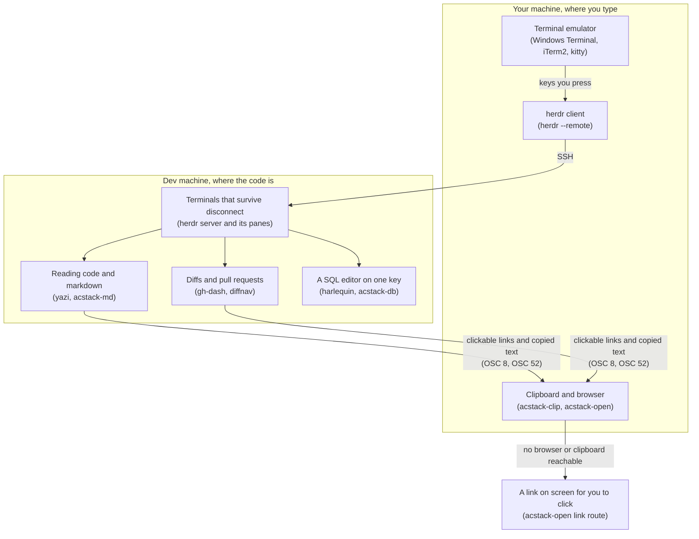

# Terminal workspace: herdr, gh-dash, diffnav, lazygit

This is an optional setup for running several coding agents on a remote machine, and reviewing their work without leaving the terminal.

- **Your code lives on a machine you reach over the network**
- You run agents on it
- **A plain terminal session dies with its connection**, taking every running agent with it
- **The tools worth reviewing code in assume a desktop**, meaning a clipboard, a browser, and a display
- **That remote machine has none of them**
    - A copy or an "open in browser" goes nowhere
- **ACStack needs none of this setup**
    - Skip the whole document if you work locally in an editor

- Run herdr on the dev machine, a terminal multiplexer that holds many terminal sessions
- herdr keeps every session running after you disconnect
- Attach to it from your own machine with `herdr --remote`
- A pane is one terminal window inside herdr
- The server keeps every pane alive when your connection drops
- The local client is what lets your own clipboard and browser reach the session, which an SSH shell cannot do
- Run `/acstack:terminal-workspace` to install and configure all of it
- One file, `~/.acstack/terminal-workspace.yaml`, turns each part on or off
- `ACSTACK_HOME` moves that folder, `~/.acstack/`, for every ACStack file in it
- This page and the pages it links explain what that sets up and why
- Read them if you would rather configure it by hand or change the defaults



| Part of the diagram | Where it is explained |
| --- | --- |
| herdr client | [How you attach](#how-you-attach) on this page |
| herdr server and its panes | [The herdr config file](terminal-workspace/install.md#the-herdr-config-file) |
| Terminal emulator | [When a key does nothing](terminal-workspace/keys.md#when-a-key-does-nothing) |
| Reading code and markdown | [Reading code, markdown, and diagrams](terminal-workspace/reading-diffs-sql.md#reading-code-markdown-and-diagrams) |
| A SQL editor on one key | [Harlequin: a SQL editor on one key](terminal-workspace/reading-diffs-sql.md#harlequin-a-sql-editor-on-one-key) |
| Diffs and pull requests | [Diffs and pull requests](terminal-workspace/reading-diffs-sql.md#diffs-and-pull-requests) |
| Clipboard and browser | [What crosses back to your machine](terminal-workspace/clipboard-and-browser.md) |
| A link on screen for you to click | [acstack-open: the browser](terminal-workspace/clipboard-and-browser.md#acstack-open-the-browser) |

The pages, by the question each answers:

- This page: what you get, the daily loop, and how you attach
- [Install and configure](terminal-workspace/install.md): what `setup.sh` installs, each tool's settings, and the herdr config file
- [Keys](terminal-workspace/keys.md): every key worth memorising, and what to do when one does nothing
- [Reading, diffs, and SQL](terminal-workspace/reading-diffs-sql.md): the file tree, the markdown reader, harlequin, and the diff and dashboard helpers
- [Clipboard and browser](terminal-workspace/clipboard-and-browser.md): how a copy or an open on the dev machine reaches your own machine
- [Design notes and traps](terminal-workspace/design-notes.md): why the parts work the way they do, and what cost real time to find

## What you get, and its parts

*Five tools you drive day to day. herdr owns the terminals, gh-dash triages pull requests, diffnav reads diffs, lazygit commits them, harlequin queries the database. Five more tools and ACStack's own helpers sit behind them. Use this when your code lives on a dev machine, you drive more than one agent at a time, and you want a keyboard-only workflow.*

- Skip it if you work locally in a graphical editor
    - A desktop tool serves you better
- **Agents that survive disconnect.** herdr runs a background server. Closing the terminal, dropping the network, or attaching from another machine never stops an agent mid-task
- **One screen that shows who needs you.** herdr marks every pane working, blocked, idle, or done
    - You stop hunting for the stuck one
- **Review without a browser.** Pull request triage, diffs with a file tree, and comments, all from the terminal

The five you drive day to day:

| Tool | Role | Why this one |
|---|---|---|
| [herdr](https://herdr.dev) | Terminal multiplexer | Background server, per-pane agent state, one container of tabs and panes per git worktree |
| [gh-dash](https://github.com/dlvhdr/gh-dash) | Pull request dashboard | Saved searches per section, custom actions, `gh` underneath |
| [diffnav](https://github.com/dlvhdr/diffnav) | Diff reader | File tree beside the diff, the blast-radius view a plain pager lacks |
| [lazygit](https://github.com/jesseduffield/lazygit) | Git TUI | Stage, commit, amend and push without leaving the keyboard, and LazyVim already binds it |
| [harlequin](https://github.com/tconbeer/harlequin) | SQL editor | Query, results and schema tree in one window, with adapters for postgres and Snowflake |

Five more tools do the work those five ask for.

- You drive one of them yourself, tuicr, from the moment a review starts on gh-dash's `D` key

| Tool | Role | Why this one |
|---|---|---|
| [delta](https://github.com/dandavison/delta) | Pager | Syntax highlighting for every diff, and gh-dash uses it internally |
| [tuicr](https://github.com/agavra/tuicr) | Code review | Vim keys, and pull request review in the same tool gh-dash hands work to |
| [yazi](https://github.com/sxyazi/yazi) | File manager | Live preview per file type, so markdown renders as the cursor moves |
| [mermaid-ascii](https://github.com/AlexanderGrooff/mermaid-ascii) | Diagram renderer | Draws a mermaid diagram, meaning one written as text inside the file, as box-drawing art |
| [glow](https://github.com/charmbracelet/glow) | Markdown pager | Readable markdown in the terminal |

ACStack adds two helpers of its own beside those tools.

- `acstack-md` reads markdown and draws its mermaid diagrams
- `acstack-clip` and `acstack-open` carry your clipboard and your browser back across the link
    - [Clipboard and browser](terminal-workspace/clipboard-and-browser.md) covers that pair

## The daily loop

*Six steps, from dispatching an agent to tearing its worktree down. Four of them start with one key.*

Three terms, then the loop.

- **A workspace** is one herdr container of tabs and panes, usually one per repository or worktree
- **A worktree** is a second checkout of the same repository on its own branch
- **Every key below** is one this setup binds (see [Keys](terminal-workspace/keys.md))

1. **Dispatch.** Press `alt+r` to create a worktree workspace. Or ask an agent, and the `new-worktree` skill registers one with herdr for you
2. **Monitor.** Press `alt+s` for the sidebar, the strip listing every workspace and every agent.

    A blocked agent needs an answer from you. A done agent has finished and you have not looked yet. Leave a working agent alone

3. **Review locally.** Press `alt+f` to see what the agent's branch adds to dev. Press `alt+x` to compare something else. Run the `pre-commit-review` skill in the agent's own pane for a deeper pass
4. **Ship.** The agent commits, pushes, and opens the pull request from its worktree
5. **Review the pull request.** Press `alt+i` for the dashboard. Press `p` then `]` to reach Files Changed. Press `D` to review it in tuicr, or `S` to hand it to an agent
6. **Tear down.** Press `alt+shift+r`, or run `herdr worktree remove --workspace <id>`. Then delete the branch
## How you attach

*herdr is a background server plus a terminal client. Where you put the client decides what the setup can do, and which key combinations reach herdr at all.*

- The server owns the panes and keeps them running whatever happens to your connection
- The client draws them
- Those are two separate machines in this setup
- Which one runs the client is the single decision the rest of this document depends on

Two terms:

- **A chord** is one key combination, such as `alt+f`
- **A keymap** is the file that says which chord runs which command

The chord family lives in the config as `herdr.chord_modifier`, so changing your mind costs one edit and one `setup.sh apply`, which rewrites the keymap and reloads it.

### From your own machine, with `herdr --remote`

*The recommended path. The client runs beside your clipboard and browser, so both can reach the session.*

Install herdr on the machine you type on as well as on the dev machine, then attach:

```bash
herdr --remote dev-box --remote-keybindings server
```

- The client connects over SSH, starts or attaches the server on the dev machine, and streams the session back
- Panes and agents still run on the dev machine, and only the drawing happens locally
- [Worth setting up once](#worth-setting-up-once-after-you-have-attached) lists four things
- You can attach without any of them

### By SSH first

*The fallback. Simpler, works from a phone, and gives up the local clipboard route.*

```bash
ssh you@dev-box
herdr
```

- Everything runs on the dev machine now, the client included
- This is the tmux-shaped path
- Detach with `prefix+q`, where `prefix` is `ctrl+b`, the key you press before a herdr command
- Then disconnect, SSH back, and run `herdr` again
- Use this path from a phone SSH app, where there is no local herdr to run
- Keep it as the fallback for when a remote attach misbehaves
- Both paths attach to the same server
    - You can move between them freely

### What differs, and why it decides your keymap

*Each attach path can carry a different set of chords. Bind the family that survives both.*

| | `herdr --remote` | `ssh`, then `herdr` |
| --- | --- | --- |
| Where the client runs | your machine | the dev machine |
| Clipboard image paste into an agent | yes | no |
| Which config supplies chords | the client's, unless `--remote-keybindings server` | the server's |
| `alt+<key>` | works | works |
| `ctrl+alt+<key>` | dead | works |
| `ctrl+<digit>` | works | dead |
| Works from a phone SSH app | no | yes |
| Windows as the dev machine | not supported | not applicable |

- We measured the three key rows on herdr 0.8.2 with a Windows client rather than inferring them
- They are why this document binds plain `alt` throughout

The two paths deliver keys by different routes.

- Over SSH the emulator encodes a chord as an escape sequence, and herdr decodes it on the far side
- Under `herdr --remote` the local client reads native key events instead
- The two routes do not carry the same set
- The `ctrl+alt` family survives the escape-sequence route and dies on the native one
- `ctrl+<digit>` does the opposite

- Either way herdr accepts the binding and then never sees the key
- A chord that does not cross is therefore silently dead, and herdr reports no error
- `alt+<key>` is the only family that crossed both
- Test the wider family and use it, if you only ever attach one way
- Bind `alt` and do not spend the time, if you use both or expect to
- This affects only herdr's own chords
    - gh-dash and diffnav read their own configs on the dev machine, where they run
    - Their keys behave the same however you attached

### Worth setting up once, after you have attached

*An SSH host block, a loaded key, the server keymap flag, and a shortcut you can tab-complete.*

**An SSH host block**, so the target is a name rather than an address.

- Anything you put in it carries through, port forwards included
- herdr builds its own SSH config by including yours first

```text
Host dev-box
  HostName 203.0.113.10
  User you
  LocalForward 6419 localhost:6419
```

**Key authentication through an agent.**

- herdr's connection reuse is Unix-only
    - A Windows client authenticates more than once while it sets the session up
- With no key loaded that is a password prompt each time
- Load it once per boot with `ssh-add`

**`--remote-keybindings server`.**

- By default herdr reads its chords from the config on the machine running the client
- It then ignores the keymap on the dev machine
- Every chord looks broken
- This flag keeps the server config as the single source of truth
- [What differs](#what-differs-and-why-it-decides-your-keymap) covers why that matters more than it sounds

**A shortcut, because you will type this many times a day.**

- On Windows use a PowerShell function rather than an alias or a symlink
- Both of those map one name to another
    - The target arrives as an argument to herdr itself, and herdr rejects it

```powershell
function herdr-dev {
  & "$env:LOCALAPPDATA\Programs\Herdr\bin\herdr.exe" `
    --remote dev-box --remote-keybindings server @args
}
```

- A hyphenated name tab-completes, where the second word of a two-word command never will
- On macOS or Linux the same thing is a shell function in your profile
- Add `--handoff` if you like
    - It asks a running server to pass its live panes to a replacement rather than restarting them
    - That matters the next time you upgrade herdr and your client meets an older server
    - It does nothing on an ordinary attach
        - It is safe to leave in the shortcut
