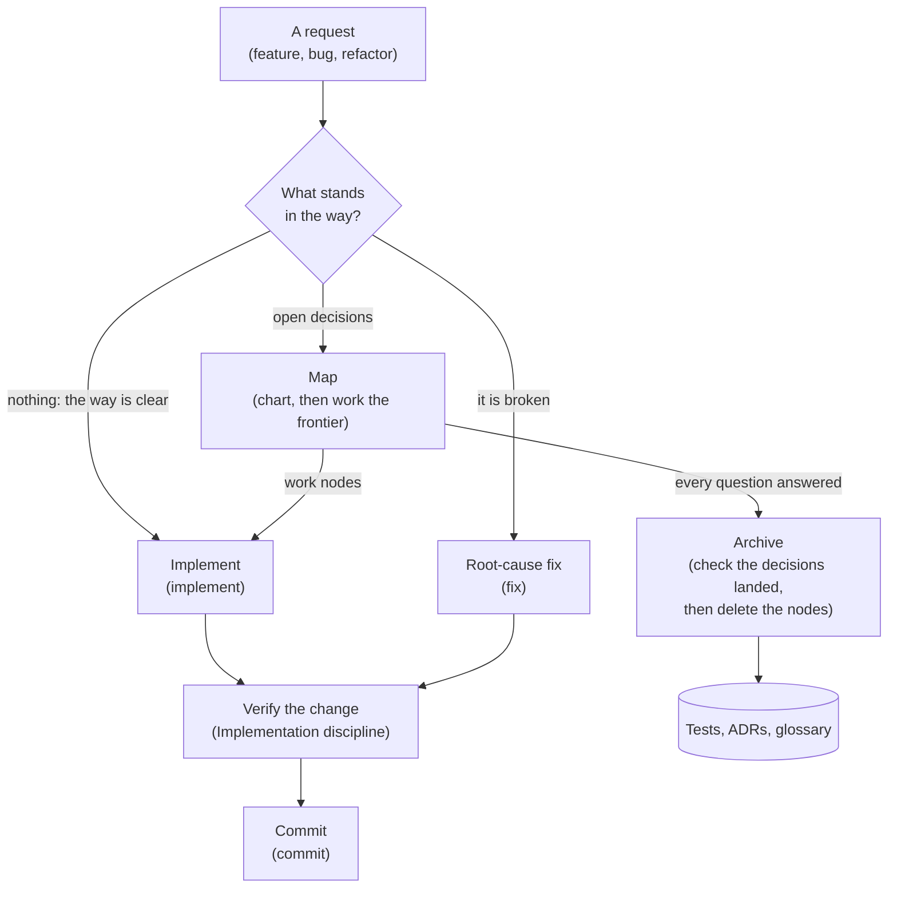

# ACStack workflows

*Every request ends with a verified commit. What changes is how many questions you settle first.*

ACStack routes a request by what stands in its way: nothing, a bug, or open decisions. Each box below links to the file that owns its rules.

| Box | Owner |
| --- | --- |
| Map | [`skills/map`](../skills/map/SKILL.md); questions through [`skills/grilling`](../skills/grilling/SKILL.md), decisions recorded by [`skills/record-context`](../skills/record-context/SKILL.md) |
| Implement | [`skills/implement`](../skills/implement/SKILL.md) |
| Root-cause fix | [`skills/fix`](../skills/fix/SKILL.md) |
| Verify the change | Implementation discipline, Review before commit, and Build verification in [`orchestrator/AGENTS.md`](../orchestrator/AGENTS.md) |
| Commit | [`skills/commit`](../skills/commit/SKILL.md) |
| Archive | [`skills/archive`](../skills/archive/SKILL.md) |

Project records live in the project folder; [config-reference.md](config-reference.md) explains where. Parallel work follows [concurrent-work.md](concurrent-work.md).

## Map vocabulary

A map is a set of small records called nodes. Nothing stores the map itself; it is queries over the nodes. ACStack never sorts requests into sizes: there is one path, and only the node count changes.

| Status | Meaning |
| --- | --- |
| `fog` | nobody can state it precisely yet |
| `open` | ready to settle |
| `claimed` | someone is working it |
| `resolved` | settled |
| `out-of-scope` | deliberately dropped |

- **`mode`**: who settles the node. `hitl` is a human; `afk` is an agent alone
- **`answers`**: the one node whose answer raised this one. These links form a tree, which gives a reading order
- **`blocked-by`**: nodes that must resolve before this one starts. These links never loop
- **frontier**: the `open` nodes with no unresolved blockers, ready to work now
- **residue**: what an effort leaves behind: tests, ADRs, and glossary entries

Kinds, labels, and the tracker contract are in [`skills/map/trackers/files.md`](../skills/map/trackers/files.md).
