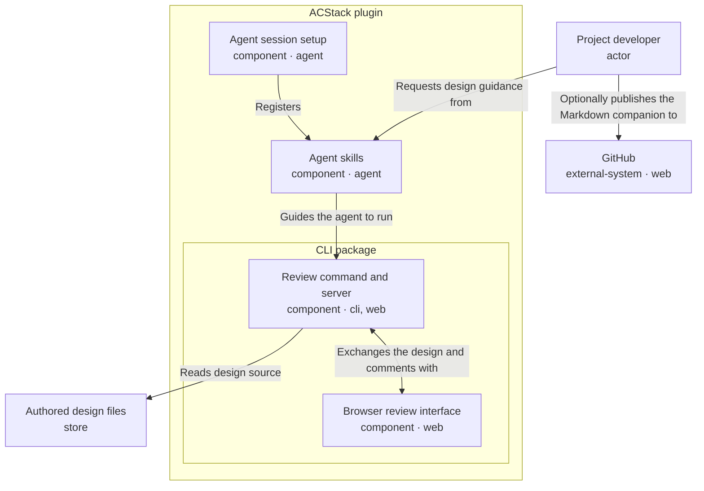

# ACStack design review

ACStack guides design authoring, saves browser feedback, reconciles optional map contributions, and records exact-revision approval with retained evidence.

<!-- Generated from the entry YAML and its element files; regenerate with design-doc --markdown -->

## Review the design before implementation

ACStack saves design feedback, reconciles comments and optional map contributions, and records human approval of the exact reviewed inputs.

This example keeps the existing architecture: Agent skills guide the agent; the Review command and server validate source and save review evidence. The Browser review interface shows the design and collects feedback and approval. Review the responsibilities, containment, and labeled arrows before implementation.

### Author, review, reconcile, and approve

1. The developer asks the agent to prepare a design through the Agent skills registered by Agent session setup
2. The agent writes the entry, element YAML, and supporting Markdown in one bounded directory tree
3. The agent runs `acstack design-doc design.yaml --markdown /tmp/acstack-design-review.md` with an unused output path and keeps the server running
4. The server validates source and serves the prepared graph with bundled browser assets; the browser never reads YAML directly
5. The developer saves comments, chooses Send to agent, and pastes the copied prompt into the agent session
6. The agent reads the saved review, revises source, and uses `acstack design-review status design.yaml` to inspect feedback and optional map contributions
7. The agent explicitly reconciles each selected comment and current contribution, then resolves blocking human questions or marks dropped scope out of scope
8. The agent reopens changed source for review; the human chooses Approve this revision once reconciliation is current
9. The agent requires `approval.valid: true` from status before implementation, then runs the separate implementation checks
10. At map closeout, archive verifies implemented functional requirements in living specs, architecture decision records (ADRs), and agreed glossary terms before disposing of temporary nodes

The developer can manually publish the generated Markdown companion to GitHub. Publication does not transfer browser comments or approval, and ACStack does not track that publication automatically.

### Approval belongs to exact inputs

- Approval binds `sourceRevision`, `reviewRevision`, `commentsDigest`, and `mapInputsDigest`, not the rendered page alone
- Each selected comment and current contribution needs one explicit disposition: `applied`, `retained`, or `needs-human`, with a rationale
- Unresolved blocking decisions or a `needs-human` disposition prevent approval; comments alone never authorize implementation
- Source, saved feedback, or meaningful contribution changes reopen the gate; presentation regeneration alone preserves approval

- Use `design-review status` for the current tuple and contribution keys
- Follow `skills/design-doc/SKILL.md` for the reconciliation schema and `design-review reconcile <entry> --input <json-file>`
- Select earlier feedback with `--review-file <canonical-review.json>` when reconciling that history
    - Original comments stay with their original version
    - Previously selected histories remain review obligations after later source changes

This revised example is a new draft requiring fresh human approval.

### Map binding is optional

This portable example has no map binding. A project can add `planning: {tracker: files | github, map: <name>}` and put `Design entry: <repository-relative-path>` in its map root. Node bodies supply explicit design contributions; the map does not become the architecture graph.

Bundled browser assets require no external fetch or design upload. Agent-side reads of a GitHub-bound map still need GitHub access. The diagram's GitHub arrow describes manual Markdown publication, not tracker synchronization.

### Archive preserves evidence; legacy import is explicit

- Archive checks current approval and reconciliation before closing a bound map
- Archive verifies implemented requirements against source and verification evidence
- Archive records qualifying ADRs and glossary terms
- Archive retains design sources, canonical reviews, import history, original legacy artifacts, and decision logs independently of node disposal

- Use `node walk`, `node frontier`, and `node diagram` for planning; ACStack retires `map --map` and `align-viewer` without aliases
- Import legacy feedback only through `design-review migrate` with an explicit target mapping
- Treat imported approval as historical; imported comments require reconciliation and fresh exact-revision approval
- Startup and archive never migrate automatically

### Local source and optional GitHub publication

- Authored design files are the local YAML and supporting Markdown read by the Review command and server
- GitHub hosts a published copy of the generated companion only when the Project developer chooses to share it
- Git ignore rules control ordinary tracking; they neither publish files nor prevent local browser review
- Both the Authored design files and GitHub drawers explain source ownership, published copies, and ignore rules

### Containment and arrows keep their existing meaning

The ACStack plugin contains Agent skills, Agent session setup, and the CLI package. The CLI package contains the Review command and server and the Browser review interface. The Project developer, Authored design files, and GitHub remain outside the plugin.

- Each component is one entity, shown collapsed or expanded
- Nesting means containment; arrows connect responsible entities, never ancestors to descendants
- Read one-way arrows as actor, action, and target: the server reads source, and the developer optionally publishes Markdown
- The bidirectional review-session arrow covers the prepared graph, posted comments, and retrieved comments
- Concerns describe shared requirements without changing containment

### Optional repository context

- Authoring, reconciliation, approval, and migration guidance: `skills/design-doc/SKILL.md`
- Local review and lifecycle commands: `cli/src/commands/design-doc.ts`
- Bounded source validation, graph, and Markdown generation: `cli/src/lib/design-doc.ts`
- Contributions and exact-input approval: `cli/src/lib/design-map.ts`, `cli/src/lib/design-lifecycle.ts`
- Saved review history and legacy imports: `cli/src/lib/design-review.ts`, `cli/src/lib/design-migration.ts`
- Closeout and evidence retention: `skills/archive/SKILL.md`

- Run the review command from this example directory with a built CLI
- Choose `--port <port>` if another review uses the default port
- Use an unused path for each Markdown export
- Keep the companion beside source when its relative links must work on GitHub
- New designs default to Git-ignored `.acstack/designs/`; this repository intentionally tracks this public example

## Project developer

*Authors the design and reviews the exported artifact locally.*

- Identity: `user`
- Kind: actor
- Channels: none
- Source: [user.yaml](user.yaml)

## ACStack plugin

*Ships agent skills, session setup, and a bundled CLI.*

- Identity: `acstack`
- Kind: component
- Channels: none
- Source: [acstack.yaml](acstack.yaml)

## Agent skills

*Guide the agent through authoring and exporting a design for review.*

- Identity: `skills`
- Kind: component
- Channels: agent
- Source: [skills.yaml](skills.yaml)

## Honest review status

- Requirement: An exported review artifact must not imply that a reviewer approved a map or implementation.
- Design response: Comments and exports are not approval. Approval requires reconciled feedback and contributions, resolved blocking questions, and the exact source, review, comments, and map-input tuple. Implementation checks remain separate.
- Applies to: skills, review-runtime, viewer

## Agent session setup

*Registers ACStack skill commands and adds rules for planning, coding, and checking changes to the agent's session.*

- Identity: `host`
- Kind: component
- Channels: agent
- Source: [host.yaml](host.yaml)

## CLI package

*Ships the review command, local server, and browser review interface.*

- Identity: `cli`
- Kind: component
- Channels: none
- Source: [cli.yaml](cli.yaml)

## Review command and server

*Reads and validates authored YAML, serves the browser review interface, saves comments, and exports Markdown.*

- Identity: `review-runtime`
- Kind: component
- Channels: cli, web
- Source: [review-runtime.yaml](review-runtime.yaml)

## Offline review

- Requirement: Reviewers can inspect the design without uploading project details or fetching browser assets.
- Design response: The review command and server read bounded local source files and embed validated graph data with bundled browser assets, without uploading the design. Agent-side reads of GitHub-bound maps still require network access.
- Applies to: review-runtime, viewer, design-source

## Honest review status

- Requirement: An exported review artifact must not imply that a reviewer approved a map or implementation.
- Design response: Comments and exports are not approval. Approval requires reconciled feedback and contributions, resolved blocking questions, and the exact source, review, comments, and map-input tuple. Implementation checks remain separate.
- Applies to: skills, review-runtime, viewer

## Browser review interface

*Receives the prepared design graph and syncs comments with the local server.*

- Identity: `viewer`
- Kind: component
- Channels: web
- Source: [viewer.yaml](viewer.yaml)

## Offline review

- Requirement: Reviewers can inspect the design without uploading project details or fetching browser assets.
- Design response: The review command and server read bounded local source files and embed validated graph data with bundled browser assets, without uploading the design. Agent-side reads of GitHub-bound maps still require network access.
- Applies to: review-runtime, viewer, design-source

## Honest review status

- Requirement: An exported review artifact must not imply that a reviewer approved a map or implementation.
- Design response: Comments and exports are not approval. Approval requires reconciled feedback and contributions, resolved blocking questions, and the exact source, review, comments, and map-input tuple. Implementation checks remain separate.
- Applies to: skills, review-runtime, viewer

## Authored design files

*Holds the local YAML and supporting Markdown that the review server reads.*

- Identity: `design-source`
- Kind: store
- Channels: none
- Source: [store.yaml](store.yaml)

Authored design files define the design in the local checkout; GitHub hosts a published copy only if the developer chooses to share it.

- Local files drive the review
    - The Review command and server read the local YAML and supporting Markdown to generate the browser view and Markdown companion
    - Revise these source files when the design changes
    - Local browser review and saved comments work without publishing design files to GitHub
- GitHub hosts a published copy
    - The Project developer can commit and push the generated companion for others to read on GitHub
    - The developer can publish the companion alone or include the authored source files
    - GitHub does not replace the local files read by the review server or automatically receive its saved comments
    - This diagram's publication arrow is separate from using GitHub issues as a map tracker
- Git ignore rules control tracking, not publication
    - Ignore rules exclude matching untracked files from ordinary staging
    - Removing an ignore rule does not stage, commit, or push anything
    - Already tracked files remain tracked even if an ignore rule later matches them
    - New project designs under `.acstack/` stay ignored by default; this public example is tracked separately

## Offline review

- Requirement: Reviewers can inspect the design without uploading project details or fetching browser assets.
- Design response: The review command and server read bounded local source files and embed validated graph data with bundled browser assets, without uploading the design. Agent-side reads of GitHub-bound maps still require network access.
- Applies to: review-runtime, viewer, design-source

## GitHub

*Hosts a published copy of the Markdown companion when the developer chooses to share it.*

- Identity: `github`
- Kind: external-system
- Channels: web
- Source: [github.yaml](github.yaml)

Authored design files define the design in the local checkout; GitHub hosts a published copy only if the developer chooses to share it.

- Local files drive the review
    - The Review command and server read the local YAML and supporting Markdown to generate the browser view and Markdown companion
    - Revise these source files when the design changes
    - Local browser review and saved comments work without publishing design files to GitHub
- GitHub hosts a published copy
    - The Project developer can commit and push the generated companion for others to read on GitHub
    - The developer can publish the companion alone or include the authored source files
    - GitHub does not replace the local files read by the review server or automatically receive its saved comments
    - This diagram's publication arrow is separate from using GitHub issues as a map tracker
- Git ignore rules control tracking, not publication
    - Ignore rules exclude matching untracked files from ordinary staging
    - Removing an ignore rule does not stage, commit, or push anything
    - Already tracked files remain tracked even if an ignore rule later matches them
    - New project designs under `.acstack/` stay ignored by default; this public example is tracked separately
