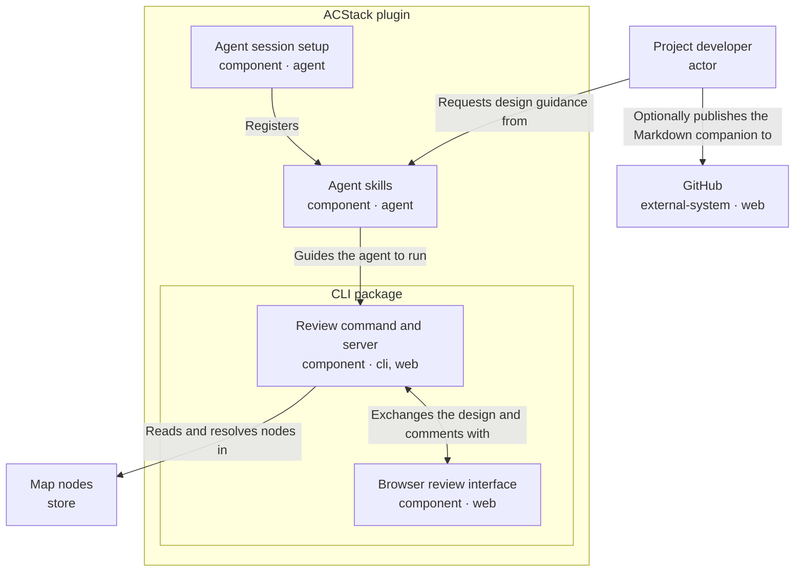

# ACStack design review

ACStack draws a design doc from a map, saves browser feedback, answers questions on the map, and records exact-revision approval.

<!-- Generated from the map's element nodes; regenerate with design-doc --markdown -->

## Review the design before implementation

ACStack draws a design doc from a map, saves review comments, writes the reviewer's answers back to the map, and records human approval of the exact reviewed inputs.

This example keeps the existing architecture: Agent skills guide the agent; the Review command and server read the map and save review evidence. The Browser review interface shows the design and collects comments, answers, locks, and approval. Review the responsibilities, containment, and labeled arrows before implementation.

### Author, review, reconcile, and approve

1. The developer asks the agent to prepare a design through the Agent skills registered by Agent session setup
2. The agent writes one `element` node per design element, each with a collapsed `Design element` block, and hangs questions off the elements they target
3. The agent runs `acstack design-doc <map> --check`, then `acstack design-doc <map>` and keeps the server running
4. The server reads the map through its tracker and serves the prepared graph with bundled browser assets
5. The developer answers questions beside their elements; each answer writes `## Answer` and resolves the question node
6. The developer saves comments, chooses Send to agent, and pastes the copied prompt into the agent session
7. The agent revises element nodes, picks up answer follow-ups at its next frontier recompute, and reconciles each comment
8. The developer locks settled elements, or approves the revision, which locks every loose element
9. The agent requires `approval.valid: true` from `acstack design-review status <map>` before implementation
10. At map closeout, archive verifies implemented functional requirements in living specs, architecture decision records (ADRs), and agreed glossary terms before disposing of temporary nodes

### Approval belongs to exact inputs

- Approval binds `sourceRevision`, `reviewRevision`, `commentsDigest`, and `mapInputsDigest`, not the rendered page alone
- Each comment needs one explicit disposition: `applied`, `retained`, or `needs-human`, with a rationale
- Any open node targeting an element, or a `needs-human` disposition, prevents approval
- Changed element nodes, saved feedback, or targeting nodes reopen the gate; presentation regeneration alone preserves approval
- Only the developer locks an element; an agent never does

### Containment and arrows keep their existing meaning

The ACStack plugin contains Agent skills, Agent session setup, and the CLI package. The CLI package contains the Review command and server and the Browser review interface. The Project developer, the Map, and GitHub remain outside the plugin.

- Each component is one entity, shown collapsed or expanded
- Nesting means containment; arrows connect responsible entities, never ancestors to descendants
- Read one-way arrows as actor, action, and target: the server reads the map, and the developer optionally publishes Markdown
- The bidirectional review-session arrow covers the prepared graph, posted comments, answers, and locks
- Concerns describe shared requirements without changing containment

### Optional repository context

- Authoring, reconciliation, and approval guidance: `skills/design-doc/SKILL.md`
- Local review and lifecycle commands: `cli/src/commands/design-doc.ts`
- Building the design from map nodes: `cli/src/lib/design-doc.ts`
- Tracker reads and writes, and exact-input approval: `cli/src/lib/design-map.ts`, `cli/src/lib/design-lifecycle.ts`
- Closeout and evidence retention: `skills/archive/SKILL.md`

## Project developer

*Authors the design and reviews the exported artifact locally.*

- Node: `002`
- Kind: actor
- State: loose
- Channels: none

## ACStack plugin

*Ships agent skills, session setup, and a bundled CLI.*

- Node: `003`
- Kind: component
- State: loose
- Channels: none

## Agent skills

*Guide the agent through authoring and exporting a design for review.*

- Node: `004`
- Kind: component
- State: loose
- Channels: agent

## Honest review status

- Requirement: An exported review artifact must not imply that a reviewer approved a map or implementation.
- Design response: Comments and exports are not approval. Approval requires reconciled comments, no open questions on the design, and the exact source, review, comments, and map-input tuple. Implementation checks remain separate.
- Applies to: 004, 007, 008

## Agent session setup

*Registers ACStack skill commands and adds rules for planning, coding, and checking changes to the agent's session.*

- Node: `005`
- Kind: component
- State: loose
- Channels: agent

## CLI package

*Ships the review command, local server, and browser review interface.*

- Node: `006`
- Kind: component
- State: loose
- Channels: none

## Review command and server

*Reads and validates the map, serves the browser review interface, saves comments, writes answers and locks to the map, and exports Markdown.*

- Node: `007`
- Kind: component
- State: loose
- Channels: cli, web

## Offline review

- Requirement: Reviewers can inspect the design without uploading project details or fetching browser assets.
- Design response: The review command and server read the map and embed validated graph data with bundled browser assets, without uploading the design. Reading and answering a GitHub map still needs network access.
- Applies to: 007, 008, 009

## Honest review status

- Requirement: An exported review artifact must not imply that a reviewer approved a map or implementation.
- Design response: Comments and exports are not approval. Approval requires reconciled comments, no open questions on the design, and the exact source, review, comments, and map-input tuple. Implementation checks remain separate.
- Applies to: 004, 007, 008

## Browser review interface

*Receives the prepared design graph and syncs comments with the local server.*

- Node: `008`
- Kind: component
- State: loose
- Channels: web

## Offline review

- Requirement: Reviewers can inspect the design without uploading project details or fetching browser assets.
- Design response: The review command and server read the map and embed validated graph data with bundled browser assets, without uploading the design. Reading and answering a GitHub map still needs network access.
- Applies to: 007, 008, 009

## Honest review status

- Requirement: An exported review artifact must not imply that a reviewer approved a map or implementation.
- Design response: Comments and exports are not approval. Approval requires reconciled comments, no open questions on the design, and the exact source, review, comments, and map-input tuple. Implementation checks remain separate.
- Applies to: 004, 007, 008

## Map nodes

*Holds the design as element nodes and the questions that target them.*

- Node: `009`
- Kind: store
- State: loose
- Channels: none

Map nodes define the design; GitHub hosts a published copy of the Markdown companion only if the developer chooses to share it.

- The map drives the review
    - The Review command and server read the element nodes through the map's tracker to generate the browser view and Markdown companion
    - Revise element nodes when the design changes
    - Answers and locks from the browser resolve map nodes through the same tracker
- GitHub hosts a published copy
    - The Project developer can commit and push the generated companion for others to read on GitHub
    - On the GitHub tracker the map itself lives in issues; this diagram's publication arrow is separate from that

## Offline review

- Requirement: Reviewers can inspect the design without uploading project details or fetching browser assets.
- Design response: The review command and server read the map and embed validated graph data with bundled browser assets, without uploading the design. Reading and answering a GitHub map still needs network access.
- Applies to: 007, 008, 009

## GitHub

*Hosts a published copy of the Markdown companion when the developer chooses to share it.*

- Node: `010`
- Kind: external-system
- State: loose
- Channels: web

Map nodes define the design; GitHub hosts a published copy of the Markdown companion only if the developer chooses to share it.

- The map drives the review
    - The Review command and server read the element nodes through the map's tracker to generate the browser view and Markdown companion
    - Revise element nodes when the design changes
    - Answers and locks from the browser resolve map nodes through the same tracker
- GitHub hosts a published copy
    - The Project developer can commit and push the generated companion for others to read on GitHub
    - On the GitHub tracker the map itself lives in issues; this diagram's publication arrow is separate from that
