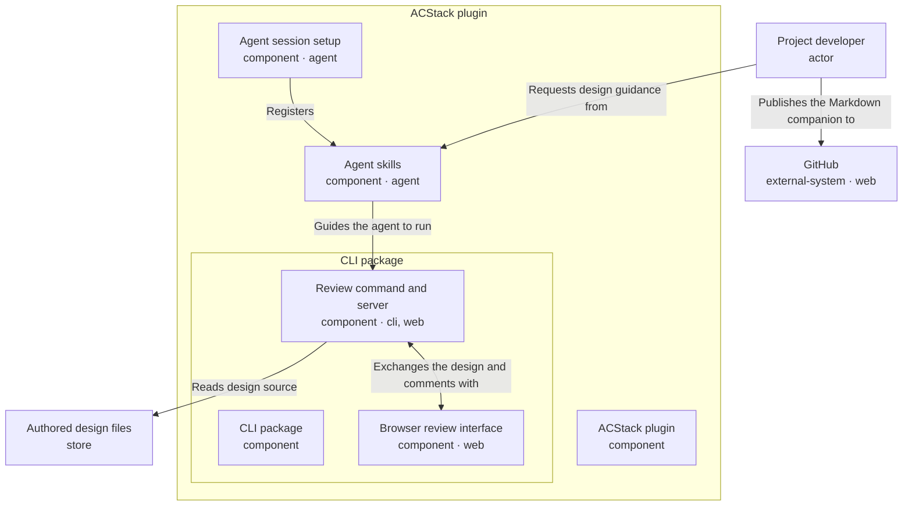

# ACStack design review

The design-doc skill guides authoring; the review command and server prepare a browser review with saved comments and a Markdown companion.

<!-- Generated from the entry YAML and its element files; regenerate with design-doc --markdown -->



## Review the authoring and local review workflow

ACStack guides design authoring and runs a local browser review with saved comments and a Markdown companion.

- The skill, review command and server, and browser review interface exist in this checkout
- This design asks reviewers to check their responsibilities, hierarchy, and labeled arrows
- Review the trade-off between saved local comments and reopening the review after each source change
- Review whether component details explain shared requirements without overwhelming the overview
- Map integration, durable approval, archiving, and legacy command removal remain deferred

### A developer authors, comments on, and revises a design

1. The project developer asks the agent to prepare a design document
2. Agent session setup registers skill commands and adds workflow instructions to the agent's session
3. The design-doc skill guides the agent to write the entry, element files, and supporting explanation
4. The agent runs `design-doc design.yaml --markdown review.md`
5. The review command reads the authored YAML through Node's filesystem API and validates containment, concerns, and mirrored relationships
6. The local server serves HTML containing the validated design graph and bundled browser review interface
7. The browser review interface reads the embedded graph, not the YAML files
8. The developer posts comments through the browser review interface
9. The browser sends comments to the local server with POST requests and retrieves saved comments with GET requests
10. The local server saves comments under `.acstack/design-reviews/`
11. The developer can manually publish the Markdown companion to GitHub
12. The developer chooses Send to agent and pastes the copied prompt into the agent session
13. The agent reads the saved comments, updates the authored design, and reopens the review

- Human feedback checks clarity; validation checks source consistency
- Saved comments record feedback, not approval of a map or implementation
- Source changes create a new review version; earlier comments remain with the earlier version
- The command refuses to overwrite the Markdown companion; each export needs an unused output path

### Architecture separates packaging from actions

- The ACStack plugin contains Agent skills, Agent session setup, and the CLI package
- The CLI package contains the Review command and server and the Browser review interface
- The CLI package describes what ships; its two children describe what runs
- Each component is one entity, represented by a collapsed card or an expanded container
- The Project developer, Authored design files, and GitHub remain outside the plugin
- The document overview explains the workflow; it is not an architecture entity
- Nesting expresses containment; arrows never connect an ancestor to its descendant
- One-way arrows name the acting entity first
    - Agent skills → Guides the agent to run → Review command and server identifies the executable, not its package
    - Review command and server → Reads design source → Authored design files describes a read dependency, not the direction of returned data
    - Project developer → Publishes the Markdown companion to → GitHub describes manual publication, not a CLI upload
    - Project developer → Requests design guidance from → Agent skills describes the request, not a bidirectional approval exchange
- One bidirectional arrow describes the review session
    - The arrow between Review command and server and Browser review interface covers the initial page and comment requests
    - The prepared graph flows from the command and server to the browser
    - Posted comments flow back to the server for saving; saved comments return to the browser
- Offline review and Honest review status span multiple entities without changing their containment
- Kinds identify entities, channels identify interactions, and concerns explain shared requirements

### Optional repository context

- `skills/design-doc/SKILL.md` guides design authoring and local review
- `pi/extension.ts` registers skills, injects guidance, and links the CLI on pi
- `hooks/session-start.sh` links the CLI and injects guidance on Claude Code
- `cli/src/commands/design-doc.ts` opens the local review and exports the Markdown companion
- `cli/src/lib/design-doc.ts` validates authored source and derives the graph and Markdown
- `cli/src/lib/review-server.ts` serves the page and handles saved comments
- `cli/src/lib/alignment-pack-renderer.ts` embeds the shared offline viewer
- `cli/src/viewer/alignment-graph.ts` lays out nested components
- `cli/src/viewer/drawer.tsx` shows supporting Markdown and concern explanations

### Open a local review

- Run from this example directory with a built CLI
- Choose an unused Markdown output path for each export
- Keep YAML and supporting Markdown as the source of design facts

```sh
~/.claude/acstack/bin/acstack design-doc design.yaml \
  --markdown /tmp/acstack-design-review.md
```


## Project developer

*Authors the design and reviews the exported artifact locally.*

- Identity: `user`
- Kind: actor
- Channels: none
- Source: [user.yaml](user.yaml)


## ACStack plugin

*Ships agent skills, session setup, and a bundled CLI.*

- Identity: `acstack`
- Kind: component
- Channels: none
- Source: [acstack.yaml](acstack.yaml)


## Agent skills

*Guide the agent through authoring and exporting a design for review.*

- Identity: `skills`
- Kind: component
- Channels: agent
- Source: [skills.yaml](skills.yaml)

## Honest review status

- Requirement: An exported review artifact must not imply that a reviewer approved a map or implementation.
- Design response: The browser review interface labels the design as a review artifact; durable approval and map reconciliation remain deferred.
- Applies to: skills, review-runtime, viewer

## Agent session setup

*Registers ACStack skill commands and adds rules for planning, coding, and checking changes to the agent's session.*

- Identity: `host`
- Kind: component
- Channels: agent
- Source: [host.yaml](host.yaml)


## CLI package

*Ships the review command, local server, and browser review interface.*

- Identity: `cli`
- Kind: component
- Channels: none
- Source: [cli.yaml](cli.yaml)


## Review command and server

*Reads and validates authored YAML, serves the browser review interface, saves comments, and exports Markdown.*

- Identity: `review-runtime`
- Kind: component
- Channels: cli, web
- Source: [review-runtime.yaml](review-runtime.yaml)

## Offline review

- Requirement: Reviewers can inspect the design without uploading project details or fetching browser assets.
- Design response: The review command and server read bounded local source files and embed validated graph data with the bundled browser review interface.
- Applies to: review-runtime, viewer, design-source

## Honest review status

- Requirement: An exported review artifact must not imply that a reviewer approved a map or implementation.
- Design response: The browser review interface labels the design as a review artifact; durable approval and map reconciliation remain deferred.
- Applies to: skills, review-runtime, viewer

## Browser review interface

*Receives the prepared design graph and syncs comments with the local server.*

- Identity: `viewer`
- Kind: component
- Channels: web
- Source: [viewer.yaml](viewer.yaml)

## Offline review

- Requirement: Reviewers can inspect the design without uploading project details or fetching browser assets.
- Design response: The review command and server read bounded local source files and embed validated graph data with the bundled browser review interface.
- Applies to: review-runtime, viewer, design-source

## Honest review status

- Requirement: An exported review artifact must not imply that a reviewer approved a map or implementation.
- Design response: The browser review interface labels the design as a review artifact; durable approval and map reconciliation remain deferred.
- Applies to: skills, review-runtime, viewer

## Authored design files

*Persist the entry, per-element YAML, and supporting Markdown in Git.*

- Identity: `design-source`
- Kind: store
- Channels: none
- Source: [store.yaml](store.yaml)

## Offline review

- Requirement: Reviewers can inspect the design without uploading project details or fetching browser assets.
- Design response: The review command and server read bounded local source files and embed validated graph data with the bundled browser review interface.
- Applies to: review-runtime, viewer, design-source

## GitHub

*Displays the generated Markdown companion during manual review.*

- Identity: `github`
- Kind: external-system
- Channels: web
- Source: [github.yaml](github.yaml)
