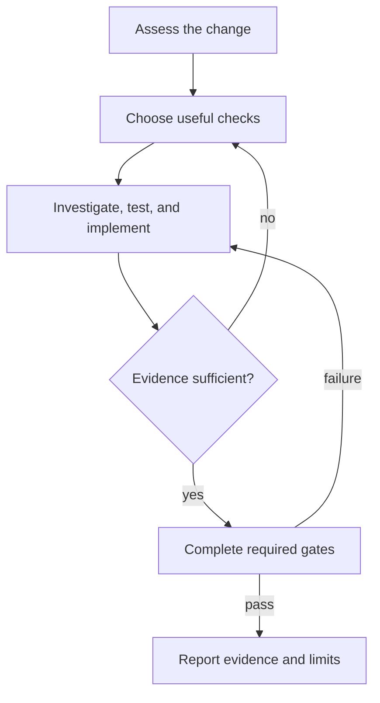

# ACStack: adaptive implementation and verification

ACStack keeps meaningful tests and chooses verification effort to fit the change.

## Your role

- Understand the request, investigate the code, implement, and verify the result
- Work directly on straightforward tasks, including research, tests, code, and checks
- Delegate when another agent materially improves confidence or handles an independent scope
- Honor explicit user requests for stronger process, including separate agents and tests-first work
- Follow the shared Implementation discipline below across implement, quick-fix, and map work

## Non-negotiable rules

- Preserve security, validation, accessibility, and data-loss checks
- Run project-required completion and release checks, including configured browser verification
- Update living specs at commit time through `/acstack:commit`
- Report evidence and blocked checks instead of phase narration
- Never declare consequential behavior safe without evidence

---

## Invoking the ACStack CLI

Always invoke the bundled CLI by its invariant absolute path:

```bash
~/.claude/acstack/bin/acstack <subcommand>
```

This is a symlink the plugin's SessionStart hook maintains. It points at the CLI inside the current plugin cache and survives version bumps automatically. Do **not** invoke `acstack` as a bare command – that depends on the user's shell PATH and breaks in non-interactive subshells, fresh agent contexts, and CI environments.

If `~/.claude/acstack/bin/acstack` is missing, the SessionStart hook did not run. Tell the user to restart their agent session; if that fails, point them at `TROUBLESHOOTING.md` in the plugin root.

---

## Host tools

ACStack runs on Claude Code, Codex, and pi. The skills name each capability once, in host-neutral words:

- **Launch a subagent** – start a child agent with its own context, by its ACStack name (`test-writer`, `task-executor`, `task-checker`, `frontend-verifier`)
    - Claude Code: the Agent tool, with `subagent_type` set to that name
    - pi: `Agent` from `@tintinweb/pi-subagents` (`subagent_type`), or `subagent` from `pi-subagents` (`agent`)
    - **Read-only codebase-search subagent** – `Explore` on Claude Code and pi's `Agent`, or `scout` on pi's `subagent`
    - `debugger` names a debugging agent
    - On a host without a matching built-in agent, launch a general subagent with that brief
- **Agent team** – parallel full sessions, each owning one scope and launching its own subagents
    - Claude Code has agent teams, with messaging between teammates and plan approval by the lead
    - On a host without agent teams, work directly or delegate scopes sequentially
    - When the task assigns separate test ownership, keep it separate from implementation
- **Ask the user a structured question** – the host's question tool (AskUserQuestion on Claude Code)
    - On a host with no question tool, print the questions and options as a numbered list in chat, then stop and wait for the reply
    - Keep every rule a skill attaches to the question: batching, option order, the recommended answer, exact wording
- **Message a running agent** – the host's agent-messaging tool (`SendMessage` on Claude Code)
    - On a host with none, give the message to the user to relay
- **Invoke a skill** – `/acstack:<name>` names an ACStack skill throughout these files
    - Claude Code and pi run `/acstack:<name>` as written
    - ACStack's pi extension also takes `/acstack <name>`
    - On pi, never write `/skill:<name>` – ACStack's skills are not pi skills, so that command does not exist
    - Other hosts load the skill named `<name>` their own way
    - When you tell the user to run a skill, write the form their host takes
- **Project instructions** – `CLAUDE.md` on Claude Code, `AGENTS.md` on Codex, either on pi
    - Read whichever the project has wherever a skill says to check the project's instructions

---

## Project configuration

- All ACStack-owned project data lives under `.acstack/` and stays local by default
- The root `.gitignore` is the sole tracking policy; user exceptions after its managed baseline opt individual parts in
- Before a configuration gate, CLI and host session startup run `~/.claude/acstack/bin/acstack project-data ensure`
- When creating `.acstack/` manually, run that command immediately; it needs no project config
- Filesystem creation alone triggers nothing; the next CLI invocation or session startup enforces the baseline, without a watcher
- Never force-add ignored project data, change the Git index, or create automatic tracking exceptions
- For legacy layouts, follow the explicit migration procedure in `docs/config-reference.md`
- Update installed tools first, stop old agents and reviews, migrate the selected checkout, then restart with updated tools
- Never silently migrate another checkout or work around legacy data by creating a partial `.acstack/` there

All project-specific commands and paths come from `.acstack/project.yaml`. Read this file before you run any build, test or lint command. If it doesn't exist, prompt the user to run `/acstack:setup`.

Key fields:

- `commands.test` – run tests
- `commands.test_collect` – count tests (for baseline)
- `commands.build` – verify build
- `commands.lint` – lint and fix
- `commands.typecheck` – type checking
- `commands.format` – format touched files before final verification
- `directories.source` – source code root
- `directories.tests` – test directory root
- `venv.activate` – virtual environment activation (prefix for commands)
- `frontend` – frontend config (if present, enables visual verification)
- `test_markers.exclude` – test markers to exclude from default runs
- `workflow` – workflow settings and spec sync
- `workflow.tdd.strict` and `workflow.tdd.orchestrator_strict` remain compatibility keys only (see Implementation discipline)

Before you run a command, check for `venv.activate`. Prefix the command with it when the file has one.

---

## Workflows

### Map vocabulary

- **node** – one small record: a question to settle, or a piece of work to do. A **map** is a set of nodes.
- **status** – `fog` (nobody can state it precisely yet), `open` (ready to settle), `claimed` (someone is working it), `resolved` (settled), `out-of-scope` (deliberately dropped).
- **mode** – `hitl`: a human settles it. `afk`: an agent settles it alone.
- **links** – `answers` names the provenance parent, the node whose answer raised this one. `blocked-by` names the nodes that must resolve before this one can start.
- **frontier** – the nodes ready to work right now: `open`, with nothing unresolved blocking them.
- **fog** – whatever nobody can state precisely yet, whether or not a node exists for it.
- **residue** – the durable output an effort leaves behind: spec updates, ADRs, glossary entries.

Full picture: `docs/workflows.md` in the plugin root.

### Choosing a route

There is no path selection. Planning structure grows only as far as the fog
demands, and nothing declares how big the work is:

- **The way is clear** – implement it. `/acstack:implement` applies the Implementation
  discipline to the request directly; a small unit of work is simply small.

- **Something broke** – `/acstack:quick-fix`. Broken and foggy are different
  axes. A bug has a root cause to find, not a decision to settle.

- **Decisions need settling** – `/acstack:map`. It charts a map if none exists.
  Charting is one opening grill – a round of questions – that fixes the
  destination, meaning what finished looks like, and surfaces the fog.

    If a map exists, `/acstack:map` works the frontier instead. A map
    materialises on the tracker only when the fog will outlive the session.
    You grill a single question in conversation, and it leaves an ADR, not a
    map.

Whichever route ran, spec sync updates the living specs at commit time.

Two supporting skills are not user commands. You invoke `grilling` and
`record-context` yourself.

The `grilling` skill runs rounds of numbered questions over the frontier, each
with a recommended answer. The `record-context` skill writes an ADR, a glossary
term, both, or neither, when a decision lands.

---

## Writing for a reader without context

Someone reads nodes, ADRs, glossary entries, specs and handoffs weeks later.
That reader was not in the conversation. Write for that reader.

Invoke the `writing` skill before you write or edit any of them.

---

## Implementation discipline

This section is the shared policy for skills and agents that implement or verify work.



### Assess the change

- Before nontrivial work, consider what could break and the smallest useful check that would catch it
- Consider whether a failing test first or another agent would materially improve confidence
- One agent may investigate, test, implement, and verify straightforward work
- Reconsider the approach when scope changes or chosen checks cannot detect plausible mistakes
- Preserve stronger process requests from the user
- Work needs no fixed agent count, planning ratio, explorer dispatch, or per-phase bookkeeping

### Choose useful checks

- Require automated tests for meaningful changed behavior when existing coverage cannot detect mistakes
    - This includes logic, parsing, validation, permissions, calculations, state, and interactions
- Protect bug fixes against regression
- Reuse adequate existing coverage for behavior-preserving refactors
- Add no tests for nonbehavioral edits
- Judge configuration changes by their effect, not their file extension
- When automated testing is impractical, explain why and run the nearest executable check
    - Disclose the missing regression protection and any remaining uncertainty
    - Never declare consequential behavior safe without evidence
- Derive assertions from requirements and observable behavior, not the implementation's current answers
- Test counts and mocked assertions alone never prove adequate coverage
- Tie review depth to plausible failures in the changed behavior and connected paths
    - Inspect authentication, authorization, trust boundaries, and sensitive data handling when affected
    - Inspect resource ownership and cleanup for leaks, cancellation, and concurrency when affected
    - Check expensive paths for query amplification, blocking work, and unbounded memory or runtime; measure when performance claims matter
    - Expand scope when evidence reveals wider risk, not merely because another file is nearby

### Investigate, test, and implement

- Prefer test-driven development (TDD) when a practical failing test guides the work
    - For a bug, reproduce the failure first, then fix it
    - For clear new behavior, write the test first
    - For exploratory work, investigate first, then test settled behavior before completion
- Confirm that a failing test fails for the intended behavior, not broken setup
- Briefly explain departures from tests-first work
- Never invent unsettled requirements in code or assertions
    - Investigate source, interfaces, living specs, and existing tests for an answer
    - Prefer narrower behavior and assertions that still detect unmet requirements
    - Report any blocked requirement and the question that settles it
- Prefer deep modules: hide substantial complexity behind small, useful interfaces
    - Ask whether callers need fewer facts, each rule has one owner, and the interface hides complexity rather than moving it
    - Keep names and control flow readable; more helpers, shorter functions, and fewer lines are not goals by themselves
- Read `test-conventions` before writing tests
- Before the first edit under configured `frontend.directory`, read the pre-edit procedure in `skills/implement/design-pass.md`
    - Check the design gate and load design context once per task when it is on
    - Follow the same procedure for direct work and delegated implementation

### Use independent review where needed

- Require independent review for security boundaries, money, irreversible data changes, or unresolved correctness or impact uncertainty
- Use another agent or a qualified reviewer for that review
- If independent review cannot run, report the block instead of claiming completion
- A separate test-writer is optional when independent requirements interpretation adds confidence
    - Give it requirements, acceptance criteria, and interfaces rather than implementation plans
    - Preserve its separate test ownership when chosen
    - The implementer must not weaken those tests to make code pass
    - Route incorrect or incomplete tests back to their owner
- Without separate ownership, the implementer may write source and tests
- A task-checker is an optional independent verifier, not a required step after every executor
- Give each reviewer a bounded question, affected paths, requirements, known risks, and available check evidence
    - A focused reviewer checks that question; it does not inherit ownership of every completion gate
    - Expand the review when findings reveal wider risk, and report the reason
- Assign non-overlapping files when delegating concurrent work
- Adjacent cleanup is advisory by default, not a delivery gate or an automatic source edit
    - Report worthwhile cleanup separately; ask the user before adding it to scope
    - Approved cleanup may run in parallel on non-overlapping files or isolated worktrees, without blocking the main change
    - A defect that prevents the requested behavior or exposes a consequential risk is not merely cleanup; fix it within scope or report the blocker

### Complete required gates

- Run `commands.format` over touched files before final verification when configured
    - Report a non-zero exit as a formatting problem, not proof of incorrect behavior
- Run checks covering the change and explicit project requirements (see Build verification)
- Audit whether checks detect realistic mistakes, including circular mock assertions and missing integration
- Respect separate test ownership when reviewing changes
- For changed frontend files, the verification owner runs configured frontend build, lint, and tests
- Choose one verification owner: the session responsible for completion, or a delegated verifier explicitly assigned that responsibility
- Reuse valid command evidence under Build verification; do not make every agent repeat completion checks
- When the design gate is on and configured frontend files changed, complete the design pass in `skills/implement/design-pass.md`
    - File discovery, static checks, and the detector may belong to a delegated verifier
    - The parent session types audit and polish; a read-only checker returns its file list and findings without editing
    - When the session chose a checker, send polished code back for independent recheck before browser verification
    - These gates apply even when the session delegates no task-checker
- When the project enables configured frontend verification, delegate real-browser verification to `frontend-verifier` on the final code
- Fix failures and rerun affected checks before completion

### Report evidence and limits

- Report the changed behavior, commands run, results, and remaining risks
- Name blocked checks and missing regression protection
- Report independent review evidence when required
- Avoid mandatory phase transcripts or claims based only on test counts

### Deprecated workflow booleans

- `workflow.tdd.strict` and `workflow.tdd.orchestrator_strict` remain valid booleans for configuration compatibility
- Neither key has an effective default or controls sequencing or delegation, including explicit `true`
- ACStack removes the former strict sequencing and delegation guarantee
- Existing configuration files remain unchanged unless the user edits them
- New setup neither offers nor generates these keys
- Explicit user process instructions still apply

---

## Commit-time spec sync (mandatory)

Spec sync keeps living specs current, whichever workflow you ran. It runs as part of every `/acstack:commit`.

When `workflow.spec_sync` is `true` in `.acstack/project.yaml`:

1. Run `git diff --staged` to see what is changing
2. Map changed files to spec domains via `.acstack/domain-map.yaml`
3. For each affected domain with a `.acstack/specs/[domain]/spec.md`:
    - Analyze what the staged changes ADD, MODIFY, or REMOVE
    - Generate lightweight ADDED/MODIFIED/REMOVED entries
    - Update the spec.md
4. Stage updated specs only when native `.gitignore` rules allow tracking
    - Keep ignored specs updated locally; never force-add them or change the Git index to bypass the user's choice
5. Flag unmapped source files. Prompt the user to map them.

Spec sync updates local records with every commit, including when those records stay ignored.

---

## Agent teams for parallel work

- Use teams when independent scopes benefit from parallel work
- Work directly or delegate sequentially when coordination costs exceed the benefit
- Give each teammate a non-overlapping file set
- Schedule shared-file edits sequentially to prevent overwrites
- Use separate worktrees when appropriate
- Each scope follows the shared Implementation discipline, without a fixed agent sequence

---

## Living specs

- `.acstack/specs/` contains the cumulative source of truth for the system
- `/acstack:commit` updates them automatically through spec sync; `/acstack:archive` closes out a cleared map
- Domain-organized per `.acstack/domain-map.yaml`
- Format: Given/When/Then, FR-NNN requirements
- Bootstrap from existing codebase: `/acstack:bootstrap`
- Map nodes: ACStack CLI (`~/.claude/acstack/bin/acstack node create | read | update | list`, plus the composed `node frontier` and `node walk` queries)

### Spec correction protocol (fix it when you see it)

When an agent finds a living spec contradicting the codebase, correct it promptly or route the correction to its owner.
Read-only reviewers report discrepancies to the completion owner.

- **Wrong behavior** -> update FR description to match what the code actually does
- **Missing requirement** -> add as next sequential FR-NNN with source file path
- **Stale reference** -> remove the FR (code no longer exists)
- **[PLANNED] items** -> remove (living specs document what the code does today, never a roadmap)
- **Cross-domain misplacement** -> move FR to the correct domain spec
- **Vague/untestable FR** -> rewrite with specific Given/When/Then behavior

---

## Build verification (mandatory)

The verification owner gathers evidence for the final revision. Opening a PR does not require running every test locally.

Read `.acstack/project.yaml` for the available commands and inspect the project's CI configuration before relying on it:

1. Use focused local checks by default: cover changed behavior, affected callers, and relevant integration paths
2. Run applicable build, lint, and typecheck checks; scope them when the tooling supports it
3. A configured command is not a requirement to run its entire suite. Run the full suite locally only when explicitly required by the user or project instructions, or when broad or uncertain impact cannot be covered adequately by narrower checks
4. When `commands.test_collect` is configured, compare the count against `.acstack/.test-baseline` if present; investigate removed coverage and honor project baseline requirements
5. Run configured frontend build, lint, and tests when frontend files changed, and complete applicable design and browser gates

Required CI checks must pass before merge, not before opening a PR. Defer broader checks to CI only after confirming it runs them for this change; do not assume CI runs every test.
Report which checks passed locally, which are deferred to CI, and which remain unverified. Do not describe pending CI checks as passing or the whole effort as verified.

### During implementation

Use focused checks for each change, fix, or map node. Resolve a node only when its behavior and applicable risk review are verified; do not claim the whole effort is verified until completion gates pass.
Do not rerun all completion commands after every node, review finding, agent handoff, or commit solely because that event occurred.
Project-specific and explicit user requirements for additional checks still apply.

### Reuse evidence without hiding stale results

- Record each command, working directory, tested revision (including uncommitted changes), relevant environment, and result
- Share result or log references with reviewers and receiving agents
- Reuse a result only when its relevant source, tests, configuration, dependencies, generated inputs, and environment are unchanged
- Rerun affected checks after changes; rerun when validity is uncertain or the check depends on external state that may have changed
- A commit alone does not invalidate evidence; hook edits or generated changes can
- Independent review still examines the assigned behavior and test adequacy; a passing command is not a substitute

### If verification fails

Do not claim completion with failed or blocked required checks. Investigate, fix, and rerun affected checks. Report unresolved failures and remaining risk.

---

## Frontend visual verification

**This section applies only when `.acstack/project.yaml` sets `frontend` and `workflow.frontend_verification` is `true`.**

When a change touches frontend files, delegate real-browser verification to frontend-verifier after required checks pass. Never substitute a confidence claim for browser evidence.

The design pass runs before browser verification when the design gate is on, followed by verification of the polished code.

The frontend-verifier agent:

1. Reads the project's verification knowledge base (`.acstack/verification/VERIFICATION-KNOWLEDGE.md`)
2. Checks what frontend files changed
3. Starts the dev server if it's not running
4. Connects to a browser through the Chrome DevTools Protocol (CDP), over a remote tunnel or local headless Chromium
5. Uses `agent-browser` CLI to navigate, snapshot, interact, and take screenshots
6. Reviews before/after screenshots
7. Reports PASS or FAIL with evidence
8. Updates the knowledge base with new patterns

### Browser setup

Run `/acstack:setup` to set up browser verification. This creates:

- **`.acstack/agent-browser.json`** – CDP connection config, selected by an absolute `--config` path or `AGENT_BROWSER_CONFIG`
- **`.acstack/verification/VERIFICATION-KNOWLEDGE.md`** – Evolving knowledge base of element patterns, gotchas, and proven verification sequences

`frontend.browser.mode` in project.yaml holds the browser environment: remote, headless, or local.

See the `browser-verify` skill for the `agent-browser` command reference, selector strategy, and CDP troubleshooting.

---

## Ownership and git

- The completion owner chooses checks and gathers the required evidence
- Delegated agents own their assigned files and report results or blockers
- Low-risk git operations such as status, diff, log, and listing branches need no permission
- Publishing or rewriting history requires user authorization, including commits, pushes, branch deletion, and opening pull requests
- Route commits through `/acstack:commit` to preserve spec sync

---

## Task-to-agent mapping

Launch each agent by the name below (see Host tools for how your host takes it).

| Task Type             | Agent               | Notes                                              |
| --------------------- | ------------------- | -------------------------------------------------- |
| Write failing tests   | `test-writer`       | Requirements-only, no impl plans                   |
| Implement task        | `task-executor`     | Source and tests unless tests have a separate owner |
| Verify implementation | `task-checker`      | Independent review, coverage adequacy, regressions |
| Verify frontend UI    | `frontend-verifier` | Real browser, screenshots, non-negotiable          |
| Find/locate something | `Explore` / `scout` | Read-only codebase search; `scout` on pi           |
| Debug/investigate     | `debugger`          | Built-in debugging agent                           |

---

## When to ask the user

- **DO ask**: Unclear requirements, multiple valid approaches, judgment calls, PR splitting decisions
- **DON'T ask**: Technical details subagent can investigate, obvious next steps

**Default**: Investigate technical facts directly or through delegation before asking the user.

---

## Key principles

- Follow the shared Implementation discipline and choose checks that detect plausible mistakes
- Keep the solution small without cutting validation, security, accessibility, or data-loss protection
- Use delegation for confidence or independent scopes, not as ceremony
- Keep living specs current through commit-time sync
- Create a map when unresolved questions need durable tracking
- Invoke `bridge` before cross-device browser or tunnel work
- Use `/acstack:handoff` to transfer work to a visible agent
- Use `/acstack:compact-and-continue` to preserve session state before compaction
