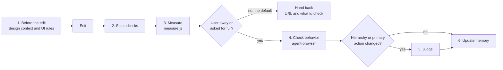

# Frontend verification

Frontend work is quick by default: load the rules, edit, run the quick checks, then hand the page to the user to look at. The agent drives the browser itself only when the user is away.



## Choose the mode

The mode belongs to the session, or to the team when several agents work together. Set it at the first frontend change, say which in one line, and keep it for later tasks until the user signals otherwise. A team lead sets it and states it in each teammate's brief; teammates use the lead's mode and never ask.

- **Hand back (default)**: steps 1 to 3, then hand back. No behavior driving, no screenshots, no judge, no `frontend-verifier`
- **Full**: steps 1 to 6 with no hand-back. Use it only when the user signals they will be away
    - They say so: "do everything", "only come back when it is done", "work through the whole map"
    - The work is a long autonomous run, such as afk map nodes or an overnight batch
- When the signal is unclear, ask one question before the first frontend change of the session (the host's question tool), with hand back as the recommended answer
- Switch when the user's signal changes, such as "I'm heading out, finish it" or "I'm back"

The parent session runs steps 1 to 3. In full mode, steps 4 to 6 run in the parent, or in the `frontend-verifier` agent when the project sets `workflow.frontend_verification: true`.

## Hand back

Leave the dev server running on `127.0.0.1` and end with a short message:

```text
Ready to check: http://127.0.0.1:<port>/<page>
- <the one or two behaviors the change is for, e.g. "Save shows Saving, then Saved">
- <anything measure.js flagged as intended or could not judge>
- <a narrow-width or state to try, when the change affects one>
Quick checks: build, lint, test, measure.js <pass, or what is open>
```

Keep it to what only a person looking at the page can confirm, three or four items at most. Fix any measure.js violation before handing back unless it is intended.

## Project configuration

The project folder is the path `~/.claude/acstack/bin/acstack project-data path` prints. `<project folder>/project.yaml` may set:

- `frontend.directory` (default `frontend/`), `frontend.dev_server_url`, `frontend.dev_server_check`, and `frontend.commands.dev|build|lint|test`
- `workflow.frontend_verification: true`, which makes the `frontend-verifier` agent run on final frontend code in full mode
- `workflow.design_review`, the design gate that adds impeccable's checks (see [`impeccable.md`](impeccable.md))
- `frontend.browser.mode`, `frontend.browser.fallback`, and `frontend.browser.cdp_port`, used only for a real-Chrome connection (see Browser choice)

Without configuration, the rules, measure.js, and agent-browser still work by hand. Do not create configuration for general work. Report an unreadable or invalid file instead of treating it as absent.

## 1. Before the edit: design context and UI rules

Load design context once per task, before your first edit under `frontend.directory`. When the design gate is on, follow step 0 of [`impeccable.md`](impeccable.md). Token values live in the project's design system; these rules are generic.

- A different font, font size, or weight needs a purpose: emphasis, de-emphasis, or hierarchy
    - Reuse the project's font family and a small type scale; equivalent text uses identical typography
- Use the spacing scale (shared tokens or repeated gaps and padding); a one-off offset usually hides a layout error
- Give same-role siblings (bar buttons, list rows) equal padding and height
- Align related elements to shared edges or baselines; use consistent indentation to show hierarchy
- Center status text and controls on the same row, including inside nested action groups; a centered parent does not align its children
- Nothing jiggles: a state change (label, pending, error, hover) must not move or resize anything it does not mean to
    - Reserve space for changing labels and for scrollbars, so overflow never shifts text or rewraps lines
- Content fills its component's width with equal horizontal padding; text wraps only after filling it, and no last line holds a single word
- Make hierarchy and the primary action obvious without explanation
- Render dropdown menus with the shared project component and tokens, never browser-native option menus or per-screen copies
    - Keep keyboard navigation (arrows, Home/End, Enter/Space, Escape, Tab), screen-reader semantics, visible focus, dismissal, and viewport fit
- No text overlaps other text or is clipped by its box
- Match whitespace to the screen's purpose: generous on a marketing or simple page, tight on a dense tool or data view
- Meet WCAG AA contrast and a 24x24px minimum target size

## 2. Static checks

When configured frontend files changed (`git status --porcelain -- <frontend.directory>`, including untracked files and excluding deletions), run the configured `frontend.commands.build`, `lint`, and `test`. When the design gate is on, run the detector, audit, and polish in [`impeccable.md`](impeccable.md) before browser work.

## 3. Measure

`measure.js` (beside this file) reads computed styles and geometry in the page and reports violations. Run it first; it is cheaper and more exact than reading screenshots.

Start the dev server bound to `127.0.0.1` when it is not running. In full mode, stop it at the end when you started it; in hand-back mode, leave it running for the user.

```bash
MEASURE="<this skill's directory>/measure.js"
agent-browser open <dev_server_url>/<page>
agent-browser eval --stdin < "$MEASURE"                                 # whole page
agent-browser eval "acstackMeasure.run({scope: '[data-testid=panel]'})"  # the changed region
```

Loading the file defines `window.acstackMeasure` and returns a report for `<body>`. Navigation clears it, so load it again after `open` or a reload.

| Rule | What it reports |
|---|---|
| `type-size`, `type-family`, `type-weight` | Text off the scale; `distinctFontSizes` lists the sizes in the region, and each needs a purpose |
| `spacing` | Padding, vertical margin, or gap off the spacing scale |
| `sibling-padding`, `sibling-height` | Same-role siblings with unequal padding, or unequal height within one row |
| `edge` | Sibling left or right edges within 4px of each other but not equal |
| `uneven-gap` | Three or more same-role siblings in one row or column with unequal gaps |
| `overlap`, `clipped` | Text drawn over other text, or cut off by its own box (ellipsis and line clamps are exempt) |
| `lone-word` | A wrapped text block whose last line holds one word |
| `contrast` | Text below WCAG AA (4.5:1, or 3:1 for large text) |
| `target-size` | An interactive element smaller than 24x24px (inline links are exempt) |
| `jiggle` | A box that moved or resized across a state change |

- Each violation is `{rule, selector, actual, expected}`
- `contentCoverage` is the share of the region covered by text, media, and controls. Judge it against the screen's purpose and against a similar screen in the project: a low share suits a marketing page, and a dense tool should run higher
- The scale comes from the custom properties on `:root`. Token names choose the category (`font-size`, `space`, `font-family`, `weight`); without tokens, values used by two or more elements on the page form the scale, so outliers stand out
- Fix each violation or state why it is intended. A heuristic can be wrong; an unexplained violation is not done

### Jiggle across states

Jiggle needs clicks, so it runs in full mode. In hand-back mode, list the state changes for the user to try instead.

Record boxes, change the state, then compare. `jiggle` waits for every finite animation and transition to finish plus two animation frames before measuring, so a same-tick reading cannot pass by accident. Never replace this with a fixed sleep.

```bash
agent-browser eval "acstackMeasure.snapshot({scope: '#toolbar'})"
agent-browser click @e5                                       # the state change
agent-browser eval "acstackMeasure.jiggle({allow: ['.spinner']})"
```

`allow` lists selectors meant to move. Check normal, pending, error, and narrow layouts (`agent-browser set viewport 390 844`).

## 4. Check behavior

Drive the change with agent-browser. Page output is the main cost, so act and assert on known targets first and read the page only when you need to find something:

| Command | Purpose |
|---|---|
| `agent-browser open <url>` | Navigate |
| `find testid <id> click`, `find role button click --name Save`, `find label Email fill "a@b.c"` | Act on a known element without a snapshot |
| `get text <sel>`, `get url`, `is visible <sel>`, `get count <sel>` | Assert without a snapshot |
| `snapshot -i -c -s "<region selector>"` | Interactive refs (`@e1`, ...) for one region, compacted; drop `-s` only to see the whole page |
| `diff snapshot` | Only what changed since the last snapshot |
| `click @eN`, `fill @eN "text"`, `type @eN "text"`, `hover @eN`, `press <Key>` | Interact through a snapshot ref; `type` sends keystrokes for search-as-you-type fields |
| `wait <sel>`, `wait --text "..."`, `wait --url <pattern>`, `wait --load networkidle` | Wait for a condition; never `wait <ms>` |
| `batch --bail "open <url>" "wait <sel>" "get text <sel>"` | Several steps in one call, stopping at the first failure |
| `console`, `errors` | Console logs and page errors |
| `set viewport <w> <h>` | Resize the viewport |
| `screenshot /abs/path.png` | Screenshot for step 5 or a `measure.js` finding; use an absolute path |

- Every command starts with `agent-browser`; the table omits it
- Prefer `data-testid`, then role and accessible name, then label or text; CSS selectors are a last resort
- Old refs go stale after anything that changes the DOM (navigation, a click that opens something, hot reload); use `diff snapshot` to see the change and get fresh refs
- Take screenshots only to judge visuals; use `get` and `is` to learn what the page says
- Report console errors even when the page looks right
- Use a named session (`--session <task>`) and run `agent-browser close` at the end

## 5. Judge, only when hierarchy or the primary action changes

Skip this step for changes that keep hierarchy and the primary action as they were. Otherwise launch a clean-context reviewer (the `reviewer` agent, or a general agent) with only the screenshots and a one-line statement of what the screen is for. It scores each item pass or fail with one sentence of reason:

1. The hierarchy is clear: the most important content reads first
2. The primary action is obvious and singular
3. A new user could use the screen without explanation

Treat a fail as a finding to fix or to put to the user.

## Browser choice

Use headless Chrome through agent-browser by default (install with `npm install -g agent-browser`, then `agent-browser install` when no Chrome is present). `agent-browser open` launches it; no CDP port or config file is needed. On VMs and containers where Chrome reports "No usable sandbox", write `{"args": "--no-sandbox"}` to `~/.agent-browser/config.json` once instead of passing `--args` on every call. Never set `AGENT_BROWSER_CDP` or `AGENT_BROWSER_CONFIG` in a shell profile: it sends every headless run to the bridge, which fails whenever the bridge is down.

Use the user's real Chrome only for checks headless cannot do: a real profile or single sign-on, platform fonts or scrollbars, Windows rendering, or a GPU. Then:

1. Run `~/.claude/acstack/bin/acstack config browser-mode --json`. It answers from the project's `frontend.browser.mode` and the host's declared modes, and prints `{mode, preferred, reason, fallback}`
    - Exit 1 prints one message on stderr naming the fix (`/acstack:setup` or `/acstack:host`). Report it verbatim
    - When `mode` is not `remote`, the real-Chrome check cannot run here; use the fallbacks below
2. When `mode` is `remote`, pass `--config "<project folder>/agent-browser.json"` to each agent-browser command (an `export AGENT_BROWSER_CONFIG` lasts only for the shell call it runs in). Check the bridge once first: `curl -sf --max-time 3 http://127.0.0.1:<cdp_port>/json/version` (port `19988` by default)
3. If that fails, do not retry or wait. Report that the bridge is down, point to the `bridge` skill (it owns bridge setup and diagnosis), and continue headless with the fallbacks below

When real Chrome is unavailable, check as much as headless can and keep going:

- **Fonts:** confirm the app's web fonts loaded with `document.fonts.check`; only system fallback fonts differ
- **Scrollbars and layout:** headless reserves scrollbar width too, so check overflow and layout there
- **Real profile or sign-on:** use the test login or dev auth bypass recorded in verification memory
- **GPU:** headless renders WebGL and canvas in software; check correctness there

List what only real Chrome can confirm (text smoothing, GPU-specific bugs) in the report for the user to check in one pass at the end. Stop only when the core check needs the user's real session and verification memory records no test login; report that as a missing setup step for the project.

Never kill the user's browser. Close only sessions you opened.

## Verification memory

Verification memory holds what the next run needs to know about this project: how to reach a screen, sign in, find a stable selector, or avoid a trap. It lives in `<project folder>/verification/`:

```text
verification/
  VERIFICATION-KNOWLEDGE.md   index: facts every run needs, then one line per topic file
  <topic>.md                  recipes and traps for one area, e.g. auth.md, library.md
```

- Read the index first, then only the topic files for the area you touch
- The index stays short (about 100 lines); a topic file splits when it passes about 150 lines
- An entry states a current fact or recipe: what, how (the exact command or selector), and why when it is not obvious
- Replace entries; never append an incident log. Rewrite a wrong entry, delete a stale one, and merge duplicates. Dates, run narratives, and "learned on" notes do not belong
- Record what the next run would otherwise rediscover, not what happened this run
- Follow the `writing` skill
- The project folder sits outside Git; keep no knowledge files elsewhere
