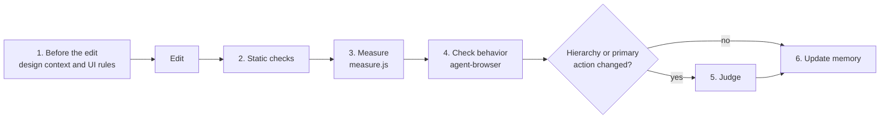

# Frontend verification

Frontend work follows one loop: load the rules before the edit, then measure, check behavior, and judge only when the change warrants it.



The parent session runs steps 1 and 2. Steps 3 to 6 run in the parent, or in the `frontend-verifier` agent when the project enables configured browser verification.

## Project configuration

The project folder is the path `~/.claude/acstack/bin/acstack project-data path` prints. `<project folder>/project.yaml` may set:

- `frontend.directory` (default `frontend/`), `frontend.dev_server_url`, `frontend.dev_server_check`, and `frontend.commands.dev|build|lint|test`
- `workflow.frontend_verification: true`, which makes the `frontend-verifier` agent run on final frontend code
- `workflow.design_review`, the design gate that adds impeccable's checks (see [`impeccable.md`](impeccable.md))
- `frontend.browser.mode`, `frontend.browser.fallback`, and `frontend.browser.cdp_port`, used only for a real-Chrome connection (see Browser choice)

Without configuration, the rules, measure.js, and agent-browser still work by hand. Do not create configuration for general work. Report an unreadable or invalid file instead of treating it as absent.

## 1. Before the edit: design context and UI rules

Load design context once per task, before your first edit under `frontend.directory`. When the design gate is on, follow step 0 of [`impeccable.md`](impeccable.md). Token values live in the project's design system; these rules are generic.

- A different font, font size, or weight needs a purpose: emphasis, de-emphasis, or hierarchy
    - Reuse the project's font family and a small type scale; equivalent text uses identical typography
- Use the spacing scale (shared tokens or repeated gaps and padding); a one-off offset usually hides a layout error
- Give same-role siblings (bar buttons, list rows) equal padding and height
- Align related elements to shared edges or baselines; use consistent indentation to show hierarchy
- Center status text and controls on the same row, including inside nested action groups; a centered parent does not align its children
- Nothing jiggles: a state change (label, pending, error, hover) must not move or resize anything it does not mean to
    - Reserve space for changing labels and for scrollbars, so overflow never shifts text or rewraps lines
- Content fills its component's width with equal horizontal padding; text wraps only after filling it, and no last line holds a single word
- Make hierarchy and the primary action obvious without explanation
- Render dropdown menus with the shared project component and tokens, never browser-native option menus or per-screen copies
    - Keep keyboard navigation (arrows, Home/End, Enter/Space, Escape, Tab), screen-reader semantics, visible focus, dismissal, and viewport fit
- Meet WCAG AA contrast and a 24x24px minimum target size

## 2. Static checks

When configured frontend files changed (`git status --porcelain -- <frontend.directory>`, including untracked files and excluding deletions), run the configured `frontend.commands.build`, `lint`, and `test`. When the design gate is on, run the detector, audit, and polish in [`impeccable.md`](impeccable.md) before browser work.

## 3. Measure

`measure.js` (beside this file) reads computed styles and geometry in the page and reports violations. Run it first; it is cheaper and more exact than reading screenshots.

```bash
MEASURE="<this skill's directory>/measure.js"
agent-browser open <dev_server_url>/<page>
agent-browser eval --stdin < "$MEASURE"                                 # whole page
agent-browser eval "acstackMeasure.run({scope: '[data-testid=panel]'})"  # the changed region
```

Loading the file defines `window.acstackMeasure` and returns a report for `<body>`. Navigation clears it, so load it again after `open` or a reload.

| Rule | What it reports |
|---|---|
| `type-size`, `type-family`, `type-weight` | Text off the scale; `distinctFontSizes` lists the sizes in the region, and each needs a purpose |
| `spacing` | Padding, vertical margin, or gap off the spacing scale |
| `sibling-padding`, `sibling-height` | Same-role siblings with unequal padding, or unequal height within one row |
| `edge` | Sibling left or right edges within 4px of each other but not equal |
| `lone-word` | A wrapped text block whose last line holds one word |
| `contrast` | Text below WCAG AA (4.5:1, or 3:1 for large text) |
| `target-size` | An interactive element smaller than 24x24px (inline links are exempt) |
| `jiggle` | A box that moved or resized across a state change |

- Each violation is `{rule, selector, actual, expected}`
- The scale comes from the custom properties on `:root`. Token names choose the category (`font-size`, `space`, `font-family`, `weight`); without tokens, values used by two or more elements on the page form the scale, so outliers stand out
- Fix each violation or state why it is intended. A heuristic can be wrong; an unexplained violation is not done

### Jiggle across states

Record boxes, change the state, then compare. `jiggle` waits for every finite animation and transition to finish plus two animation frames before measuring, so a same-tick reading cannot pass by accident. Never replace this with a fixed sleep.

```bash
agent-browser eval "acstackMeasure.snapshot({scope: '#toolbar'})"
agent-browser click @e5                                       # the state change
agent-browser eval "acstackMeasure.jiggle({allow: ['.spinner']})"
```

`allow` lists selectors meant to move. Check normal, pending, error, and narrow layouts (`agent-browser set viewport 390 844`).

## 4. Check behavior

Start the dev server bound to `127.0.0.1` when it is not running, and stop it when you started it. Then drive the change with agent-browser:

| Command | Purpose |
|---|---|
| `agent-browser open <url>` | Navigate |
| `agent-browser snapshot -i` | Accessibility tree with interactive refs (`@e1`, ...) |
| `agent-browser click @eN`, `fill @eN "text"`, `type @eN "text"`, `hover @eN`, `press <Key>` | Interact |
| `agent-browser screenshot /abs/path.png` | Screenshot; use an absolute path |
| `agent-browser console`, `agent-browser errors` | Console logs and page errors |
| `agent-browser set viewport <w> <h>` | Resize the viewport |
| `agent-browser wait <selector>` | Wait for an element instead of sleeping |

- Re-run `snapshot -i` after anything that changes the DOM (navigation, a click that opens something, hot reload); old refs go stale
- Prefer `data-testid`, then the accessible role and name from the snapshot, then text; CSS selectors are a last resort
- Report console errors even when the page looks right
- Use a named session (`--session <task>`) and run `agent-browser close` at the end

## 5. Judge, only when hierarchy or the primary action changes

Skip this step for changes that keep hierarchy and the primary action as they were. Otherwise launch a clean-context reviewer (the `reviewer` agent, or a general agent) with only the screenshots and a one-line statement of what the screen is for. It scores each item pass or fail with one sentence of reason:

1. The hierarchy is clear: the most important content reads first
2. The primary action is obvious and singular
3. A new user could use the screen without explanation

Treat a fail as a finding to fix or to put to the user.

## Browser choice

Use headless Chrome through agent-browser by default (install with `npm install -g agent-browser`, then `agent-browser install` when no Chrome is present). `agent-browser open` launches it; no CDP port or config file is needed. Add `--args "--no-sandbox"` on VMs and containers where Chrome reports "No usable sandbox".

Use the user's real Chrome only for checks headless cannot do: a real profile or single sign-on, platform fonts or scrollbars, Windows rendering, or a GPU. Then:

1. Run `~/.claude/acstack/bin/acstack config browser-mode --json`. It answers from the project's `frontend.browser.mode` and the host's declared modes, and prints `{mode, preferred, reason, fallback}`
    - Exit 1 prints one message on stderr naming the fix (`/acstack:setup` or `/acstack:host`). Report it verbatim
    - When `mode` is not `remote`, the real-Chrome check cannot run here; report that limit
2. When `mode` is `remote`, connect once: `export AGENT_BROWSER_CONFIG="<project folder>/agent-browser.json"`, then `curl -sf --max-time 3 http://127.0.0.1:<cdp_port>/json/version` (port `19988` by default)
3. If that fails, stop. Do not retry, wait, or launch something else. Report that the bridge is down and point to the `bridge` skill, which owns the Playwriter bridge setup and diagnosis

Never kill the user's browser. Close only sessions you opened.

## Verification memory

Verification memory holds what the next run needs to know about this project: how to reach a screen, sign in, find a stable selector, or avoid a trap. It lives in `<project folder>/verification/`:

```text
verification/
  VERIFICATION-KNOWLEDGE.md   index: facts every run needs, then one line per topic file
  <topic>.md                  recipes and traps for one area, e.g. auth.md, library.md
```

- Read the index first, then only the topic files for the area you touch
- The index stays short (about 100 lines); a topic file splits when it passes about 150 lines
- An entry states a current fact or recipe: what, how (the exact command or selector), and why when it is not obvious
- Replace entries; never append an incident log. Rewrite a wrong entry, delete a stale one, and merge duplicates. Dates, run narratives, and "learned on" notes do not belong
- Record what the next run would otherwise rediscover, not what happened this run
- Follow the `writing` skill
- Git tracking follows the project's global or tracked mode; keep no knowledge files elsewhere
