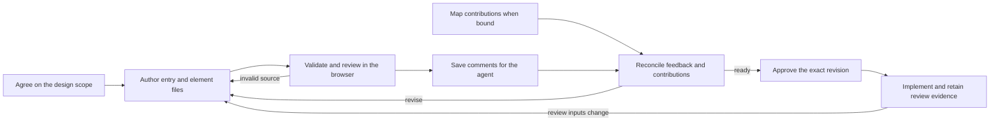

# Author and review a design document

Author one design source for interactive browser review and a GitHub-readable Markdown companion with Mermaid.
The React Flow browser view supports drill-down and comments saved on the agent's device.



## Agree on the design scope

- Read the writing and visual-docs skills before authoring prose
- Inspect the source to establish current responsibilities
- Ask the user about unresolved product decisions before inventing behavior
- Distinguish existing behavior from proposed changes throughout the document
- Open with the proposed change, the review questions, and the trade-offs the reviewer must judge
- Use the worked journey to show who does what and where the proposal changes today's flow
- Use `examples/design-doc/acstack/` as the worked example

## Author entry and element files

- Default new project designs to `.acstack/designs/<id>/design.yaml`, unless the user chooses another location
- Keep the entry and its referenced files in one directory tree
- Use stable IDs matching `[a-zA-Z][a-zA-Z0-9_-]{0,79}`
- Give the entry `id`, `name`, `summary`, and an `elements` array of relative YAML paths
- Optionally add `detail` with a relative Markdown path for the overview and worked journey
- Give each element `id`, `name`, `summary`, and `kind`
- Write each summary as a standalone responsibility, not a code fragment or a list of implementation steps
- Keep peer elements at comparable levels of abstraction
- Reuse element names in the overview, relationships, and detail; connect readable names to code identifiers when they differ
- Model only real entities; the document overview is context, not an architecture node
- Choose `kind` from `actor`, `component`, `store`, or `external-system`
    - An actor participates from outside the system, such as a person or an external autonomous agent
    - An agent built into the system is a component
- Use optional `parent` only for genuine containment, not dependencies or shared concerns
    - Each component represents one entity, shown as either a collapsed card or an expanded container, never both
    - Keep relationships across containers explicit rather than inventing a shared owner
    - Let nesting express containment without a duplicate "Contains" or "Embeds" arrow
    - Do not draw an arrow between an ancestor and its descendant; nesting already expresses containment
    - Show interactions between the responsible components rather than between a container and its contents
- Use optional `detail` to reference supporting Markdown
    - Repository paths and other source metadata are optional context in that Markdown, not prerequisites for a design
- Use optional `channels` for zero or more software interfaces
    - Allowed values: `web`, `mobile`, `desktop`, `cli`, `agent`, `email`, `sms`, and `voice`
    - A web app, CLI, or agent can be its own component
    - Put interface labels on the software that provides them, not on an actor because that actor uses them
    - Channels describe access to software; channels do not replace elements
- Declare each relationship identically in both endpoint files under `relationships`
    - Include `id`, `from`, `to`, `direction`, and `label`
    - Choose `direction` from `one-way` or `bidirectional`
    - Keep canonical `from` and `to` identical in both copies, including bidirectional relationships
    - Read every arrow as source → verb → target: `Checkout CLI → Reads → Order files`
    - Use the acting entity as `from`; reading files points from the reader to the store, not along the returned data
    - Keep that action convention consistent throughout the document
    - Use separate arrows when opposite actions need different labels
    - Use `bidirectional` only when the same label accurately describes both directions, not merely because a workflow includes feedback
- Keep kind, concern, and channel separate: what an entity is, what requirement spans entities, and how interactions occur
- Put cross-element requirements in the entry's optional `concerns` array
    - Include `id`, `name`, `elements`, `requirement`, and `response`
    - Name at least two affected element IDs
    - Explain both the requirement and the design response in meaningful prose
    - The viewer shows these explanations in each affected element's drawer

```yaml
id: checkout-design
name: Checkout design
summary: The checkout CLI reads orders from a local store.
elements: [checkout.yaml, orders.yaml]
concerns:
  - id: local-data
    name: Local data
    elements: [checkout, orders]
    requirement: Orders must stay on the developer's machine.
    response: The CLI reads local files without a network service.
```

```yaml
# checkout.yaml
id: checkout
name: Checkout CLI
summary: Inspects locally stored orders.
kind: component
channels: [cli]
relationships:
  - id: read-orders
    from: checkout
    to: orders
    direction: one-way
    label: Reads
```

```yaml
# orders.yaml
id: orders
name: Order files
summary: Persist the orders inspected by the checkout CLI.
kind: store
relationships:
  - id: read-orders
    from: checkout
    to: orders
    direction: one-way
    label: Reads
```

## Validate and start review

```sh
~/.claude/acstack/bin/acstack design-doc path/to/design.yaml \
  --markdown /tmp/design-review.md
```

- Keep the command running while the reviewer works
- Open the printed localhost URL when the browser and agent share a device
- On separate devices, run the printed SSH forwarding command from the browser's device, then open the localhost URL
- Use `--port <port>` when another review already uses the default port
- Use a new Markdown path to protect existing files
- Keep Markdown beside source files when its relative source links must resolve on GitHub
- Generate the companion from the same YAML and supporting Markdown; revise the source instead of hand-editing its Mermaid
- Fix validation errors before asking the user to review
- Keep each source file within 256 KiB and the document within 4 MiB
- Keep the document within 200 elements, 100 concerns, and 200 relationships per element
- Referenced paths cannot escape the entry directory, including through symlinks

## Review the design and saved feedback

- Review through the running server rather than an exported HTML file
- Read the document overview and worked journey separately from the architecture entities
- Select elements to read their responsibilities, types, channels, and concern explanations
- Check that each entity appears once, whether collapsed or expanded
- Inspect both collapsed and expanded views at a readable zoom
    - Keep related elements close, with consistent padding around their group
    - Reserve room for labels without spreading unrelated groups apart
    - Compare width, height, and text readability; a smaller area alone can hide a taller diagram
- Read every relationship aloud as source → verb → target
- Inspect containment and crosscutting relationships before reviewing implementation detail
- Answer the opening review questions and discuss the stated trade-offs
- Review the generated Markdown companion on GitHub when useful
- GitHub publication remains separate from the live comment connection
- Use human feedback as the clarity loop; code tests do not establish whether the explanation makes sense
- Choose Send to agent to finish pending saves and copy the feedback prompt
- Copy the displayed prompt manually if the browser denies clipboard access
- Paste the prompt into the agent's chat to request revisions
- Read the prompt's `review.json` file and authored design entry
- Resolve comment targets against the authored design to recover names and context
- Use the developer's comments as requests to revise the design
- Retry a failed save before closing the review
- Preserve local edits when the server reports a conflicting revision
- Edit the authored files following feedback, then restart the review for the changed design
- Keep earlier feedback with its original design version rather than silently moving comments to changed text
- Comments do not approve a design or authorize implementation
- Approval records the exact authored source, ordered saved comments, and current map contributions

## Reconcile and approve a map-linked design

- Invoke this workflow from map for shared behavior, component boundaries, or data-flow decisions
- Store `Design entry: <repository-relative-path>` in the map root body
- Add `planning: {tracker: files | github, map: <name>}` to the entry
- Use the same contribution format in files and GitHub node bodies
- Put one fenced JSON array under `## Design contributions`

```json
[
  {
    "id": "interface-choice",
    "designId": "checkout-design",
    "targets": ["checkout"],
    "statement": "The checkout component exposes the command interface"
  }
]
```

- Use document, element, relationship, or concern IDs as targets
- Read `~/.claude/acstack/bin/acstack design-review status <entry>` for contribution keys and the exact revision tuple
- Select older feedback with `--review-file <canonical-review.json>` when the source changed
- Preserve the selected historical snapshot; reconciliation belongs to the current revision
- Resolve blocking decision nodes or mark them out of scope
- Surface contradictory proposals as decision nodes rather than choosing one silently
- Write reconciliation input with the four status fields: `sourceRevision`, `reviewRevision`, `commentsDigest`, and `mapInputsDigest`
- Add a `decisions` array with `comments`, `contributions`, `outcome`, and nonempty `rationale` in each decision
- Reference each selected comment index and current contribution key exactly once
- Choose `applied`, `retained`, or `needs-human`; `needs-human` keeps approval blocked
- Run `~/.claude/acstack/bin/acstack design-review reconcile <entry> --input <json-file>` with the same optional `--review-file`
- Empty feedback and contribution sets need no invented reconciliation
- Reopen `~/.claude/acstack/bin/acstack design-doc <entry>` after authored source changes
- Choose Approve this revision in the document details after reconciliation
- Keep unposted drafts intact; approval saves only posted comment edits
- Require `approval.valid: true` from status before implementation
- Reopen the gate after authored source, saved feedback, or meaningful contribution inputs change
- Presentation regeneration alone preserves approval
- Keep `workflow.design_review` unchanged; it controls the separate frontend design pass

## Import legacy review history explicitly

- ACStack removes `map --map` and `align-viewer` without aliases
- Author the new design first; the old planning graph cannot define its architecture
- Keep map planning in `node walk`, `node frontier`, and `node diagram`
- Use a nonsymlink legacy directory under `.acstack/alignment-packs/`
- Write an explicit JSON mapping array of `{from: {type, id}, to: {type, id}}` pairs
- Map every commented legacy target to a valid current target
- Choose document context explicitly when a legacy target is ambiguous

```sh
~/.claude/acstack/bin/acstack design-review migrate <entry> \
  --legacy-dir <path> --mapping <json-file> [--feedback <json-file>]
```

- Supply `--feedback` only for an explicit exported feedback JSON file
- Migration reads saved pack versions, approvals, annotations, and the corresponding main-checkout decision log
- Migration preserves original artifacts and decision logs byte-for-byte
- Canonical `review.json` retains imported history, source fingerprints, and original comments, quotes, authors, timestamps, and provenance
- Imported comments append to existing feedback; duplicate source comments import once
- Historical approval remains history, never current approval
- An actual import advances the comment revision once and invalidates prior effective approval
- Repeating the same source and mapping imports nothing again
- Invalid inputs fail before any write; publication uses the canonical review lock
- Reconcile imported feedback and obtain current exact-revision approval before implementation or archive
- Never migrate automatically at startup or archive
- Retain design sources, canonical reviews, import history, and decision logs independently of `workflow.maps.persist`
- Respect native Git ignore rules; never force-add private review records
