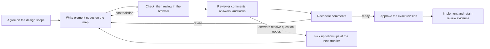

# Author and review a design doc

A design doc is drawn from a map. Each design element is its own map node, and the map is the only source.
The browser view supports drill-down, questions beside the elements they target, and feedback saved on the agent's device.



## Agree on the design scope

- Read the writing and visual-docs skills before authoring prose
- Inspect the source to establish current responsibilities
- Ask the user about unresolved product decisions before inventing behavior
- Distinguish existing behavior from proposed changes throughout the document
- Open the root body with the proposed change, the review questions, and the trade-offs the reviewer must judge
- Use the worked journey to show who does what and where the proposal changes today's flow
- Use `examples/design-doc/acstack/maps/acstack-design/` as the worked example

## Write element nodes on the map

A design doc belongs to one map. Use `/acstack:map` to chart it if none exists.

- Create one node per design element with `kind: element`
    - Its `label` is the name the diagram draws
    - Its `summary` is the element's standalone responsibility, not a code fragment or a list of implementation steps
    - Its body prose is the element's detail; the config block below holds its structure
- An open element is **loose**; a resolved one is **locked**, and a locked element is a requirement
    - Create elements open
    - **Never lock or approve an element on your own.** Do it only on the user's explicit instruction in conversation, after reporting what changed, with `~/.claude/acstack/bin/acstack design-review approve-element <map> <id>`
    - Otherwise the user locks, through Lock in the element's drawer or by approving the design
    - You may edit a locked element. Each lock records a digest of the element's config, so an edit unapproves the element: it stops being locked and stops being a requirement
    - The tracker node stays resolved; the digest alone marks the element as changed until the user re-approves it
- Elements never appear on the frontier. Questions about them do
- Put the element's config in one collapsed block, so the node stays readable on GitHub:

````markdown
<details>
<summary>Design element</summary>

```yaml
kind: component        # actor | component | store | external-system
parent: "003"          # optional: the element that contains this one
channels: [cli, web]   # optional
connections:           # each connection declared once, on the acting element
  - to: "007"
    direction: one-way # one-way | bidirectional
    label: Reads design source
```
</details>
````

- Choose `kind` from `actor`, `component`, `store`, or `external-system`
    - An actor participates from outside the system, such as a person or an external autonomous agent
    - An agent built into the system is a component
- Use `parent` only for genuine containment, not dependencies or shared concerns
    - Each component represents one entity, shown as either a collapsed card or an expanded container, never both
    - Let nesting express containment without a duplicate "Contains" arrow
    - Never connect an ancestor and its descendant; nesting already expresses containment
    - Show interactions between the responsible components rather than between a container and its contents
- Declare each connection once, on the element that acts
    - Read every arrow as source → verb → target: `Checkout CLI → Reads → Order files`
    - Reading files points from the reader to the store, not along the returned data
    - Use a second connection, declared on the other element, when the opposite action needs a different label
    - Use `bidirectional` only when the same label describes both directions
- Use `channels` for software interfaces: `web`, `mobile`, `desktop`, `cli`, `agent`, `email`, `sms`, and `voice`
    - Put interface labels on the software that provides them, not on an actor that uses them
- Reference elements by node id. Quote ids so YAML keeps them as text
- Keep peer elements at comparable levels of abstraction, and model only real entities
- Element and root prose support Markdown, GFM tables, fenced Mermaid diagrams, and nested `<details>` sections
    - Leave blank lines around Markdown inside HTML disclosure sections
    - Mermaid renders offline in an isolated frame; scripts and unsafe HTML are stripped

### Design-wide config on the root

The root's title and summary name the design. Its body is the overview and worked journey. Put cross-element requirements in a `Design doc` block:

````markdown
<details>
<summary>Design doc</summary>

```yaml
concerns:
  - id: offline-review
    name: Offline review
    elements: ["007", "008"]
    requirement: Reviewers can inspect the design without uploading project details.
    response: The server embeds validated graph data with bundled browser assets.
```
</details>
````

- Name at least two affected elements per concern
- Keep kind, concern, and channel separate: what an entity is, what requirement spans entities, and how interactions occur

### Questions for the reviewer

A question targets an element when its `answers:` parent is that element node.

- A hitl question that targets an element shows beside it in the viewer
- Research (afk) nodes that target an element stay on the map only
- Questions answering the root do not target the design
- For a connection, target one of its endpoints
- State the proposed behavior and your recommendation in the body; do not ask for judgment without showing what the reviewer would accept
- Choose the answer format in an optional `Design question` block; omit it for free text:

````markdown
<details>
<summary>Design question</summary>

```yaml
choices: [Refresh the preview, Keep the stale preview]  # 2–12 unique labels; the viewer adds Other
multiple: false                                         # true for select all that apply
highlights: ["Refreshes the preview after a conflict"]  # passages quoted from the target element's prose
```
</details>
````

- Each highlight must appear exactly once in the target element's prose; quote a longer passage when it repeats

## Check, then review in the browser

```sh
~/.claude/acstack/bin/acstack design-doc <map> --check
~/.claude/acstack/bin/acstack design-doc <map> --markdown /tmp/design-review.md
```

- `--check` validates the design and prints warnings without serving it
- The build fails on contradictions:
    - an element without a config block, or a config block on another kind
    - an unknown, out-of-scope, or self connection, or the same connection declared twice
    - a containment cycle, or a connection between an ancestor and its descendant
    - an element with no connection or parent, unless it is the only element
    - a concern or highlight that names nothing on the map
    - an element changed since the user approved it, until it is re-approved
- It warns on oddities: a fog element, a locked element inside a loose one, and an open question on a locked element
- Fix contradictions before asking the user to review
- Keep the command running while the reviewer works
- Open the printed localhost URL when the browser and agent share a device
- On separate devices, run the printed SSH forwarding command from the browser's device, then open the localhost URL
- Use `--port <port>` when another review already uses the default port
- Choose `--orientation left-to-right` for horizontal flow; the default is `top-to-bottom`
- The Markdown companion derives from the same nodes; use a new path to protect existing files
- The tracker comes from `workflow.maps.tracker`; GitHub maps need `gh` authenticated against the repo

## Review the design and saved feedback

- Review through the running server rather than an exported HTML file
- Select elements to read their responsibilities, types, channels, lock state, and concern explanations
- Read every relationship aloud as source → verb → target
- Open Questions, or select a target's question indicator, to read and answer questions
- Saving an answer writes `## Answer` on the question node and resolves it through the tracker
    - Pick up follow-ups at your next frontier recompute
- Lock in an element's drawer resolves that element node
- Choose Send to agent to finish pending saves and copy the feedback prompt
- Read the prompt's `review.json` file, resolve each comment against the map, and revise element nodes
- Comments do not approve a design or authorize implementation
- Restart the review after element nodes change; the open page refuses writes against a changed design

## Reconcile feedback and approve

- Read `~/.claude/acstack/bin/acstack design-review status <map>` for the exact revision tuple, open questions, `blockers`, and warnings
- Select older feedback with `--review-file <canonical-review.json>` when the design changed
- Write reconciliation input with `sourceRevision`, `reviewRevision`, `commentsDigest`, and `mapInputsDigest`
- Add a `decisions` array with `comments`, `outcome`, and a nonempty `rationale` in each decision
    - Reference each zero-based comment index exactly once
    - Choose `applied`, `retained`, or `needs-human`; `needs-human` keeps approval blocked
- Run `~/.claude/acstack/bin/acstack design-review reconcile <map> --input <json-file>`
- Approval waits on every open node that targets an element, in any mode, including fog
    - Resolve each one, or mark it out of scope
- Changed elements block approval; the blocker list offers Re-approve for each
- The user chooses Approve this version; approval locks every loose element
    - While anything blocks approval, the viewer lists each blocker and links straight to its element and question
- Require `approval.valid: true` from status before implementation
- Changed element nodes, saved comments, or targeting nodes reopen the gate
- Keep `workflow.design_review` unchanged; it controls the separate frontend design pass
- Retain canonical reviews in `<project folder>/design-reviews/` independently of `workflow.maps.persist`
