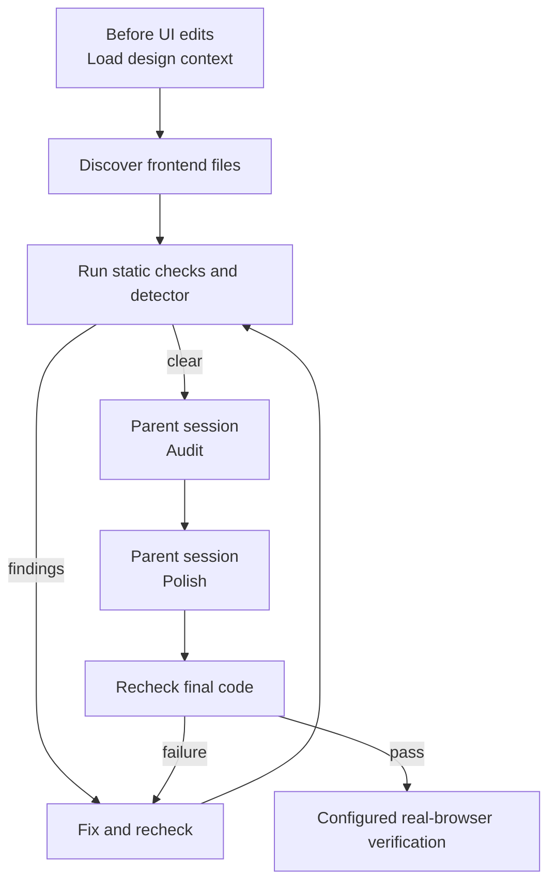

# The design pass

The parent session owns audit and polish; frontend checks remain required even when the session delegates no task-checker.



## 0. Load design context before a UI edit (mandatory)

- Frontend content fills its component's available width with equal horizontal padding; text wraps only after filling that width
- Reuse the project's font family and a small type scale; equivalent text uses identical typography, with variations reserved for meaningful hierarchy
- Align related elements to shared edges or baselines; use consistent spacing and indentation to show their hierarchy
- Center status text and controls on the same row, including inside nested action groups; a centered parent does not align its children
- Use shared spacing tokens or repeated gaps and padding; avoid one-off offsets that conceal a layout error
- Reserve scrollbar space in scrollable panels so overflow never shifts text or changes line wrapping
- Render dropdown menus with shared project components and tokens, not browser-native option menus or per-screen copies
- Preserve keyboard navigation, screen-reader semantics, visible focus, dismissal, and viewport fit in shared dropdowns

impeccable is a third-party design plugin. It holds the project's design context, meaning the files that state the design rules and the token definitions a UI file follows.

Load that context before your first edit under `frontend.directory`. Load it once per task.

**Check the design gate first**

The design gate is the set of optional checks impeccable adds to acstack's pipeline. `workflow.design_review` in `.acstack/project.yaml` turns the gate on. Ask acstack for the answer:

```bash
~/.claude/acstack/bin/acstack design-gate --json
```

- exit code 0 means the gate is on
- exit code 1 means the gate is off

The command prints one JSON object:

```json
{"on": true, "reasons": ["..."], "impeccable": {"version": "4.2.0", "launcher": "/abs/path/to/scripts/impeccable"}}
```

The `impeccable` field holds the launcher path. It holds `null` only when the gate is off.

When the gate is off, edit exactly as you do today. Make no impeccable call, and skip the rest of this section.

**Load the context once per task**

When the gate is on, run the launcher path the JSON printed:

```bash
<launcher> context --target <file>
```

- `<launcher>` is the `impeccable.launcher` path from the design-gate JSON
- `context` is a verb of impeccable's bundled launcher binary, not of its npm command-line tool
- `<file>` is the first file you edit under `frontend.directory`

Run this command once for the whole task. impeccable's own skill says to follow the directives it prints and never to rerun the command.

**Directives you act on**

- `RESOLVED_CONTEXT` – JSON naming where the project's design files live, such as the token definitions you reuse

**Directives you report instead**

Each directive below asks for work you do not own. Put it in your report and carry on with the edit.

- `CONTEXT_STALE` – the loaded context is out of date. Never rerun `context`
- `NO_PRODUCT_MD` and `PRODUCT_INIT_REQUIRED` – both point at impeccable's `init`, which owns `PRODUCT.md`
- `INCUMBENT_WORLD_UNDOCUMENTED` and `WORLD_DISCOVERY_REQUIRED` – both point at impeccable's `document`, which owns `DESIGN.md`
- `UPDATE_AVAILABLE` – never run impeccable's `update` in the same turn, because it rewrites files this session is reading
- `MANUAL_DETECTOR_REQUIRED` – report it to the verification owner, who runs the detector under `skills/implement/design-pass.md`

**File ownership**

You never write `PRODUCT.md` or `DESIGN.md`. impeccable's `init` interviews the user and writes `PRODUCT.md`. acstack's sync skill runs impeccable's `document` at commit time, which refreshes `DESIGN.md`.

Edit only assigned files, including tests when the task assigns no separate test owner.

**impeccable checks the files you write**

impeccable installs its own PostToolUse hook, a check Claude Code runs right after a file write. The hook reads each UI file you write. You never run that check yourself.

## 1. Discover frontend files

- Follow the shared Implementation discipline in `orchestrator/AGENTS.md`
- The verification owner gathers the file list, completes static checks, and handles the detector
    - A delegated task-checker may own this work, but its presence is optional
- Read `.acstack/project.yaml` before deriving paths
    - This pass requires a configured `frontend`
    - `frontend.directory` defaults to `frontend/` when omitted
    - If the project configures no frontend, warn that `frontend.directory` is missing and skip this pass
- Derive one changed-file list for the checks, detector, audit, and polish

```bash
git status --porcelain -- <frontend.directory>
```

- Include modified, added, and untracked files (`??`)
- Drop paths carrying a `D` status because the detector cannot read deleted files
- Treat a missing directory or unmatched pathspec as an empty list
- Skip this pass when the list is empty
- Run configured frontend checks when the list contains files
    - `frontend.commands.build`
    - `frontend.commands.lint`
    - `frontend.commands.test`
- Leave browser interaction to `frontend-verifier` after the required gates pass

## 2. Run the design detector

- Verify shared edges, text baselines, control centers, gaps, and padding before running the detector
- Check nested groups as well as their parents; a shared row must not leave status text aligned to a button's top edge
- Check normal, pending, error, and narrow layouts; compare bounding boxes or text baselines in the browser rather than judging a screenshot alone
- Verify dropdowns reuse the shared component and project tokens before running the detector
- Check arrow keys, Home/End, Enter/Space, Escape, Tab, focus, and viewport fit when a shared dropdown changes
- Check the design gate before running the detector

```bash
~/.claude/acstack/bin/acstack design-gate
```

- Exit code 0 prints `on`
- Exit code 1 prints `off: <reason>`
- Record the gate state and skip the detector, audit, and polish when the gate is off
- When the gate is on, run the nonadvisory detector over the discovered file list
    - The detector reads files without starting a browser
    - It searches upward from each target for `DESIGN.md`

```bash
npx impeccable detect --json --no-advisory <file> [<file>...]
```

- Use this run to set the verdict
    - Exit code 0 passes
    - Exit code 2 fails verification
        - Report each finding with its file and line, then send it to the implementation owner
    - Any other exit code means the detector could not run
        - Report a warning with the command output and continue verification
        - Detector unavailability alone does not fail the task
- Run the advisory detector only after the nonadvisory run exits 0

```bash
npx impeccable detect --json <file> [<file>...]
```

- Use the same file list and report each `"advisory": true` finding as a note
- Omit the notes when none exist
- Advisory findings never change the verdict or require implementation changes
- Exit codes 0 and 2 hold usable advisory output
- Report other exit codes as advisory-run warnings and continue

## 3. Audit and polish

- Run audit and polish only when the design gate is on and configured frontend files changed
- Complete applicable static checks and resolve detector failures before audit
- The parent session is the session directing this work, including direct implementation without delegation
- A delegated checker returns the discovered file list and findings to the parent without editing files
- The parent session must type `/impeccable audit` over the discovered file list
    - Audit edits nothing and needs no browser
    - Ask audit to name each recommended command against its finding
- The parent session must type `/impeccable polish` over the same files using the audit findings
    - Slash playbooks expand only in the session that types them
    - Leave factual claims in copy untouched during unattended polish
    - Ask polish to list every factual claim it left alone
- Run only `polish` from the audit's recommended commands
    - `harden`, `clarify`, `adapt`, `optimize`, and `onboard` require a human decision
    - Repeat recommended command names with their findings in the completion report

## 4. Recheck final code

- The parent sends polished code back to the independent checker when the workflow chose one
    - The checker reruns affected tests, static checks, and the detector without editing files
- Without a delegated checker, the parent reruns those checks on the polished code
- Resolve failures before browser verification
- Delegate `frontend-verifier` on final code when the project enables configured browser verification
- Report actual checks and results, including detector warnings and advisory findings
