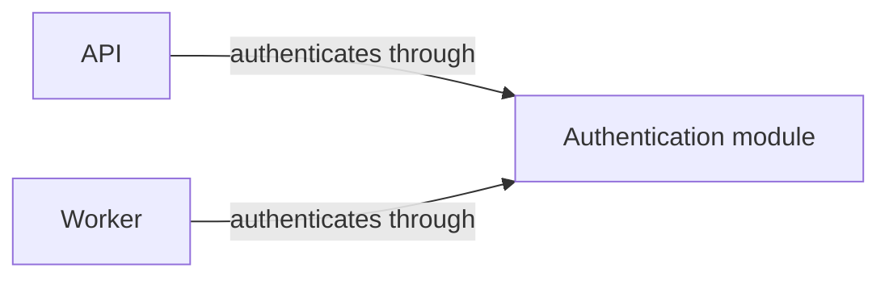

# Visual docs

Choose the smallest document structure that makes the answer and its supporting relationships clear.

Read `../writing/SKILL.md`, including its shared-standard loading instructions, before drafting if you have not read it this session.
This skill applies that standard to document structure; it does not maintain a second communication standard.

## Establish what the reader needs

- Identify the reader's question and the answer the document must support
- Check the relevant code, configuration, and entry points before describing current behavior
- Separate current behavior from proposals and decision history
- Choose the relationships that explain the answer
    - A workflow needs sequence, decisions, and failure paths
    - A component explanation needs responsibilities, interfaces, and dependencies
    - A comparison needs consistent criteria across options

## Choose structure from those relationships

- Start with the answer and enough orientation to make the answer meaningful
- Group supporting detail under the questions it answers
- Make each heading summarize its section
    - Add a takeaway only when it provides information the heading cannot carry clearly
    - Use numbered headings when readers need stable, visible cross-references
- Reuse names across the overview, diagrams, and detailed sections
    - If a diagram says "SessionStart hook", identify its source as `hooks/session-start.sh` in the detail
    - Link overview elements to sections when readers need help finding the detail
- Keep crosscutting relationships visible
    - A dependency shared by two components belongs in a dependency explanation, not under an invented owner
    - Section order can follow a reader's questions without mirroring the directory tree
- Stop adding structure when another heading, list level, or diagram would repeat an existing point

## Use diagrams when they explain more clearly than prose

A diagram is useful when a reader must track several relationships at once.
A short answer or straightforward explanation needs no diagram.

| Reader's question | Useful diagram |
| --- | --- |
| What depends on what? | Flowchart with named dependency edges |
| Who calls whom, and in what order? | Sequence diagram |
| What states and transitions exist? | State diagram |
| What determines the next step? | Flowchart with decisions |
| What data is related? | Entity relationship diagram |

- Place an overview diagram early when it gives readers the picture needed for the detail
- Show dependencies and interactions as edges; use containment only for genuine part-whole relationships
- Label elements in plain language and connect them to technical names
- Label edges when their meaning is not obvious
- Include relevant failure paths and conditions
- Split a diagram when readers cannot follow it at a glance
    - A node count can prompt review, but it does not determine whether the diagram is clear
- Carry meaning in labels, not color alone

For example, two callers can share a module without containing each other:

Use the same names in the related sections.
The sections can explain interfaces and call behavior without creating one section for every diagram node.

## Review the explanation as a whole

- Read only the opening and headings to check that the answer remains visible
- Read each parent with its children to check that the children support its claim
- Check each sibling group for mixed questions, overlap, and missing support
- Follow each name from the overview to the detailed explanation
- Check that links across components remain visible instead of becoming misleading nesting
- Remove repeated summaries and references that make readers jump away for an essential fact
- Verify Mermaid syntax and rendering when you add a diagram
    - Report when rendering could not be checked
